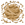
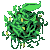

# 地震（Earthquake）

在 3/3/4x3/3/4 格范围内，对附近的单位造成 5-13/9-17/9-17 点伤害。

[原文与贡献者记录](https://ballxpit.wiki.gg/wiki/Earthquake) · [修订 4204](https://ballxpit.wiki.gg/index.php?oldid=4204) · [返回目录](../%E7%90%83%E6%AF%94%E4%BC%A6%E6%88%98%E8%AE%B0%20Wiki.md)

## 基本信息

### 初始角色（Starting Characters）

[临时西西弗斯](The_Makeshift_Sisyphus.md) 
[掘地者](The_Tunneller.md) 

### 解锁

默认解锁

### 状态效果（Status Effects）

-

## 进化（Evolutions）

### 进化成

[钻头](Drill.md) , [元素](Elemental.md) , [冰川](Glacier.md) , [山崩](Landslide.md) , [岩浆](Magma.md) , [疯长](Overgrowth.md) , [沙暴](Sandstorm.md) , [沼泽](Swamp.md) 

**地震** 是 [基础圆球](Balls.md#%E5%9F%BA%E7%A1%80%E5%9C%86%E7%90%83) 在基础游戏版本中引入 *[球比伦战记](Ball_x_Pit.md)*. 默认即可解锁。这是起始球。 [临时西西弗斯](The_Makeshift_Sisyphus.md)  和 [掘地者](The_Tunneller.md) .

当与另一个基础球融合时，该球会获得地震的范围效果，在 3x3 的区域内造成额外伤害。当与 [育巢母体](Brood_Mother.md)  等球融合时，它产生的 [小球](Balls.md#%E5%B0%8F%E7%90%83) 也会具有范围效果。

## 关卡

| 等级 | 伤害 | 效果 |
| --- | --- | --- |
| 1 |  x(3.5 至 6.5) | 在3x3格范围内对附近的单位造成5-13点伤害 |
| 2 |  x(3.5 至 6.5) | 在3x3格范围内对附近的单位造成9-17点伤害 |
| 3 |  x(3.5 至 6.5) | 在 4x4 格范围内对附近的单位造成 9-17 点伤害 |

## 进化

| 组合 | 进化 |
| --- | --- |
|  地震（Earthquake） + [铁（Iron）](Iron.md)  | [钻头（Drill）](Drill.md)  |
|  地震（Earthquake） + [灼烧（Burn）](Burn.md)  + [风（Wind）](Wind.md)  + [冻结（Freeze）](Freeze.md)  | [元素（Elemental）](Elemental.md)  |
|  地震（Earthquake） + [冻结（Freeze）](Freeze.md)  | [冰川（Glacier）](Glacier.md)  |
|  地震（Earthquake） + [石头（Stone）](Stone.md)  | [山崩（Landslide）](Landslide.md)  |
|  地震（Earthquake） + [灼烧（Burn）](Burn.md)  | [岩浆（Magma）](Magma.md)  |
|  地震（Earthquake） + [细胞（Cell）](Cell.md)  | [疯长（Overgrowth）](Overgrowth.md)  |
|  地震（Earthquake） + [风（Wind）](Wind.md)  | [沙暴（Sandstorm）](Sandstorm.md)  |
|  地震（Earthquake） + [中毒（Poison）](Poison.md)  | [沼泽（Swamp）](Swamp.md)  |

## 策略

## 更新记录

## 冷知识

## 图片库

[共享导航](../navigation/nav-63012059ef49.md)

**分类**　[分类 · 基础圆球](../categories/Base_Balls.md) · [分类 · 圆球](../categories/Balls.md) · [分类 · 带有导航框的页面](../categories/Pages_with_navboxes.md)

[返回总入口](../%E7%90%83%E6%AF%94%E4%BC%A6%E6%88%98%E8%AE%B0%20Wiki.md) · [返回本分目录](%E7%9B%AE%E5%BD%95.md)
