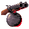

# 蛋袋（Egg Sac）

在击中敌人时爆炸到2/4/2-5/3-5的婴儿球。 在再次射击之前，需要3秒的冷却。

[原文与贡献者记录](https://ballxpit.wiki.gg/wiki/Egg_Sac) · [修订 4349](https://ballxpit.wiki.gg/index.php?oldid=4349) · [返回目录](../%E7%90%83%E6%AF%94%E4%BC%A6%E6%88%98%E8%AE%B0%20Wiki.md)

#### 一般信息

##### 开始的性格

[自笞者](The_Flagellant.md) 

##### 解锁

默认解锁

##### 命中效果（On-Hit Effects）

自杀，斯帕恩

##### 状态效果（Status Effects）

生成 [小球](Baby_Ball.md)

##### 由于状态影响

命中时、生成时

#### 发展情况（Evolutions）

##### 演变为

[投石机](Catapult.md) 、 [烟花](Fireworks.md) 、 [蚊子群](Mosquito_Swarm.md) 、 [枪枪](Shotgun.md) 、 [蜘蛛女王](Spider_Queen.md) 、 [雪茄沙卡](Voluptuous_Egg_Sac.md) 

**蛋袋** 是一个 [基球](Balls.md#%E5%9F%BA%E7%A1%80%E5%9C%86%E7%90%83) 在基本游戏版本中推出了 *[球比伦战记](Ball_x_Pit.md)*它是首发的球。 [自笞者](The_Flagellant.md) .

这是一个单次使用的"冷却"球，类似于 [黑暗](Dark.md)  在几秒钟内被禁用之前，它会爆炸成一群婴儿球。

#### 关卡

| 等级 | 伤害 | 影响 |
| --- | --- | --- |
| 1 |  x(3.5至6.5) | 在击中敌人时爆炸到2到4个婴儿球，在再次射击之前，它会冷却3秒钟。 ／ |
| 2 |  x(3.5至6.5) | 在击中敌人时，它会爆炸到2-5个婴儿球，在再次发射之前，它会冷却3秒钟。 ／ |
| 3 |  x(3.5至6.5) | 在击中敌人时，它会爆炸到3到5个婴儿球，在再次射击之前，它会冷却3秒。 ／ |

#### 发展情况

| 组合 | 进化 |
| --- | --- |
|  蛋袋（Egg Sac） + [石头（Stone）](Stone.md)  | [投石机（Catapult）](Catapult.md)  |
|  蛋袋（Egg Sac） + [灼烧（Burn）](Burn.md)  | [烟花（Fireworks）](Fireworks.md)  |
|  蛋袋（Egg Sac） + [吸血鬼（Vampire）](Vampire.md)  | [蚊子群（Mosquito Swarm）](Mosquito_Swarm.md) （\*） |
|  蛋袋（Egg Sac） + [铁（Iron）](Iron.md)  | [枪枪（Shotgun）](Shotgun.md) （\*） |
|  蛋袋（Egg Sac） + [育巢母体（Brood Mother）](Brood_Mother.md)  | [蜘蛛女王（Spider Queen）](Spider_Queen.md) （\*） |
|  蛋袋（Egg Sac） + [细胞（Cell）](Cell.md)  | [雪茄沙卡（Voluptuous Egg Sac）](Voluptuous_Egg_Sac.md)  |

* 可以进一步发展。

#### 策略

#### 更新记录

#### 冷知识

#### 图片库

[共享导航](../navigation/nav-63012059ef49.md)

**分类**　[分类 · 基础圆球](../categories/Base_Balls.md) · [分类 · 圆球](../categories/Balls.md) · [分类 · 页面有导航框](../categories/Pages_with_navboxes.md)

[返回总入口](../%E7%90%83%E6%AF%94%E4%BC%A6%E6%88%98%E8%AE%B0%20Wiki.md) · [返回本分目录](%E7%9B%AE%E5%BD%95.md)
