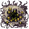

# 卵囊（Egg Sac）

击中敌人后，会爆炸成2-4个/2-5个/3-5个小球。再次射击前需等待3秒的冷却时间。

[原文与贡献者记录](https://ballxpit.wiki.gg/wiki/Egg_Sac) · [修订 4349](https://ballxpit.wiki.gg/index.php?oldid=4349) · [返回目录](../%E7%90%83%E6%AF%94%E4%BC%A6%E6%88%98%E8%AE%B0%20Wiki.md)

## 基本信息

### 初始角色（Starting Character）

[自笞者](The_Flagellant.md) 

### 解锁

默认解锁

### 命中效果（On-Hit Effects）

自毁，生成

### 状态效果（Status Effects）

生成 [小球](Baby_Ball.md)

### 由状态效果触发

命中时、生成时

## 进化（Evolutions）

### 进化成

[投石机](Catapult.md) , [烟花](Fireworks.md) , [蚊群](Mosquito_Swarm.md) , [霰弹枪](Shotgun.md) , [蜘蛛女王](Spider_Queen.md) , [丰满的卵囊](Voluptuous_Egg_Sac.md) 

**卵囊** 是 [基础圆球](Balls.md#%E5%9F%BA%E7%A1%80%E5%9C%86%E7%90%83) 在基础游戏版本中引入 *[球比伦战记](Ball_x_Pit.md)*. 默认即可解锁。这是起始球。 [自笞者](The_Flagellant.md) .

这是一种单次使用的“冷却时间”球，类似于 [黑暗](Dark.md) ，它会爆炸成一群小球，然后失效几秒钟。

## 关卡

| 等级 | 伤害 | 效果 |
| --- | --- | --- |
| 1 |  x(3.5 至 6.5) | 击中敌人后，会爆炸成2-4个小球。再次射击前需等待3秒的冷却时间。 |
| 2 |  x(3.5 至 6.5) | 击中敌人后，会爆炸成2-5个小球。再次射击前需等待3秒的冷却时间。 |
| 3 |  x(3.5 至 6.5) | 击中敌人后，会爆炸成3-5个小球。再次射击前需等待3秒的冷却时间。 |

## 进化

| 组合 | 进化 |
| --- | --- |
|  卵囊（Egg Sac） + [石头（Stone）](Stone.md)  | [投石机（Catapult）](Catapult.md)  |
|  卵囊（Egg Sac） + [灼烧（Burn）](Burn.md)  | [烟花（Fireworks）](Fireworks.md)  |
|  卵囊（Egg Sac） + [吸血鬼（Vampire）](Vampire.md)  | [蚊群（Mosquito Swarm）](Mosquito_Swarm.md) （\*） |
|  卵囊（Egg Sac） + [铁（Iron）](Iron.md)  | [霰弹枪（Shotgun）](Shotgun.md) （\*） |
|  卵囊（Egg Sac） + [育巢母体（Brood Mother）](Brood_Mother.md)  | [蜘蛛女王（Spider Queen）](Spider_Queen.md) （\*） |
|  卵囊（Egg Sac） + [细胞（Cell）](Cell.md)  | [丰满的卵囊（Voluptuous Egg Sac）](Voluptuous_Egg_Sac.md)  |

* 可以进一步进化。

## 策略

## 更新记录

## 冷知识

## 图片库

[共享导航](../navigation/nav-63012059ef49.md)

**分类**　[分类 · 基础圆球](../categories/Base_Balls.md) · [分类 · 圆球](../categories/Balls.md) · [分类 · 带有导航框的页面](../categories/Pages_with_navboxes.md)

[返回总入口](../%E7%90%83%E6%AF%94%E4%BC%A6%E6%88%98%E8%AE%B0%20Wiki.md) · [返回本分目录](%E7%9B%AE%E5%BD%95.md)
