# 图鉴（Encyclopedia）

[原文与贡献者记录](https://ballxpit.wiki.gg/wiki/Encyclopedia) · [修订 3707](https://ballxpit.wiki.gg/index.php?oldid=3707) · [返回目录](../%E7%90%83%E6%AF%94%E4%BC%A6%E6%88%98%E8%AE%B0%20Wiki.md)

**图鉴** 是从暂停菜单中可以访问的菜单，它提供了保存配置统计和目录，每[球](Balls.md),[被动](Passives.md),以及玩家遇到的[敌方](Enemies.md),以及每个实体的更多信息。

#### 统计

**TBA**

#### 项目列表

##### 圆球

###### 基本游戏

| 基本游戏球 |  |  |  |
| --- | --- | --- | --- |
|  ／ [流血（Bleed）](Bleed.md) |  ／ [育巢母体（Brood Mother）](Brood_Mother.md) |  ／ [灼烧（Burn）](Burn.md) |  ／ [细胞（Cell）](Cell.md) |
|  ／ [迷人（Charm）](Charm.md) |  ／ [黑暗（Dark）](Dark.md) |  ／ [地震（Earthquake）](Earthquake.md) |  ／ [蛋袋（Egg Sac）](Egg_Sac.md) |
|  ／ [冻结（Freeze）](Freeze.md) |  ／ [鬼魂（Ghost）](Ghost.md) |  ／ [铁（Iron）](Iron.md) |  ／ [激光 (水平)（Laser (Horizontal)）](Laser_Horizontal.md) |
|  ／ [激光 (垂直)（Laser (Vertical)）](Laser_Vertical.md) |  ／ [光（Light）](Light.md) |  ／ [闪电（Lightning）](Lightning.md) |  ／ [中毒（Poison）](Poison.md) |
|  ／ [吸血鬼（Vampire）](Vampire.md) |  ／ [风（Wind）](Wind.md) |  ／ [凶手（Assassin）](Assassin.md) |  ／ [贝尔塞克（Berserk）](Berserk.md) |
|  ／ [黑洞（Black Hole）](Black_Hole.md) |  ／ [雪风（Blizzard）](Blizzard.md) |  ／ [炸弹（Bomb）](Bomb.md) |  ／ [闪光（Flash）](Flash.md) |
|  ／ [闪烁（Flicker）](Flicker.md) |  ／ [冰冻射线（Freeze Ray）](Freeze_Ray.md) |  ／ [冰冻火焰（Frozen Flame）](Frozen_Flame.md) |  ／ [冰川（Glacier）](Glacier.md) |
|  ／ [输血（Hemorrhage）](Hemorrhage.md) |  ／ [圣激光（Holy Laser）](Holy_Laser.md) |  ／ [梦魔（Incubus）](Incubus.md) |  ／ [在地狱里（Inferno）](Inferno.md) |
|  ／ [激光束（Laser Beam）](Laser_Beam.md) |  ／ [李克（Leech）](Leech.md) |  ／ [闪电棒（Lightning Rod）](Lightning_Rod.md) |  ／ [爱情者（Lovestruck）](Lovestruck.md) |
|  ／ [蛆虫（Maggot）](Maggot.md) |  ／ [马格玛（Magma）](Magma.md) |  ／ [蚊子王（Mosquito King）](Mosquito_King.md) |  ／ [蚊子群（Mosquito Swarm）](Mosquito_Swarm.md) |
| [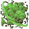](Noxious.md) ／ [危害性（Noxious）](Noxious.md) |  ／ [核弹（Nuclear Bomb）](Nuclear_Bomb.md) |  ／ [过度增长（Overgrowth）](Overgrowth.md) |  ／ [幽灵（Phantom）](Phantom.md) |
|  ／ [辐射束（Radiation Beam）](Radiation_Beam.md) |  ／ [牺牲（Sacrifice）](Sacrifice.md) |  ／ [沙风（Sandstorm）](Sandstorm.md) |  ／ [撒旦（Satan）](Satan.md) |
|  ／ [枪枪（Shotgun）](Shotgun.md) |  ／ [吸血鬼（Soul Sucker）](Soul_Sucker.md) |  ／ [蜘蛛女王（Spider Queen）](Spider_Queen.md) |  ／ [风暴（Storm）](Storm.md) |
|  ／ [魅魔（Succubus）](Succubus.md) |  ／ [太阳（Sun）](Sun.md) |  ／ [沼泽（Swamp）](Swamp.md) |  ／ [吸血鬼主（Vampire Lord）](Vampire_Lord.md) |
|  ／ [病毒（Virus）](Virus.md) |  ／ [雪茄沙卡（Voluptuous Egg Sac）](Voluptuous_Egg_Sac.md) |  ／ [灵魂（Wraith）](Wraith.md) |  ／ [诺斯法拉图（Nosferatu）](Nosferatu.md) |

###### 发射后

| 发射后的球 |  |  |  |
| --- | --- | --- | --- |
|  ／ [肉类（Flesh）](Flesh.md) |  ／ [石头（Stone）](Stone.md) |  ／ [时间（Time）](Time.md) |  ／ [亚马格登（Armageddon）](Armageddon.md) |
|  ／ [驱逐的火焰（Banished Flame）](Banished_Flame.md) |  ／ [班西（Banshee）](Banshee.md) |  ／ [硫磺（Brimstone）](Brimstone.md) |  ／ [投石机（Catapult）](Catapult.md) |
|  ／ [钻头（Drill）](Drill.md) |  ／ [侵蚀（Erosion）](Erosion.md) |  ／ [烟花（Fireworks）](Fireworks.md) |  ／ [肉山（Flesh Mound）](Flesh_Mound.md) |
|  ／ [吞心者（Heart Swallower）](Heart_Swallower.md) |  ／ [地滑坡（Landslide）](Landslide.md) |  ／ [激光切割机（Laser Cutter）](Laser_Cutter.md) |  ／ [闪电虫（Lightning Bug）](Lightning_Bug.md) |
|  ／ [蚊子王国（Mosquito Kingdom）](Mosquito_Kingdom.md) |  ／ [后代（Offspring）](Offspring.md) |  ／ [石化（Petrify）](Petrify.md) |  ／ [收获者（Reaper）](Reaper.md) |
|  ／ [狙击手（Sniper）](Sniper.md) |  ／ [钢铁（Steel）](Steel.md) |  ／ [时间炸弹（Time Bomb）](Time_Bomb.md) | [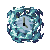](Timestop.md) ／ [时间限制（Timestop）](Timestop.md) |
| [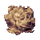](Tumor.md) ／ [肿瘤（Tumor）](Tumor.md) |  ／ [毒药（Venom）](Venom.md) |  ／ [变形（Warp）](Warp.md) |  ／ [X 射线（X Ray）](X_Ray.md) |
|  ／ [僵尸（Zombie）](Zombie.md) |  ／ [基本（Elemental）](Elemental.md) |  |  |

##### 被动道具

###### 基本游戏

| 基本游戏的负债 |  |  |  |
| --- | --- | --- | --- |
|  ／ [弓箭手雕像（Archer's Effigy）](Archer_s_Effigy.md) | [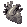](Artificial_Heart.md) ／ [人工心脏（Artificial Heart）](Artificial_Heart.md) |  ／ [婴儿摇铃（Baby Rattle）](Baby_Rattle.md) | [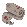](Bandage_Roll.md) ／ [绷带卷（Bandage Roll）](Bandage_Roll.md) |
| [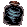](Bottled_Tornado.md) ／ [瓶装龙卷风（Bottled Tornado）](Bottled_Tornado.md) |  ／ [胸罩（Breastplate）](Breastplate.md) |  ／ [棘的冠冕（Crown of Thorns）](Crown_of_Thorns.md) | [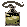](Cursed_Elixir.md) ／ [诅咒的精液（Cursed Elixir）](Cursed_Elixir.md) |
|  ／ [死亡眼睛的宝藏（Deadeye's Amulet）](Deadeye_s_Amulet.md) |  ／ [钻石钻头（Diamond Hilted Dagger）](Diamond_Hilted_Dagger.md) | [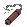](Dynamite.md) ／ [动力石（Dynamite）](Dynamite.md) |  ／ [翡翠光光闪闪（Emerald Hilted Dagger）](Emerald_Hilted_Dagger.md) |
| [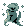](Ethereal_Cloak.md) ／ [虚灵斗篷（Ethereal Cloak）](Ethereal_Cloak.md) |  ／ [一直流动的杯子（Everflowing Goblet）](Everflowing_Goblet.md) | [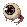](Eye_of_the_Beholder.md) ／ [观察者的眼睛（Eye of the Beholder）](Eye_of_the_Beholder.md) | [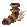](https://ballxpit.wiki.gg/wiki/Fleet_Feet) ／ [舰队脚](https://ballxpit.wiki.gg/wiki/Fleet_Feet?action=edit&redlink=1) |
| [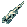](https://ballxpit.wiki.gg/wiki/Frozen_Spike) ／ [冰冻尖刺（Frozen Spike）](https://ballxpit.wiki.gg/wiki/Frozen_Spike?action=edit&redlink=1) |  ／ [宝石之春](https://ballxpit.wiki.gg/wiki/Gemspring?action=edit&redlink=1) | [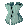](https://ballxpit.wiki.gg/wiki/Ghostly_Corset) ／ [幽灵的皮套](https://ballxpit.wiki.gg/wiki/Ghostly_Corset?action=edit&redlink=1) |  ／ [幽灵盾牌](https://ballxpit.wiki.gg/wiki/Ghostly_Shield?action=edit&redlink=1) |
|  ／ [黄金牛](https://ballxpit.wiki.gg/wiki/Golden_Bull?action=edit&redlink=1) |  ／ [手机风扇](https://ballxpit.wiki.gg/wiki/Hand_Fan?action=edit&redlink=1) |  ／ [手镜](https://ballxpit.wiki.gg/wiki/Hand_Mirror?action=edit&redlink=1) |  ／ [医生的效果](https://ballxpit.wiki.gg/wiki/Healer%27s_Effigy?action=edit&redlink=1) |
|  ／ [砂钟（Hourglass）](Hourglass.md) |  ／ [死亡的吻](https://ballxpit.wiki.gg/wiki/Kiss_of_Death?action=edit&redlink=1) |  ／ [恋人的箭袋（Lover's Quiver）](https://ballxpit.wiki.gg/wiki/Lover%27s_Quiver?action=edit&redlink=1) |  ／ [魔术人员（Magic Staff）](Magic_Staff.md) |
|  ／ [磁铁（Magnet）](Magnet.md) | [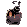](Midnight_Oil.md) ／ [午夜油（Midnight Oil）](Midnight_Oil.md) |  ／ [压力阀（Pressure Valve）](Pressure_Valve.md) |  ／ [保护的魅力](https://ballxpit.wiki.gg/wiki/Protective_Charm?action=edit&redlink=1) |
|  ／ [发光的羽毛](https://ballxpit.wiki.gg/wiki/Radiant_Feather?action=edit&redlink=1) |  ／ [射手的矛（Reacher's Spear）](Reacher_s_Spear.md) |  ／ [橡胶头带（Rubber Headband）](https://ballxpit.wiki.gg/wiki/Rubber_Headband?action=edit&redlink=1) |  ／ [Ruby 闪亮的弹跳器（Ruby Hilted Dagger）](Ruby_Hilted_Dagger.md) |
| [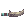](Sapphire_Hilted_Dagger.md) ／ [Sapphire 欢笑大算器（Sapphire Hilted Dagger）](Sapphire_Hilted_Dagger.md) | [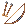](Shortbow.md) ／ [短弓（Shortbow）](Shortbow.md) |  ／ [银眼罩](https://ballxpit.wiki.gg/wiki/Silver_Blindfold?action=edit&redlink=1) | [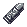](Silver_Bullet.md) ／ [银子子弹（Silver Bullet）](Silver_Bullet.md) |
| [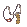](Slingshot.md) ／ [弹弓（Slingshot）](Slingshot.md) |  ／ [尖刺项圈（Spiked Collar）](https://ballxpit.wiki.gg/wiki/Spiked_Collar?action=edit&redlink=1) |  ／ [石雕像（Stone Effigy）](https://ballxpit.wiki.gg/wiki/Stone_Effigy?action=edit&redlink=1) |  ／ [叛徒的外套（Traitor's Cowl）](Traitor_s_Cowl.md) |
| [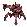](Turret.md) ／ [塔楼（Turret）](Turret.md) | [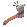](https://ballxpit.wiki.gg/wiki/Upturned_Hatchet) ／ [翻转的斧头](https://ballxpit.wiki.gg/wiki/Upturned_Hatchet?action=edit&redlink=1) | [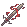](Vampiric_Sword.md) ／ [吸血鬼剑（Vampiric Sword）](Vampiric_Sword.md) | [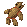](Voodoo_Doll.md) ／ [伏都娃娃（Voodoo Doll）](Voodoo_Doll.md) |
|  ／ [车轮](https://ballxpit.wiki.gg/wiki/Wagon_Wheel?action=edit&redlink=1) | [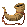](War_Horn.md) ／ [战争角（War Horn）](War_Horn.md) |  ／ [可怜洋葱（Wretched Onion）](https://ballxpit.wiki.gg/wiki/Wretched_Onion?action=edit&redlink=1) | [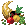](Cornucopia.md) ／ [黄斑（Cornucopia）](Cornucopia.md) |
| [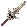](Gracious_Impaler.md) ／ [慈悲不仁者（Gracious Impaler）](Gracious_Impaler.md) | [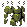](Odiferous_Shell.md) ／ [恶臭外壳（Odiferous Shell）](Odiferous_Shell.md) | [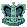](Phantom_Regalia.md) ／ [鬼魂雷加利亚（Phantom Regalia）](Phantom_Regalia.md) |  ／ [灵魂收获者（Soul Reaver）](Soul_Reaver.md) |
| [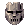](Tormenters_Mask.md) ／ [折磨者面具（Tormenters Mask）](Tormenters_Mask.md) | [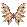](Wings_of_the_Anointed.md) ／ [油膏者的翅膀（Wings of the Anointed）](Wings_of_the_Anointed.md) |  ／ ["死眼之十字架"（Deadeye's Cross）](Deadeye_s_Cross.md) |  |

###### 发射后

| 发射后的负担 |  |  |  |
| --- | --- | --- | --- |
| [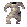](Iron_Onesie.md) ／ [铁制连体衣（Iron Onesie）](Iron_Onesie.md) | [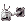](Platinum_Dumbbell.md) ／ [哑铃（Platinum Dumbbell）](Platinum_Dumbbell.md) | [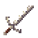](Sword_Breaker.md) ／ [剑打破者（Sword Breaker）](Sword_Breaker.md) | [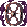](Ardent_Tire.md) ／ [燃烧的轮胎（Ardent Tire）](Ardent_Tire.md) |
| [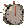](Argent_Stopwatch.md) ／ [阿根廷止时钟（Argent Stopwatch）](Argent_Stopwatch.md) | [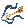](Arrow_of_Fate.md) ／ [命运的箭（Arrow of Fate）](Arrow_of_Fate.md) |  ／ [死眼的硬化剂（Deadeye's Impaler）](Deadeye_s_Impaler.md) | [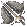](Full_Metal_Rapier.md) ／ [全金属光谱机（Full Metal Rapier）](Full_Metal_Rapier.md) |
| [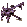](Grotesque_Artillery.md) ／ [怪异的炮兵（Grotesque Artillery）](Grotesque_Artillery.md) | [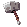](Inglorious_Hammer.md) ／ [光荣锤（Inglorious Hammer）](Inglorious_Hammer.md) | [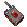](Remote_Detonator.md) ／ [远程发射器（Remote Detonator）](Remote_Detonator.md) |  ／ [风织机（Windweaver）](Windweaver.md) |

##### 动物动物

| 动物动物 |  |  |  |
| --- | --- | --- | --- |
| [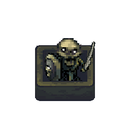](Skeleton_Warrior.md) ／ [骨架战士（Skeleton Warrior）](Skeleton_Warrior.md) | [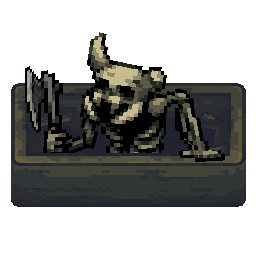](Skeletal_Brute.md) ／ [骸骨蛮兵（Skeletal Brute）](Skeletal_Brute.md) | [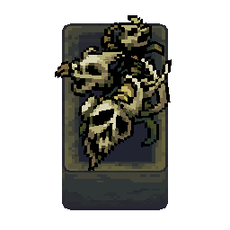](Skeletal_Beast.md) ／ [骸骨野兽（Skeletal Beast）](Skeletal_Beast.md) | [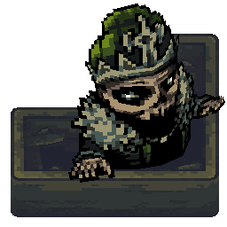](Skeletal_Bishop.md) ／ [骸骨主教（Skeletal Bishop）](Skeletal_Bishop.md) |
| [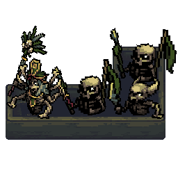](Skeletal_Bastion.md) ／ [骸骨堡垒（Skeletal Bastion）](Skeletal_Bastion.md) | [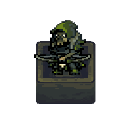](Skeleton_Archer.md) ／ [骨架弓箭手（Skeleton Archer）](Skeleton_Archer.md) | [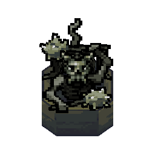](Bone_Behemoth.md) ／ [骨贝赫莫特（Bone Behemoth）](Bone_Behemoth.md) | [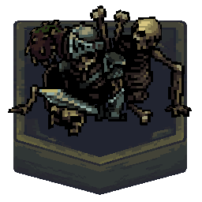](Skeletal_Brigade.md) ／ [骨架旅队（Skeletal Brigade）](Skeletal_Brigade.md) |
| [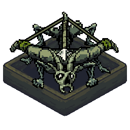](Bone_Ballista.md) ／ [骨球ista（Bone Ballista）](Bone_Ballista.md) | [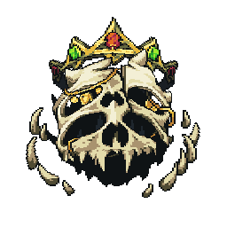](Skeleton_King.md) ／ [骨架国王（Skeleton King）](Skeleton_King.md) | [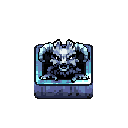](Icebound_Warrior.md) ／ [冰岛战士（Icebound Warrior）](Icebound_Warrior.md) |  ／ [冰伤残疾（Icebound Brute）](Icebound_Brute.md) |
|  ／ [冰封野兽（Icebound Beast）](Icebound_Beast.md) |  ／ [冰封指环（Icebound Band）](Icebound_Band.md) |  ／ [冰岛堡垒（Icebound Bastion）](Icebound_Bastion.md) |  ／ [冰患盾牌手（Icebound Shieldbearer）](Icebound_Shieldbearer.md) |
|  ／ [冰封投掷者（Icebound Hurler）](Icebound_Hurler.md) |  ／ [冰球冠军（Icebound Champion）](Icebound_Champion.md) |  ／ [冰封嚎兽（Icebound Howler）](Icebound_Howler.md) |  ／ [冰岛女王（Icebound Queen）](Icebound_Queen.md) |
|  ／ [蜥蜴（Lizard）](Lizard.md) |  ／ [蛮力蜥蜴（Lizard Brute）](Lizard_Brute.md) |  ／ [滑蜥（Slizard）](Slizard.md) |  ／ [蜥蜴壮汉（Lizard Strongman）](Lizard_Strongman.md) |
|  ／ [蜥蜴堡垒（Lizard Bastion）](Lizard_Bastion.md) |  ／ [激光蝗虫（Laser Locust）](Laser_Locust.md) |  ／ [蠕虫（Worm）](Worm.md) |  ／ [沙步行者（Sandwalker）](Sandwalker.md) |
|  ／ [转移的科布拉（Shifting Cobra）](Shifting_Cobra.md) |  ／ [沙漠哨兵（Desert Sentinel）](Desert_Sentinel.md) |  ／ [狂怒蝗虫（Seething Locust）](Seething_Locust.md) |  ／ [伟大的卫兵（Great Sentinel）](Great_Sentinel.md) |
|  ／ [扭曲的蛇（Twisted Serpent）](Twisted_Serpent.md) |  ／ [蘑菇战士（Shroom Fighter）](Shroom_Fighter.md) |  ／ [双生蘑菇（Twin Shrooms）](Twin_Shrooms.md) |  ／ [潜行菇（Shroom Stalker）](Shroom_Stalker.md) |
|  ／ [层架菌（Bracket Fungus）](Bracket_Fungus.md) |  ／ [伊诺基集团（Enoki Cluster）](Enoki_Cluster.md) |  ／ [爆炸菇（Boomshroom）](Boomshroom.md) |  ／ [螺旋式螺旋桨（Cordyceps Spitter）](Cordyceps_Spitter.md) |
|  ／ [工作室（Rushroom）](Rushroom.md) |  ／ [爆鸣菇（Shroomboomer）](Shroomboomer.md) |  ／ [科尔迪西普斯女王（Cordyceps Queen）](Cordyceps_Queen.md) |  ／ [长老爆炸菇（Elder Boomshroom）](Elder_Boomshroom.md) |
|  ／ [菇群（Shroom Swarm）](Shroom_Swarm.md) |  ／ [华格（Warg）](Warg.md) |  ／ [沃格骑手（Warg Rider）](Warg_Rider.md) |  ／ [沃格·阿彻（Warg Archer）](Warg_Archer.md) |
|  ／ [鼠标（Mouse）](Mouse.md) |  ／ [古代的华格（Ancient Warg）](Ancient_Warg.md) |  ／ [妖精战主（Goblin Warlord）](Goblin_Warlord.md) |  ／ [妖精狙击手（Goblin Sniper）](Goblin_Sniper.md) |
|  ／ [沙伯牙（Sabertooth）](Sabertooth.md) |  ／ [幼龙（Dragonling）](Dragonling.md) |  ／ [龙头野兽（Dragonling Brute）](Dragonling_Brute.md) |  ／ [龙号号号（Dragonling Thrall）](Dragonling_Thrall.md) |
|  ／ [龙头屠夫（Dragonling Butcher）](Dragonling_Butcher.md) |  ／ [龙子族（Dragonling Clan）](Dragonling_Clan.md) |  ／ [集群群（Grub Cluster）](Grub_Cluster.md) |  ／ [幼虫（Grub）](Grub.md) |
|  ／ [消防员（Firespitter）](Firespitter.md) |  ／ [幼虫母体（Grub Mother）](Grub_Mother.md) |  ／ [Great Grub 群集群集（Great Grub Cluster）](Great_Grub_Cluster.md) |  ／ [喷焰者（Flamespitter）](Flamespitter.md) |
|  ／ [龙王子（Dragon Prince）](Dragon_Prince.md) |  ／ [天使眷属（Angelspawn）](Angelspawn.md) |  ／ [天使双头（Angelic Twinhead）](Angelic_Twinhead.md) |  ／ [天使巨鸮（Angelic Great Owl）](Angelic_Great_Owl.md) |
|  ／ [Angelspawn 贝尔塞尔（Angelspawn Berserker）](Angelspawn_Berserker.md) |  ／ [天使队合唱团（Angelspawn Choir）](Angelspawn_Choir.md) |  ／ [双翼天使（Winged Angelspawn）](Winged_Angelspawn.md) |  ／ [双翼天使童子军（Winged Angelspawn Scout）](Winged_Angelspawn_Scout.md) |
|  ／ [Angelspawh 女祭司（Angelspawn Priestess）](Angelspawn_Priestess.md) |  ／ [Angelspawn Snatcher 天使捕猎者（Angelspawn Snatcher）](Angelspawn_Snatcher.md) |  ／ [丘比特（Cupid）](Cupid.md) |  ／ [一个不安的人（Restless One）](Restless_One.md) |
|  ／ [枯瘦劫掠者（Wizened Snatcher）](Wizened_Snatcher.md) |  ／ [猫头鹰领主（Lord of Owls）](Lord_of_Owls.md) |  ／ [月灵（Moonling）](Moonling.md) |  ／ [月球弓箭手（Moonling Archer）](Moonling_Archer.md) |
|  ／ [月亮的地质（Moonling Geode）](Moonling_Geode.md) |  ／ [月石（Moonrock）](Moonrock.md) |  ／ [废除（Voidling）](Voidling.md) |  ／ [半月月亮（Crescent Moonling）](Crescent_Moonling.md) |
|  ／ [衰落的月球（Waning Moonling）](Waning_Moonling.md) |  ／ [月族（Moonkin）](Moonkin.md) |  ／ [月族晶洞（Moonkin Geode）](Moonkin_Geode.md) |  ／ [月亮（The Moon）](The_Moon.md) |

[返回总入口](../%E7%90%83%E6%AF%94%E4%BC%A6%E6%88%98%E8%AE%B0%20Wiki.md) · [返回本分目录](%E7%9B%AE%E5%BD%95.md)
