# 图鉴（Encyclopedia）

[原文与贡献者记录](https://ballxpit.wiki.gg/wiki/Encyclopedia) · [修订 3707](https://ballxpit.wiki.gg/index.php?oldid=3707) · [返回目录](../%E7%90%83%E6%AF%94%E4%BC%A6%E6%88%98%E8%AE%B0%20Wiki.md)

**图鉴** 是一个可以从暂停菜单访问的菜单。它提供了存档统计信息，并记录了玩家遇到的每一个[圆球](Balls.md)、[被动道具](Passives.md)和[敌人](Enemies.md)的信息，以及关于这些实体的更多细节。

## 统计信息

**TBA**

## 物品列表

### 圆球

#### 本体

| 基础游戏球 |  |  |  |
| --- | --- | --- | --- |
|  ／ [流血（Bleed）](Bleed.md) |  ／ [育巢母体（Brood Mother）](Brood_Mother.md) |  ／ [灼烧（Burn）](Burn.md) |  ／ [细胞（Cell）](Cell.md) |
|  ／ [魅惑（Charm）](Charm.md) |  ／ [黑暗（Dark）](Dark.md) |  ／ [地震（Earthquake）](Earthquake.md) |  ／ [卵囊（Egg Sac）](Egg_Sac.md) |
|  ／ [冻结（Freeze）](Freeze.md) | [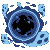](Ghost.md) ／ [幽灵（Ghost）](Ghost.md) |  ／ [铁（Iron）](Iron.md) |  ／ [激光（水平）（Laser (Horizontal)）](Laser_Horizontal.md) |
|  ／ [激光（垂直）（Laser (Vertical)）](Laser_Vertical.md) |  ／ [光（Light）](Light.md) |  ／ [闪电（Lightning）](Lightning.md) |  ／ [中毒（Poison）](Poison.md) |
|  ／ [吸血鬼（Vampire）](Vampire.md) |  ／ [风（Wind）](Wind.md) |  ／ [刺客（Assassin）](Assassin.md) |  ／ [狂暴（Berserk）](Berserk.md) |
|  ／ [黑洞（Black Hole）](Black_Hole.md) |  ／ [暴风雪（Blizzard）](Blizzard.md) |  ／ [炸弹（Bomb）](Bomb.md) |  ／ [闪光（Flash）](Flash.md) |
|  ／ [闪烁（Flicker）](Flicker.md) |  ／ [冰冻射线（Freeze Ray）](Freeze_Ray.md) |  ／ [冰冻火焰（Frozen Flame）](Frozen_Flame.md) |  ／ [冰川（Glacier）](Glacier.md) |
|  ／ [大出血（Hemorrhage）](Hemorrhage.md) |  ／ [圣光激光（Holy Laser）](Holy_Laser.md) |  ／ [梦魔（Incubus）](Incubus.md) |  ／ [炼狱（Inferno）](Inferno.md) |
| [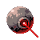](Laser_Beam.md) ／ [激光束（Laser Beam）](Laser_Beam.md) |  ／ [水蛭（Leech）](Leech.md) |  ／ [避雷针（Lightning Rod）](Lightning_Rod.md) |  ／ [迷恋（Lovestruck）](Lovestruck.md) |
|  ／ [蛆虫（Maggot）](Maggot.md) |  ／ [岩浆（Magma）](Magma.md) |  ／ [蚊王（Mosquito King）](Mosquito_King.md) |  ／ [蚊群（Mosquito Swarm）](Mosquito_Swarm.md) |
|  ／ [毒雾（Noxious）](Noxious.md) |  ／ [核弹（Nuclear Bomb）](Nuclear_Bomb.md) |  ／ [疯长（Overgrowth）](Overgrowth.md) |  ／ [幻影（Phantom）](Phantom.md) |
|  ／ [辐射束（Radiation Beam）](Radiation_Beam.md) |  ／ [献祭（Sacrifice）](Sacrifice.md) |  ／ [沙暴（Sandstorm）](Sandstorm.md) |  ／ [撒旦（Satan）](Satan.md) |
|  ／ [霰弹枪（Shotgun）](Shotgun.md) |  ／ [吸魂者（Soul Sucker）](Soul_Sucker.md) |  ／ [蜘蛛女王（Spider Queen）](Spider_Queen.md) |  ／ [风暴（Storm）](Storm.md) |
|  ／ [魅魔（Succubus）](Succubus.md) |  ／ [太阳（Sun）](Sun.md) |  ／ [沼泽（Swamp）](Swamp.md) |  ／ [吸血鬼领主（Vampire Lord）](Vampire_Lord.md) |
|  ／ [病毒（Virus）](Virus.md) |  ／ [丰满的卵囊（Voluptuous Egg Sac）](Voluptuous_Egg_Sac.md) |  ／ [怨灵（Wraith）](Wraith.md) |  ／ [诺斯费拉图（Nosferatu）](Nosferatu.md) |

#### 发行后

| 发布后的球 |  |  |  |
| --- | --- | --- | --- |
|  ／ [肉身（Flesh）](Flesh.md) |  ／ [石头（Stone）](Stone.md) |  ／ [时间（Time）](Time.md) |  ／ [末日审判（Armageddon）](Armageddon.md) |
|  ／ [放逐之焰（Banished Flame）](Banished_Flame.md) |  ／ [女妖（Banshee）](Banshee.md) |  ／ [硫磺（Brimstone）](Brimstone.md) |  ／ [投石机（Catapult）](Catapult.md) |
|  ／ [钻头（Drill）](Drill.md) |  ／ [侵蚀（Erosion）](Erosion.md) |  ／ [烟花（Fireworks）](Fireworks.md) |  ／ [肉丘（Flesh Mound）](Flesh_Mound.md) |
|  ／ [吞心者（Heart Swallower）](Heart_Swallower.md) |  ／ [山崩（Landslide）](Landslide.md) |  ／ [激光切割机（Laser Cutter）](Laser_Cutter.md) |  ／ [闪电虫（Lightning Bug）](Lightning_Bug.md) |
|  ／ [蚊子王国（Mosquito Kingdom）](Mosquito_Kingdom.md) |  ／ [后代（Offspring）](Offspring.md) |  ／ [石化（Petrify）](Petrify.md) |  ／ [死神（Reaper）](Reaper.md) |
|  ／ [狙击手（Sniper）](Sniper.md) |  ／ [钢铁（Steel）](Steel.md) |  ／ [时间炸弹（Time Bomb）](Time_Bomb.md) |  ／ [时间停止（Timestop）](Timestop.md) |
|  ／ [肿瘤（Tumor）](Tumor.md) |  ／ [毒液（Venom）](Venom.md) |  ／ [扭曲（Warp）](Warp.md) |  ／ [X 射线（X Ray）](X_Ray.md) |
|  ／ [僵尸（Zombie）](Zombie.md) |  ／ [元素（Elemental）](Elemental.md) |  |  |

### 被动道具

#### 本体

| 基础游戏被动道具 |  |  |  |
| --- | --- | --- | --- |
|  ／ [弓箭手雕像（Archer's Effigy）](Archer_s_Effigy.md) |  ／ [人工心脏（Artificial Heart）](Artificial_Heart.md) |  ／ [婴儿摇铃（Baby Rattle）](Baby_Rattle.md) |  ／ [绷带卷（Bandage Roll）](Bandage_Roll.md) |
|  ／ [瓶装龙卷风（Bottled Tornado）](Bottled_Tornado.md) |  ／ [胸甲（Breastplate）](Breastplate.md) |  ／ [荆棘王冠（Crown of Thorns）](Crown_of_Thorns.md) |  ／ [诅咒灵药（Cursed Elixir）](Cursed_Elixir.md) |
|  ／ [神射手护符（Deadeye's Amulet）](Deadeye_s_Amulet.md) | [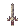](Diamond_Hilted_Dagger.md) ／ [钻石柄匕首（Diamond Hilted Dagger）](Diamond_Hilted_Dagger.md) |  ／ [炸药（Dynamite）](Dynamite.md) |  ／ [翡翠柄匕首（Emerald Hilted Dagger）](Emerald_Hilted_Dagger.md) |
|  ／ [虚灵斗篷（Ethereal Cloak）](Ethereal_Cloak.md) |  ／ [永流之杯（Everflowing Goblet）](Everflowing_Goblet.md) |  ／ [观者之眼（Eye of the Beholder）](Eye_of_the_Beholder.md) |  ／ [飞毛腿（Fleet Feet）](https://ballxpit.wiki.gg/wiki/Fleet_Feet?action=edit&redlink=1) |
|  ／ [冰冻尖刺（Frozen Spike）](https://ballxpit.wiki.gg/wiki/Frozen_Spike?action=edit&redlink=1) |  ／ [Gemspring](https://ballxpit.wiki.gg/wiki/Gemspring?action=edit&redlink=1) |  ／ [幽灵紧身衣](https://ballxpit.wiki.gg/wiki/Ghostly_Corset?action=edit&redlink=1) |  ／ [幽灵护盾](https://ballxpit.wiki.gg/wiki/Ghostly_Shield?action=edit&redlink=1) |
|  ／ [金牛座](https://ballxpit.wiki.gg/wiki/Golden_Bull?action=edit&redlink=1) | [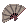](https://ballxpit.wiki.gg/wiki/Hand_Fan) ／ [手扇](https://ballxpit.wiki.gg/wiki/Hand_Fan?action=edit&redlink=1) |  ／ [手镜](https://ballxpit.wiki.gg/wiki/Hand_Mirror?action=edit&redlink=1) |  ／ [治疗者的雕像](https://ballxpit.wiki.gg/wiki/Healer%27s_Effigy?action=edit&redlink=1) |
| [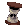](Hourglass.md) ／ [沙漏（Hourglass）](Hourglass.md) |  ／ [死亡之吻](https://ballxpit.wiki.gg/wiki/Kiss_of_Death?action=edit&redlink=1) |  ／ [恋人的箭袋（Lover's Quiver）](https://ballxpit.wiki.gg/wiki/Lover%27s_Quiver?action=edit&redlink=1) | [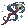](Magic_Staff.md) ／ [魔杖（Magic Staff）](Magic_Staff.md) |
|  ／ [磁石（Magnet）](Magnet.md) |  ／ [午夜灯油（Midnight Oil）](Midnight_Oil.md) |  ／ [压力阀（Pressure Valve）](Pressure_Valve.md) |  ／ [防护魅惑](https://ballxpit.wiki.gg/wiki/Protective_Charm?action=edit&redlink=1) |
|  ／ [耀光羽毛（Radiant Feather）](https://ballxpit.wiki.gg/wiki/Radiant_Feather?action=edit&redlink=1) |  ／ [伸刺长矛（Reacher's Spear）](Reacher_s_Spear.md) |  ／ [橡胶头带（Rubber Headband）](https://ballxpit.wiki.gg/wiki/Rubber_Headband?action=edit&redlink=1) | [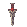](Ruby_Hilted_Dagger.md) ／ [红宝石柄匕首（Ruby Hilted Dagger）](Ruby_Hilted_Dagger.md) |
|  ／ [蓝宝石柄匕首（Sapphire Hilted Dagger）](Sapphire_Hilted_Dagger.md) |  ／ [短弓（Shortbow）](Shortbow.md) | [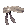](https://ballxpit.wiki.gg/wiki/Silver_Blindfold) ／ [银色蒙眼](https://ballxpit.wiki.gg/wiki/Silver_Blindfold?action=edit&redlink=1) |  ／ [银弹（Silver Bullet）](Silver_Bullet.md) |
|  ／ [弹弓（Slingshot）](Slingshot.md) |  ／ [尖刺项圈（Spiked Collar）](https://ballxpit.wiki.gg/wiki/Spiked_Collar?action=edit&redlink=1) | [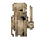](https://ballxpit.wiki.gg/wiki/Stone_Effigy) ／ [石雕像（Stone Effigy）](https://ballxpit.wiki.gg/wiki/Stone_Effigy?action=edit&redlink=1) |  ／ [叛徒斗篷（Traitor's Cowl）](Traitor_s_Cowl.md) |
|  ／ [炮塔（Turret）](Turret.md) |  ／ [翻转砍刀](https://ballxpit.wiki.gg/wiki/Upturned_Hatchet?action=edit&redlink=1) |  ／ [吸血剑（Vampiric Sword）](Vampiric_Sword.md) |  ／ [巫毒娃娃（Voodoo Doll）](Voodoo_Doll.md) |
|  ／ [Wagon Wheel](https://ballxpit.wiki.gg/wiki/Wagon_Wheel?action=edit&redlink=1) |  ／ [战争号角（War Horn）](War_Horn.md) |  ／ [可怜洋葱（Wretched Onion）](https://ballxpit.wiki.gg/wiki/Wretched_Onion?action=edit&redlink=1) |  ／ [丰饶之角（Cornucopia）](Cornucopia.md) |
|  ／ [仁慈穿刺者（Gracious Impaler）](Gracious_Impaler.md) |  ／ [恶臭外壳（Odiferous Shell）](Odiferous_Shell.md) |  ／ [幻影战袍（Phantom Regalia）](Phantom_Regalia.md) | [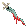](Soul_Reaver.md) ／ [灵魂掠夺者（Soul Reaver）](Soul_Reaver.md) |
|  ／ [折磨者面具（Tormenters Mask）](Tormenters_Mask.md) |  ／ [受膏之翼（Wings of the Anointed）](Wings_of_the_Anointed.md) |  ／ [神射手十字架（Deadeye's Cross）](Deadeye_s_Cross.md) |  |

#### 发行后

| 发布后被动道具 |  |  |  |
| --- | --- | --- | --- |
|  ／ [铁制连体衣（Iron Onesie）](Iron_Onesie.md) |  ／ [铂金哑铃（Platinum Dumbbell）](Platinum_Dumbbell.md) |  ／ [破剑者（Sword Breaker）](Sword_Breaker.md) |  ／ [炽热轮胎（Ardent Tire）](Ardent_Tire.md) |
|  ／ [银质秒表（Argent Stopwatch）](Argent_Stopwatch.md) |  ／ [命运之箭（Arrow of Fate）](Arrow_of_Fate.md) |  ／ [神射手穿刺矛（Deadeye's Impaler）](Deadeye_s_Impaler.md) |  ／ [全金属细剑（Full Metal Rapier）](Full_Metal_Rapier.md) |
|  ／ [怪异火炮（Grotesque Artillery）](Grotesque_Artillery.md) |  ／ [无名战锤（Inglorious Hammer）](Inglorious_Hammer.md) |  ／ [遥控起爆器（Remote Detonator）](Remote_Detonator.md) |  ／ [风织者（Windweaver）](Windweaver.md) |

### 兽栏

| 兽栏 |  |  |  |
| --- | --- | --- | --- |
| [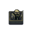](Skeleton_Warrior.md) ／ [骷髅战士（Skeleton Warrior）](Skeleton_Warrior.md) | [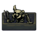](Skeletal_Brute.md) ／ [骸骨蛮兵（Skeletal Brute）](Skeletal_Brute.md) | [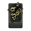](Skeletal_Beast.md) ／ [骸骨野兽（Skeletal Beast）](Skeletal_Beast.md) | [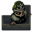](Skeletal_Bishop.md) ／ [骸骨主教（Skeletal Bishop）](Skeletal_Bishop.md) |
| [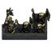](Skeletal_Bastion.md) ／ [骸骨堡垒（Skeletal Bastion）](Skeletal_Bastion.md) | [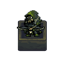](Skeleton_Archer.md) ／ [骷髅弓箭手（Skeleton Archer）](Skeleton_Archer.md) | [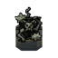](Bone_Behemoth.md) ／ [白骨巨兽（Bone Behemoth）](Bone_Behemoth.md) | [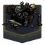](Skeletal_Brigade.md) ／ [骸骨军团（Skeletal Brigade）](Skeletal_Brigade.md) |
| [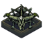](Bone_Ballista.md) ／ [白骨弩炮（Bone Ballista）](Bone_Ballista.md) |  ／ [骷髅王（Skeleton King）](Skeleton_King.md) | [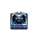](Icebound_Warrior.md) ／ [冰封战士（Icebound Warrior）](Icebound_Warrior.md) | [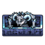](Icebound_Brute.md) ／ [冰封蛮兽（Icebound Brute）](Icebound_Brute.md) |
| [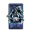](Icebound_Beast.md) ／ [冰封野兽（Icebound Beast）](Icebound_Beast.md) | [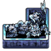](Icebound_Band.md) ／ [冰封指环（Icebound Band）](Icebound_Band.md) | [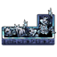](Icebound_Bastion.md) ／ [冰封要塞（Icebound Bastion）](Icebound_Bastion.md) | [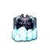](Icebound_Shieldbearer.md) ／ [冰封持盾者（Icebound Shieldbearer）](Icebound_Shieldbearer.md) |
| [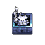](Icebound_Hurler.md) ／ [冰封投掷者（Icebound Hurler）](Icebound_Hurler.md) | [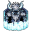](Icebound_Champion.md) ／ [冰封勇士（Icebound Champion）](Icebound_Champion.md) | [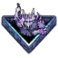](Icebound_Howler.md) ／ [冰封嚎兽（Icebound Howler）](Icebound_Howler.md) | [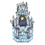](Icebound_Queen.md) ／ [冰封女王（Icebound Queen）](Icebound_Queen.md) |
| [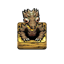](Lizard.md) ／ [蜥蜴（Lizard）](Lizard.md) | [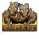](Lizard_Brute.md) ／ [蛮力蜥蜴（Lizard Brute）](Lizard_Brute.md) | [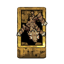](Slizard.md) ／ [滑蜥（Slizard）](Slizard.md) | [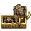](Lizard_Strongman.md) ／ [蜥蜴壮汉（Lizard Strongman）](Lizard_Strongman.md) |
| [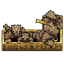](Lizard_Bastion.md) ／ [蜥蜴堡垒（Lizard Bastion）](Lizard_Bastion.md) | [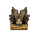](Laser_Locust.md) ／ [激光蝗虫（Laser Locust）](Laser_Locust.md) | [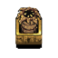](Worm.md) ／ [蠕虫（Worm）](Worm.md) | [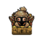](Sandwalker.md) ／ [踏沙者（Sandwalker）](Sandwalker.md) |
| [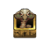](Shifting_Cobra.md) ／ [变形眼镜蛇（Shifting Cobra）](Shifting_Cobra.md) | [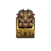](Desert_Sentinel.md) ／ [沙漠哨兵（Desert Sentinel）](Desert_Sentinel.md) | [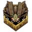](Seething_Locust.md) ／ [狂怒蝗虫（Seething Locust）](Seething_Locust.md) | [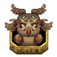](Great_Sentinel.md) ／ [巨型哨兵（Great Sentinel）](Great_Sentinel.md) |
| [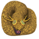](Twisted_Serpent.md) ／ [扭曲之蛇（Twisted Serpent）](Twisted_Serpent.md) | [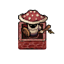](Shroom_Fighter.md) ／ [蘑菇战士（Shroom Fighter）](Shroom_Fighter.md) | [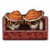](Twin_Shrooms.md) ／ [双生蘑菇（Twin Shrooms）](Twin_Shrooms.md) | [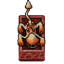](Shroom_Stalker.md) ／ [潜行菇（Shroom Stalker）](Shroom_Stalker.md) |
| [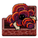](Bracket_Fungus.md) ／ [层架菌（Bracket Fungus）](Bracket_Fungus.md) | [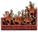](Enoki_Cluster.md) ／ [金针菇丛（Enoki Cluster）](Enoki_Cluster.md) | [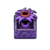](Boomshroom.md) ／ [爆炸菇（Boomshroom）](Boomshroom.md) | [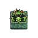](Cordyceps_Spitter.md) ／ [虫草喷吐者（Cordyceps Spitter）](Cordyceps_Spitter.md) |
|  ／ [冲锋菇（Rushroom）](Rushroom.md) | [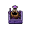](Shroomboomer.md) ／ [爆鸣菇（Shroomboomer）](Shroomboomer.md) |  ／ [虫草女王（Cordyceps Queen）](Cordyceps_Queen.md) |  ／ [长老爆炸菇（Elder Boomshroom）](Elder_Boomshroom.md) |
|  ／ [菇群（Shroom Swarm）](Shroom_Swarm.md) |  ／ [座狼（Warg）](Warg.md) |  ／ [座狼骑手（Warg Rider）](Warg_Rider.md) |  ／ [座狼弓手（Warg Archer）](Warg_Archer.md) |
|  ／ [老鼠（Mouse）](Mouse.md) |  ／ [远古座狼（Ancient Warg）](Ancient_Warg.md) |  ／ [哥布林军阀（Goblin Warlord）](Goblin_Warlord.md) |  ／ [哥布林狙击手（Goblin Sniper）](Goblin_Sniper.md) |
|  ／ [剑齿兽（Sabertooth）](Sabertooth.md) |  ／ [幼龙（Dragonling）](Dragonling.md) |  ／ [蛮力幼龙（Dragonling Brute）](Dragonling_Brute.md) |  ／ [幼龙奴仆（Dragonling Thrall）](Dragonling_Thrall.md) |
|  ／ [幼龙屠夫（Dragonling Butcher）](Dragonling_Butcher.md) |  ／ [幼龙氏族（Dragonling Clan）](Dragonling_Clan.md) |  ／ [幼虫群（Grub Cluster）](Grub_Cluster.md) |  ／ [幼虫（Grub）](Grub.md) |
|  ／ [喷火者（Firespitter）](Firespitter.md) |  ／ [幼虫母体（Grub Mother）](Grub_Mother.md) |  ／ [巨型幼虫群（Great Grub Cluster）](Great_Grub_Cluster.md) |  ／ [喷焰者（Flamespitter）](Flamespitter.md) |
|  ／ [龙王子（Dragon Prince）](Dragon_Prince.md) |  ／ [天使眷属（Angelspawn）](Angelspawn.md) |  ／ [双头天使（Angelic Twinhead）](Angelic_Twinhead.md) |  ／ [天使巨鸮（Angelic Great Owl）](Angelic_Great_Owl.md) |
|  ／ [天使眷属狂战士（Angelspawn Berserker）](Angelspawn_Berserker.md) |  ／ [天使眷属唱诗班（Angelspawn Choir）](Angelspawn_Choir.md) |  ／ [有翼天使眷属（Winged Angelspawn）](Winged_Angelspawn.md) |  ／ [有翼天使眷属斥候（Winged Angelspawn Scout）](Winged_Angelspawn_Scout.md) |
|  ／ [天使眷属女祭司（Angelspawn Priestess）](Angelspawn_Priestess.md) |  ／ [天使眷属掠夺者（Angelspawn Snatcher）](Angelspawn_Snatcher.md) |  ／ [丘比特（Cupid）](Cupid.md) |  ／ [不安者（Restless One）](Restless_One.md) |
|  ／ [枯瘦劫掠者（Wizened Snatcher）](Wizened_Snatcher.md) |  ／ [猫头鹰领主（Lord of Owls）](Lord_of_Owls.md) |  ／ [月灵（Moonling）](Moonling.md) |  ／ [月灵弓箭手（Moonling Archer）](Moonling_Archer.md) |
|  ／ [月灵晶洞（Moonling Geode）](Moonling_Geode.md) |  ／ [月岩（Moonrock）](Moonrock.md) |  ／ [虚空幼体（Voidling）](Voidling.md) |  ／ [新月月灵（Crescent Moonling）](Crescent_Moonling.md) |
|  ／ [残月月灵（Waning Moonling）](Waning_Moonling.md) |  ／ [月族（Moonkin）](Moonkin.md) |  ／ [月族晶洞（Moonkin Geode）](Moonkin_Geode.md) |  ／ [月球（The Moon）](The_Moon.md) |

[返回总入口](../%E7%90%83%E6%AF%94%E4%BC%A6%E6%88%98%E8%AE%B0%20Wiki.md) · [返回本分目录](%E7%9B%AE%E5%BD%95.md)
