# 敌人（Enemies）

[原文与贡献者记录](https://ballxpit.wiki.gg/wiki/Enemies) · [修订 3591](https://ballxpit.wiki.gg/index.php?oldid=3591) · [返回目录](../%E7%90%83%E6%AF%94%E4%BC%A6%E6%88%98%E8%AE%B0%20Wiki.md)

这是一份列表 **敌人** 在 *[球比伦战记](Ball_x_Pit.md)*一个敌人被列在 [动物动物](Encyclopedia.md#%E5%8A%A8%E7%89%A9%E5%8A%A8%E7%89%A9) 部分 [图鉴](Encyclopedia.md) 当它第一次被杀时。

#### 敌人的名单

| 名称 | 标志 | 描述 | 卫生规模 | 敌人类型 | 等级 |
| --- | --- | --- | --- | --- | --- |
| [骨架战士（Skeleton Warrior）](Skeleton_Warrior.md) | [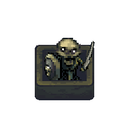](Skeleton_Warrior.md) | - | 1x | 正常的 | [骸骨墓园（The BONExYARD）](The_BONExYARD.md)  |
| [骸骨蛮兵（Skeletal Brute）](Skeletal_Brute.md) |  | - | 3x | 正常的 | [骸骨墓园（The BONExYARD）](The_BONExYARD.md)  |
| [骸骨野兽（Skeletal Beast）](Skeletal_Beast.md) | [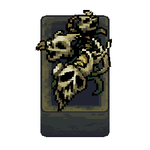](Skeletal_Beast.md) | - | 3x | 正常的 | [骸骨墓园（The BONExYARD）](The_BONExYARD.md)  |
| [骸骨主教（Skeletal Bishop）](Skeletal_Bishop.md) | [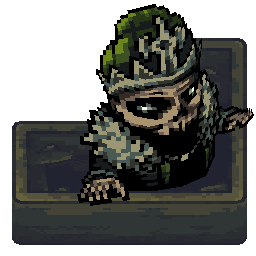](Skeletal_Bishop.md) | - | 4x | 正常的 | [骸骨墓园（The BONExYARD）](The_BONExYARD.md)  |
| [骸骨堡垒（Skeletal Bastion）](Skeletal_Bastion.md) | [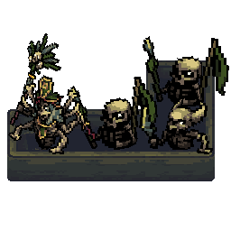](Skeletal_Bastion.md) | - | 6x | 正常的 | [骸骨墓园（The BONExYARD）](The_BONExYARD.md)  |
| [骨架弓箭手（Skeleton Archer）](Skeleton_Archer.md) | [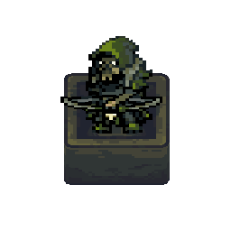](Skeleton_Archer.md) | - | 1x | 正常的 | [骸骨墓园（The BONExYARD）](The_BONExYARD.md)  |
| [骨贝赫莫特（Bone Behemoth）](Bone_Behemoth.md) | [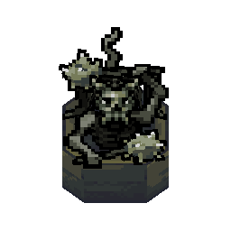](Bone_Behemoth.md) | - | 2x | 正常的 | [骸骨墓园（The BONExYARD）](The_BONExYARD.md)  |
| [骨架旅队（Skeletal Brigade）](Skeletal_Brigade.md) | [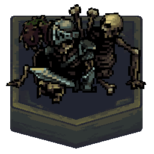](Skeletal_Brigade.md) | - | 20x | 副主管 | [骸骨墓园（The BONExYARD）](The_BONExYARD.md)  |
| [骨球ista（Bone Ballista）](Bone_Ballista.md) | [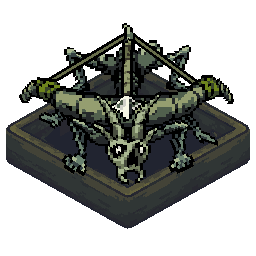](Bone_Ballista.md) | 射击射箭的波向玩家 | 20x | 副主管 | [骸骨墓园（The BONExYARD）](The_BONExYARD.md)  |
| [骨架国王（Skeleton King）](Skeleton_King.md) | [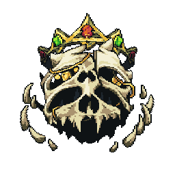](Skeleton_King.md) | - | - | 级别老板 | [骸骨墓园（The BONExYARD）](The_BONExYARD.md)  |
| [冰岛战士（Icebound Warrior）](Icebound_Warrior.md) | [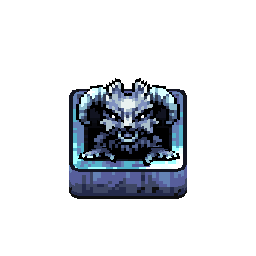](Icebound_Warrior.md) | - | 1x | 正常的 | [白雪海岸（The SNOWYxSHORES）](The_SNOWYxSHORES.md)  |
| [冰伤残疾（Icebound Brute）](Icebound_Brute.md) | [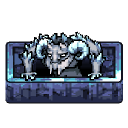](Icebound_Brute.md) | - | 3x | 正常的 | [白雪海岸（The SNOWYxSHORES）](The_SNOWYxSHORES.md)  |
| [冰封野兽（Icebound Beast）](Icebound_Beast.md) | [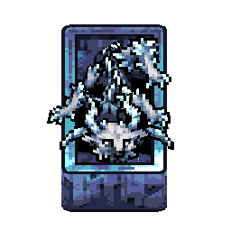](Icebound_Beast.md) | - | 3x | 正常的 | [白雪海岸（The SNOWYxSHORES）](The_SNOWYxSHORES.md)  |
| [冰封指环（Icebound Band）](Icebound_Band.md) | [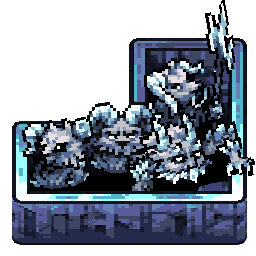](Icebound_Band.md) | - | 4x | 正常的 | [白雪海岸（The SNOWYxSHORES）](The_SNOWYxSHORES.md)  |
| [冰岛堡垒（Icebound Bastion）](Icebound_Bastion.md) | [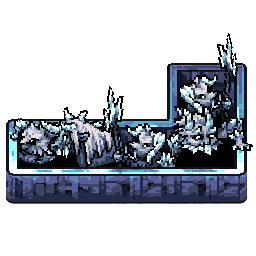](Icebound_Bastion.md) | - | 6x | 正常的 | [白雪海岸（The SNOWYxSHORES）](The_SNOWYxSHORES.md)  |
| [冰患盾牌手（Icebound Shieldbearer）](Icebound_Shieldbearer.md) | [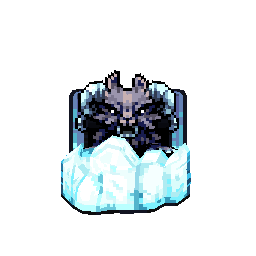](Icebound_Shieldbearer.md) | 防弹侧的球损伤 | 1x | 正常的 | [白雪海岸（The SNOWYxSHORES）](The_SNOWYxSHORES.md)  |
| [冰封投掷者（Icebound Hurler）](Icebound_Hurler.md) | [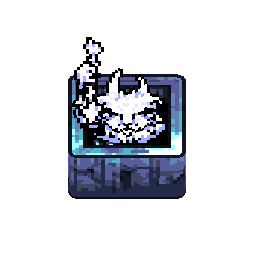](Icebound_Hurler.md) | 向玩家扔冰棒，使玩家被击中时冻结播放器 | 1x | 正常的 | [白雪海岸（The SNOWYxSHORES）](The_SNOWYxSHORES.md)  |
| [冰球冠军（Icebound Champion）](Icebound_Champion.md) |  | 从前面免疫球损伤 | 20x | 副主管 | [白雪海岸（The SNOWYxSHORES）](The_SNOWYxSHORES.md)  |
| [冰封嚎兽（Icebound Howler）](Icebound_Howler.md) | [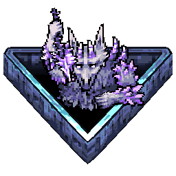](Icebound_Howler.md) | 投射多个冰球到玩家身上, | 20x | 副主管 | [白雪海岸（The SNOWYxSHORES）](The_SNOWYxSHORES.md)  |
| [冰岛女王（Icebound Queen）](Icebound_Queen.md) | [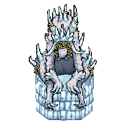](Icebound_Queen.md) | - | - | 级别老板 | [白雪海岸（The SNOWYxSHORES）](The_SNOWYxSHORES.md)  |
| [蜥蜴（Lizard）](Lizard.md) | [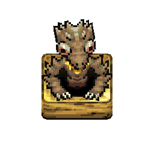](Lizard.md) | - | 1x | 正常的 | [边境沙漠（The LIMINALxDESERT）](The_LIMINALxDESERT.md)  |
| [蛮力蜥蜴（Lizard Brute）](Lizard_Brute.md) | [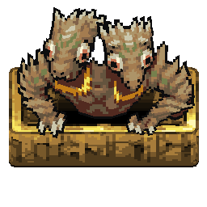](Lizard_Brute.md) | - | 3x | 正常的 | [边境沙漠（The LIMINALxDESERT）](The_LIMINALxDESERT.md)  |
| [滑蜥（Slizard）](Slizard.md) | [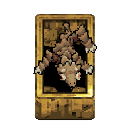](Slizard.md) | - | 3x | 正常的 | [边境沙漠（The LIMINALxDESERT）](The_LIMINALxDESERT.md)  |
| [蜥蜴壮汉（Lizard Strongman）](Lizard_Strongman.md) | [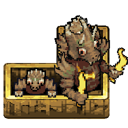](Lizard_Strongman.md) | - | 4x | 正常的 | [边境沙漠（The LIMINALxDESERT）](The_LIMINALxDESERT.md)  |
| [蜥蜴堡垒（Lizard Bastion）](Lizard_Bastion.md) | [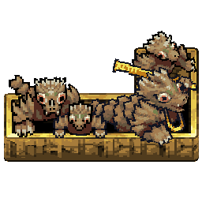](Lizard_Bastion.md) | - | 6x | 正常的 | [边境沙漠（The LIMINALxDESERT）](The_LIMINALxDESERT.md)  |
| [激光蝗虫（Laser Locust）](Laser_Locust.md) | [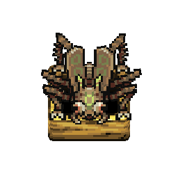](Laser_Locust.md) | 目标和射击激光对玩家 | 1x | 正常的 | [边境沙漠（The LIMINALxDESERT）](The_LIMINALxDESERT.md)  |
| [蠕虫（Worm）](Worm.md) | [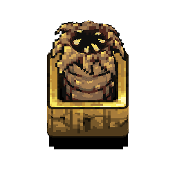](Worm.md) | 每当它出现时，它都会在地下喷出毒药。 | 1x | 正常的 | [边境沙漠（The LIMINALxDESERT）](The_LIMINALxDESERT.md)  |
| [沙步行者（Sandwalker）](Sandwalker.md) | [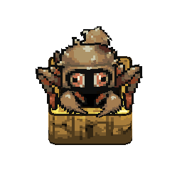](Sandwalker.md) | 从一边移动到另一边 | 2x | 正常的 | [边境沙漠（The LIMINALxDESERT）](The_LIMINALxDESERT.md)  |
| [转移的科布拉（Shifting Cobra）](Shifting_Cobra.md) | [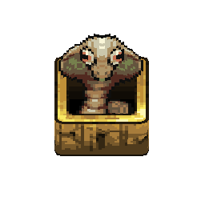](Shifting_Cobra.md) | 方形和钻石形状的平台之间的转移 | 1x | 正常的 | [边境沙漠（The LIMINALxDESERT）](The_LIMINALxDESERT.md)  |
| [沙漠哨兵（Desert Sentinel）](Desert_Sentinel.md) | [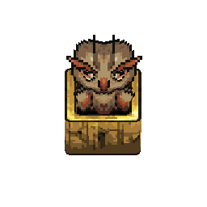](Desert_Sentinel.md) | 有一个旋转平台 | 1x | 正常的 | [边境沙漠（The LIMINALxDESERT）](The_LIMINALxDESERT.md)  |
| [狂怒蝗虫（Seething Locust）](Seething_Locust.md) | [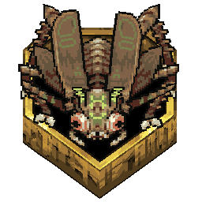](Seething_Locust.md) | 射出一个大的激光光束到播放器 | 20x | 副主管 | [边境沙漠（The LIMINALxDESERT）](The_LIMINALxDESERT.md)  |
| [伟大的卫兵（Great Sentinel）](Great_Sentinel.md) | [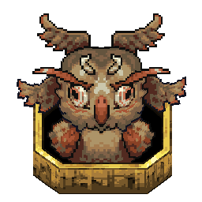](Great_Sentinel.md) | 有一个大的旋转平台 | 20x | 副主管 | [边境沙漠（The LIMINALxDESERT）](The_LIMINALxDESERT.md)  |
| [扭曲的蛇（Twisted Serpent）](Twisted_Serpent.md) | [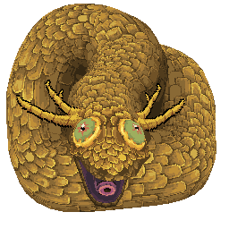](Twisted_Serpent.md) | - | - | 级别老板 | [边境沙漠（The LIMINALxDESERT）](The_LIMINALxDESERT.md)  |
| [蘑菇战士（Shroom Fighter）](Shroom_Fighter.md) | [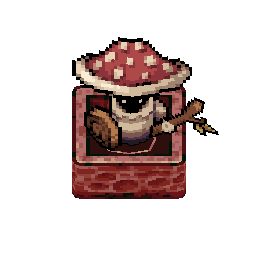](Shroom_Fighter.md) | - | 1x | 正常的 | [真菌森林（The FUNGALxFOREST）](The_FUNGALxFOREST.md)  |
| [双生蘑菇（Twin Shrooms）](Twin_Shrooms.md) | [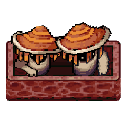](Twin_Shrooms.md) | - | 3x | 正常的 | [真菌森林（The FUNGALxFOREST）](The_FUNGALxFOREST.md)  |
| [潜行菇（Shroom Stalker）](Shroom_Stalker.md) | [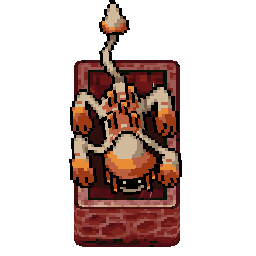](Shroom_Stalker.md) | - | 3x | 正常的 | [真菌森林（The FUNGALxFOREST）](The_FUNGALxFOREST.md)  |
| [层架菌（Bracket Fungus）](Bracket_Fungus.md) | [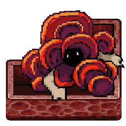](Bracket_Fungus.md) | - | 4x | 正常的 | [真菌森林（The FUNGALxFOREST）](The_FUNGALxFOREST.md)  |
| [伊诺基集团（Enoki Cluster）](Enoki_Cluster.md) | [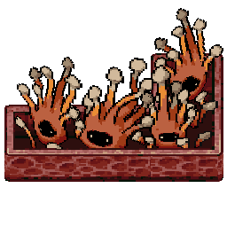](Enoki_Cluster.md) | - | 6x | 正常的 | [真菌森林（The FUNGALxFOREST）](The_FUNGALxFOREST.md)  |
| [爆炸菇（Boomshroom）](Boomshroom.md) | [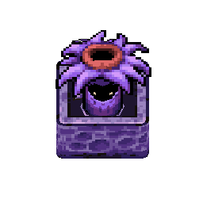](Boomshroom.md) | 射出弹道，在空气中，它在延迟后降落在你的附近 | 1x | 正常的 | [真菌森林（The FUNGALxFOREST）](The_FUNGALxFOREST.md)  |
| [螺旋式螺旋桨（Cordyceps Spitter）](Cordyceps_Spitter.md) | [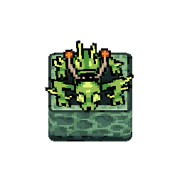](Cordyceps_Spitter.md) | 向玩家施用沥青， 减慢他们被击中的速度 | 1x | 正常的 | [真菌森林（The FUNGALxFOREST）](The_FUNGALxFOREST.md)  |
| [工作室（Rushroom）](Rushroom.md) |  | 增加附近的敌人的移动速度 | 1x | 正常的 | [真菌森林（The FUNGALxFOREST）](The_FUNGALxFOREST.md)  |
| [爆鸣菇（Shroomboomer）](Shroomboomer.md) | [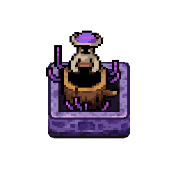](Shroomboomer.md) | 射击时发射一颗小弹道，它在延迟后落在玩家附近 | 1x | 正常的 | [真菌森林（The FUNGALxFOREST）](The_FUNGALxFOREST.md)  |
| [科尔迪西普斯女王（Cordyceps Queen）](Cordyceps_Queen.md) | [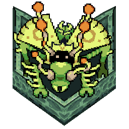](Cordyceps_Queen.md) | 向玩家发射多个焦油浮流，从而减慢播放器被击中的速度 | 20x | 副主管 | [真菌森林（The FUNGALxFOREST）](The_FUNGALxFOREST.md)  |
| [长老爆炸菇（Elder Boomshroom）](Elder_Boomshroom.md) | [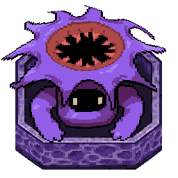](Elder_Boomshroom.md) | 射出一个大弹道，在你的附近落地 | 20x | 副主管 | [真菌森林（The FUNGALxFOREST）](The_FUNGALxFOREST.md)  |
| [菇群（Shroom Swarm）](Shroom_Swarm.md) |  | - | - | 级别老板 | [真菌森林（The FUNGALxFOREST）](The_FUNGALxFOREST.md)  |
| [华格（Warg）](Warg.md) |  | - (可能会出现堆叠的 [沃格骑手](Warg_Rider.md) 或是 [沃格·阿彻](Warg_Archer.md)) | 1x | 正常的 | [血腥草原（The GORYxGRASSLANDS）](The_GORYxGRASSLANDS.md)  |
| [沃格骑手（Warg Rider）](Warg_Rider.md) | [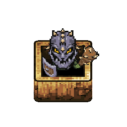](Warg_Rider.md) | - (可能会出现堆叠的 [华格](Warg.md)) | 1x | 正常的 | [血腥草原（The GORYxGRASSLANDS）](The_GORYxGRASSLANDS.md)  |
| [沃格·阿彻（Warg Archer）](Warg_Archer.md) | [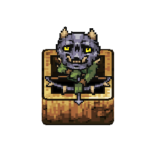](Warg_Archer.md) | - (可能会出现堆叠的 [华格](Warg.md)) | 1x | 正常的 | [血腥草原（The GORYxGRASSLANDS）](The_GORYxGRASSLANDS.md)  |
| [鼠标（Mouse）](Mouse.md) | [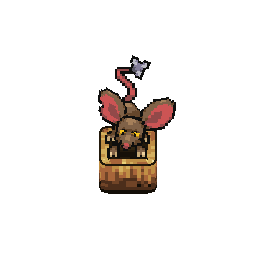](Mouse.md) | - | 1x | 正常的 | [血腥草原（The GORYxGRASSLANDS）](The_GORYxGRASSLANDS.md)  |
| [古代的华格（Ancient Warg）](Ancient_Warg.md) | [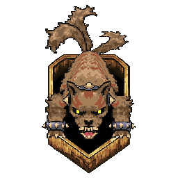](Ancient_Warg.md) | - (看起来堆叠了 [妖精战主](Goblin_Warlord.md) 或是 [妖精狙击手](Goblin_Sniper.md)) | 20x | 副主管 | [血腥草原（The GORYxGRASSLANDS）](The_GORYxGRASSLANDS.md)  |
| [妖精战主（Goblin Warlord）](Goblin_Warlord.md) | [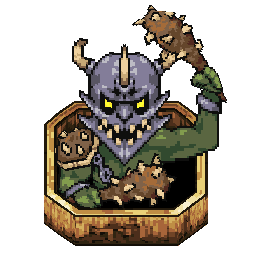](Goblin_Warlord.md) | - (看起来堆叠了 [古代的华格](Ancient_Warg.md)) | 20x | 副主管 | [血腥草原（The GORYxGRASSLANDS）](The_GORYxGRASSLANDS.md)  |
| [妖精狙击手（Goblin Sniper）](Goblin_Sniper.md) | [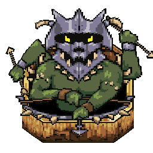](Goblin_Sniper.md) | - (看起来堆叠了 [古代的华格](Ancient_Warg.md)) | 20x | 副主管 | [血腥草原（The GORYxGRASSLANDS）](The_GORYxGRASSLANDS.md)  |
| [沙伯牙（Sabertooth）](Sabertooth.md) | [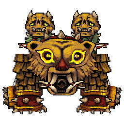](Sabertooth.md) | - | - | 级别老板 | [血腥草原（The GORYxGRASSLANDS）](The_GORYxGRASSLANDS.md)  |
| [幼龙（Dragonling）](Dragonling.md) | [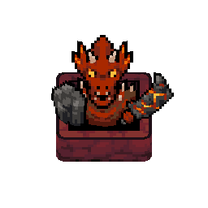](Dragonling.md) | - | 1x | 正常的 | [阴燃深渊（The SMOLDERINGxDEPTHS）](The_SMOLDERINGxDEPTHS.md)  |
| [龙头野兽（Dragonling Brute）](Dragonling_Brute.md) | [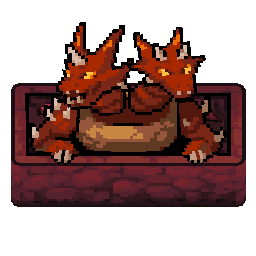](Dragonling_Brute.md) | - | 3x | 正常的 | [阴燃深渊（The SMOLDERINGxDEPTHS）](The_SMOLDERINGxDEPTHS.md)  |
| [龙号号号（Dragonling Thrall）](Dragonling_Thrall.md) |  | - | 3x | 正常的 | [阴燃深渊（The SMOLDERINGxDEPTHS）](The_SMOLDERINGxDEPTHS.md)  |
| [龙头屠夫（Dragonling Butcher）](Dragonling_Butcher.md) |  | - | 4x | 正常的 | [阴燃深渊（The SMOLDERINGxDEPTHS）](The_SMOLDERINGxDEPTHS.md)  |
| [龙子族（Dragonling Clan）](Dragonling_Clan.md) |  | - | 6x | 正常的 | [阴燃深渊（The SMOLDERINGxDEPTHS）](The_SMOLDERINGxDEPTHS.md)  |
| [集群群（Grub Cluster）](Grub_Cluster.md) |  | 当销毁时爆炸成一组[幼虫](Grub.md) | 1x | 正常的 | [阴燃深渊（The SMOLDERINGxDEPTHS）](The_SMOLDERINGxDEPTHS.md)  |
| [幼虫（Grub）](Grub.md) |  |  | 0.5x | 正常的 | [阴燃深渊（The SMOLDERINGxDEPTHS）](The_SMOLDERINGxDEPTHS.md)  |
| [消防员（Firespitter）](Firespitter.md) |  | 吐火球到玩家身上 | 1.5x | 正常的 | [阴燃深渊（The SMOLDERINGxDEPTHS）](The_SMOLDERINGxDEPTHS.md)  |
| [幼虫母体（Grub Mother）](Grub_Mother.md) |  | 随时间推移， 喷出 [幼虫](Grub.md) | 1x | 正常的 | [阴燃深渊（The SMOLDERINGxDEPTHS）](The_SMOLDERINGxDEPTHS.md)  |
| [Great Grub 群集群集（Great Grub Cluster）](Great_Grub_Cluster.md) |  | 当被摧毁时会爆炸成一群 [群群](Grub_Cluster.md) | 20x | 副主管 | [阴燃深渊（The SMOLDERINGxDEPTHS）](The_SMOLDERINGxDEPTHS.md)  |
| [喷焰者（Flamespitter）](Flamespitter.md) |  | 吐了一条长的火球向玩家 | 20x | 副主管 | [阴燃深渊（The SMOLDERINGxDEPTHS）](The_SMOLDERINGxDEPTHS.md)  |
| [龙王子（Dragon Prince）](Dragon_Prince.md) |  | - | - | 级别老板 | [阴燃深渊（The SMOLDERINGxDEPTHS）](The_SMOLDERINGxDEPTHS.md)  |
| [天使眷属（Angelspawn）](Angelspawn.md) |  | - | 1x | 正常的 | [天堂之门（The HEAVENLYxGATES）](The_HEAVENLYxGATES.md)  |
| [天使双头（Angelic Twinhead）](Angelic_Twinhead.md) |  | - | 3x | 正常的 | [天堂之门（The HEAVENLYxGATES）](The_HEAVENLYxGATES.md)  |
| [天使巨鸮（Angelic Great Owl）](Angelic_Great_Owl.md) |  | - | 3x | 正常的 | [天堂之门（The HEAVENLYxGATES）](The_HEAVENLYxGATES.md)  |
| [Angelspawn 贝尔塞尔（Angelspawn Berserker）](Angelspawn_Berserker.md) |  | - | 4x | 正常的 | [天堂之门（The HEAVENLYxGATES）](The_HEAVENLYxGATES.md)  |
| [天使队合唱团（Angelspawn Choir）](Angelspawn_Choir.md) |  | - | 6x | 正常的 | [天堂之门（The HEAVENLYxGATES）](The_HEAVENLYxGATES.md)  |
| [双翼天使（Winged Angelspawn）](Winged_Angelspawn.md) |  | 偶尔飞到空中，在空中不能被球击中。 | 1x | 正常的 | [天堂之门（The HEAVENLYxGATES）](The_HEAVENLYxGATES.md)  |
| [双翼天使童子军（Winged Angelspawn Scout）](Winged_Angelspawn_Scout.md) |  | 偶尔会飞到空中射箭，在空中不能被球击中。 | 1x | 正常的 | [天堂之门（The HEAVENLYxGATES）](The_HEAVENLYxGATES.md)  |
| [Angelspawh 女祭司（Angelspawn Priestess）](Angelspawn_Priestess.md) |  | 偶尔会治愈附近的敌人 | 1x | 正常的 | [天堂之门（The HEAVENLYxGATES）](The_HEAVENLYxGATES.md)  |
| [Angelspawn Snatcher 天使捕猎者（Angelspawn Snatcher）](Angelspawn_Snatcher.md) |  | 抓住你的球，直到你摧毁它。 | 2x | 正常的 | [天堂之门（The HEAVENLYxGATES）](The_HEAVENLYxGATES.md)  |
| [丘比特（Cupid）](Cupid.md) |  | 射向玩家的射箭 | 2x | 正常的 | [天堂之门（The HEAVENLYxGATES）](The_HEAVENLYxGATES.md)  |
| [一个不安的人（Restless One）](Restless_One.md) |  | 偶尔会飞到空中 | 20x | 副主管 | [天堂之门（The HEAVENLYxGATES）](The_HEAVENLYxGATES.md)  |
| [枯瘦劫掠者（Wizened Snatcher）](Wizened_Snatcher.md) |  | 每次可接住并扣留你的 3 颗圆球。 | 20x | 副主管 | [天堂之门（The HEAVENLYxGATES）](The_HEAVENLYxGATES.md)  |
| [猫头鹰领主（Lord of Owls）](Lord_of_Owls.md) |  | - | - | 级别老板 | [天堂之门（The HEAVENLYxGATES）](The_HEAVENLYxGATES.md)  |
| [月灵（Moonling）](Moonling.md) |  | - | 1x | 正常的 | [浩瀚虚空（The VASTxVOID）](The_VASTxVOID.md)  |
| [月球弓箭手（Moonling Archer）](Moonling_Archer.md) |  | 吐石到玩家身上 | 1x | 正常的 | [浩瀚虚空（The VASTxVOID）](The_VASTxVOID.md)  |
| [月亮的地质（Moonling Geode）](Moonling_Geode.md) |  | 销毁时爆炸成若干[月岩](Moonrock.md) | 1x | 正常的 | [浩瀚虚空（The VASTxVOID）](The_VASTxVOID.md)  |
| [月石（Moonrock）](Moonrock.md) |  | - | 0.5x | 正常的 | [浩瀚虚空（The VASTxVOID）](The_VASTxVOID.md)  |
| [废除（Voidling）](Voidling.md) |  | 所有的球都穿过这个敌人 | 1x | 正常的 | [浩瀚虚空（The VASTxVOID）](The_VASTxVOID.md)  |
| [半月月亮（Crescent Moonling）](Crescent_Moonling.md) |  | - | 4x | 正常的 | [浩瀚虚空（The VASTxVOID）](The_VASTxVOID.md)  |
| [衰落的月球（Waning Moonling）](Waning_Moonling.md) |  | - | 6x | 正常的 | [浩瀚虚空（The VASTxVOID）](The_VASTxVOID.md)  |
| [月族（Moonkin）](Moonkin.md) |  | - | 20x | 副主管 | [浩瀚虚空（The VASTxVOID）](The_VASTxVOID.md)  |
| [月族晶洞（Moonkin Geode）](Moonkin_Geode.md) |  | 爆炸成若干[月球大地测量](Moonling_Geode.md) | 16x | 副主管 | [浩瀚虚空（The VASTxVOID）](The_VASTxVOID.md)  |
| [月亮（The Moon）](The_Moon.md) |  | - | - | 级别老板 | [浩瀚虚空（The VASTxVOID）](The_VASTxVOID.md)  |

[返回总入口](../%E7%90%83%E6%AF%94%E4%BC%A6%E6%88%98%E8%AE%B0%20Wiki.md) · [返回本分目录](%E7%9B%AE%E5%BD%95.md)
