# 敌人（Enemies）

[原文与贡献者记录](https://ballxpit.wiki.gg/wiki/Enemies) · [修订 3591](https://ballxpit.wiki.gg/index.php?oldid=3591) · [返回目录](../%E7%90%83%E6%AF%94%E4%BC%A6%E6%88%98%E8%AE%B0%20Wiki.md)

下表列出*[《球比伦战记》](Ball_x_Pit.md)*中的**敌人**。首次击败某种敌人后，[图鉴](Encyclopedia.md)中的[敌人图鉴（Bestiary）](Encyclopedia.md#%E5%85%BD%E6%A0%8F)会收录该敌人。

## 敌人列表

| 名称 | 图标 | 说明 | 生命值倍率 | 敌人类型 | 等级 |
| --- | --- | --- | --- | --- | --- |
| [骷髅战士（Skeleton Warrior）](Skeleton_Warrior.md) | [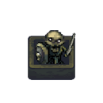](Skeleton_Warrior.md) | - | 1x | 普通 | [骸骨墓园（The BONExYARD）](The_BONExYARD.md)  |
| [骸骨蛮兵（Skeletal Brute）](Skeletal_Brute.md) | [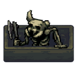](Skeletal_Brute.md) | - | 3x | 普通 | [骸骨墓园（The BONExYARD）](The_BONExYARD.md)  |
| [骸骨野兽（Skeletal Beast）](Skeletal_Beast.md) | [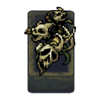](Skeletal_Beast.md) | - | 3x | 普通 | [骸骨墓园（The BONExYARD）](The_BONExYARD.md)  |
| [骸骨主教（Skeletal Bishop）](Skeletal_Bishop.md) | [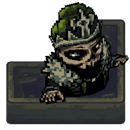](Skeletal_Bishop.md) | - | 4x | 普通 | [骸骨墓园（The BONExYARD）](The_BONExYARD.md)  |
| [骸骨堡垒（Skeletal Bastion）](Skeletal_Bastion.md) | [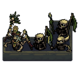](Skeletal_Bastion.md) | - | 6x | 普通 | [骸骨墓园（The BONExYARD）](The_BONExYARD.md)  |
| [骷髅弓箭手（Skeleton Archer）](Skeleton_Archer.md) | [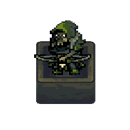](Skeleton_Archer.md) | - | 1x | 普通 | [骸骨墓园（The BONExYARD）](The_BONExYARD.md)  |
| [白骨巨兽（Bone Behemoth）](Bone_Behemoth.md) | [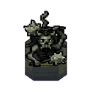](Bone_Behemoth.md) | - | 2x | 普通 | [骸骨墓园（The BONExYARD）](The_BONExYARD.md)  |
| [骸骨军团（Skeletal Brigade）](Skeletal_Brigade.md) | [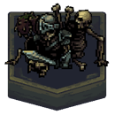](Skeletal_Brigade.md) | - | 20x | 小首领 | [骸骨墓园（The BONExYARD）](The_BONExYARD.md)  |
| [白骨弩炮（Bone Ballista）](Bone_Ballista.md) | [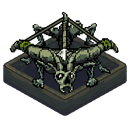](Bone_Ballista.md) | 向玩家发射一连串的箭矢 | 20x | 小首领 | [骸骨墓园（The BONExYARD）](The_BONExYARD.md)  |
| [骷髅王（Skeleton King）](Skeleton_King.md) |  | - | - | 关卡首领 | [骸骨墓园（The BONExYARD）](The_BONExYARD.md)  |
| [冰封战士（Icebound Warrior）](Icebound_Warrior.md) | [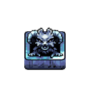](Icebound_Warrior.md) | - | 1x | 普通 | [白雪海岸（The SNOWYxSHORES）](The_SNOWYxSHORES.md)  |
| [冰封蛮兽（Icebound Brute）](Icebound_Brute.md) | [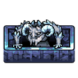](Icebound_Brute.md) | - | 3x | 普通 | [白雪海岸（The SNOWYxSHORES）](The_SNOWYxSHORES.md)  |
| [冰封野兽（Icebound Beast）](Icebound_Beast.md) | [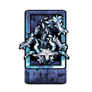](Icebound_Beast.md) | - | 3x | 普通 | [白雪海岸（The SNOWYxSHORES）](The_SNOWYxSHORES.md)  |
| [冰封指环（Icebound Band）](Icebound_Band.md) | [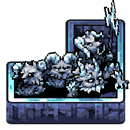](Icebound_Band.md) | - | 4x | 普通 | [白雪海岸（The SNOWYxSHORES）](The_SNOWYxSHORES.md)  |
| [冰封要塞（Icebound Bastion）](Icebound_Bastion.md) | [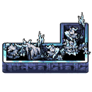](Icebound_Bastion.md) | - | 6x | 普通 | [白雪海岸（The SNOWYxSHORES）](The_SNOWYxSHORES.md)  |
| [冰封持盾者（Icebound Shieldbearer）](Icebound_Shieldbearer.md) | [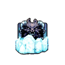](Icebound_Shieldbearer.md) | 护盾一侧免疫圆球的伤害。 | 1x | 普通 | [白雪海岸（The SNOWYxSHORES）](The_SNOWYxSHORES.md)  |
| [冰封投掷者（Icebound Hurler）](Icebound_Hurler.md) | [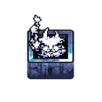](Icebound_Hurler.md) | 向玩家投掷冰柱，命中时使玩家冻结。 | 1x | 普通 | [白雪海岸（The SNOWYxSHORES）](The_SNOWYxSHORES.md)  |
| [冰封勇士（Icebound Champion）](Icebound_Champion.md) | [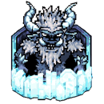](Icebound_Champion.md) | 正面免疫圆球的伤害 | 20x | 小首领 | [白雪海岸（The SNOWYxSHORES）](The_SNOWYxSHORES.md)  |
| [冰封嚎兽（Icebound Howler）](Icebound_Howler.md) | [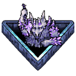](Icebound_Howler.md) | 向玩家投掷多个冰柱，命中时将其冻结。 | 20x | 小首领 | [白雪海岸（The SNOWYxSHORES）](The_SNOWYxSHORES.md)  |
| [冰封女王（Icebound Queen）](Icebound_Queen.md) | [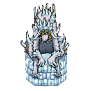](Icebound_Queen.md) | - | - | 关卡首领 | [白雪海岸（The SNOWYxSHORES）](The_SNOWYxSHORES.md)  |
| [蜥蜴（Lizard）](Lizard.md) | [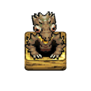](Lizard.md) | - | 1x | 普通 | [边境沙漠（The LIMINALxDESERT）](The_LIMINALxDESERT.md)  |
| [蛮力蜥蜴（Lizard Brute）](Lizard_Brute.md) | [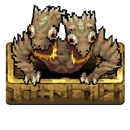](Lizard_Brute.md) | - | 3x | 普通 | [边境沙漠（The LIMINALxDESERT）](The_LIMINALxDESERT.md)  |
| [滑蜥（Slizard）](Slizard.md) | [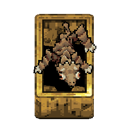](Slizard.md) | - | 3x | 普通 | [边境沙漠（The LIMINALxDESERT）](The_LIMINALxDESERT.md)  |
| [蜥蜴壮汉（Lizard Strongman）](Lizard_Strongman.md) | [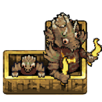](Lizard_Strongman.md) | - | 4x | 普通 | [边境沙漠（The LIMINALxDESERT）](The_LIMINALxDESERT.md)  |
| [蜥蜴堡垒（Lizard Bastion）](Lizard_Bastion.md) | [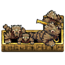](Lizard_Bastion.md) | - | 6x | 普通 | [边境沙漠（The LIMINALxDESERT）](The_LIMINALxDESERT.md)  |
| [激光蝗虫（Laser Locust）](Laser_Locust.md) | [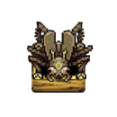](Laser_Locust.md) | 瞄准并发射激光攻击玩家 | 1x | 普通 | [边境沙漠（The LIMINALxDESERT）](The_LIMINALxDESERT.md)  |
| [蠕虫（Worm）](Worm.md) | [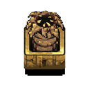](Worm.md) | 潜入地下，每次出现都会向玩家吐出毒液。 | 1x | 普通 | [边境沙漠（The LIMINALxDESERT）](The_LIMINALxDESERT.md)  |
| [踏沙者（Sandwalker）](Sandwalker.md) | [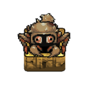](Sandwalker.md) | 左右移动 | 2x | 普通 | [边境沙漠（The LIMINALxDESERT）](The_LIMINALxDESERT.md)  |
| [变形眼镜蛇（Shifting Cobra）](Shifting_Cobra.md) | [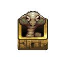](Shifting_Cobra.md) | 在方形和菱形平台之间切换 | 1x | 普通 | [边境沙漠（The LIMINALxDESERT）](The_LIMINALxDESERT.md)  |
| [沙漠哨兵（Desert Sentinel）](Desert_Sentinel.md) | [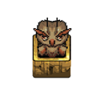](Desert_Sentinel.md) | 有一个旋转平台 | 1x | 普通 | [边境沙漠（The LIMINALxDESERT）](The_LIMINALxDESERT.md)  |
| [狂怒蝗虫（Seething Locust）](Seething_Locust.md) | [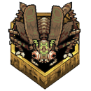](Seething_Locust.md) | 向玩家发射一道巨大的激光束 | 20x | 小首领 | [边境沙漠（The LIMINALxDESERT）](The_LIMINALxDESERT.md)  |
| [巨型哨兵（Great Sentinel）](Great_Sentinel.md) | [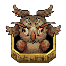](Great_Sentinel.md) | 有一个大型旋转平台 | 20x | 小首领 | [边境沙漠（The LIMINALxDESERT）](The_LIMINALxDESERT.md)  |
| [扭曲之蛇（Twisted Serpent）](Twisted_Serpent.md) | [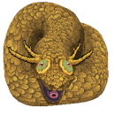](Twisted_Serpent.md) | - | - | 关卡首领 | [边境沙漠（The LIMINALxDESERT）](The_LIMINALxDESERT.md)  |
| [蘑菇战士（Shroom Fighter）](Shroom_Fighter.md) | [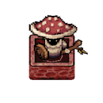](Shroom_Fighter.md) | - | 1x | 普通 | [真菌森林（The FUNGALxFOREST）](The_FUNGALxFOREST.md)  |
| [双生蘑菇（Twin Shrooms）](Twin_Shrooms.md) | [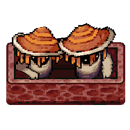](Twin_Shrooms.md) | - | 3x | 普通 | [真菌森林（The FUNGALxFOREST）](The_FUNGALxFOREST.md)  |
| [潜行菇（Shroom Stalker）](Shroom_Stalker.md) | [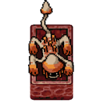](Shroom_Stalker.md) | - | 3x | 普通 | [真菌森林（The FUNGALxFOREST）](The_FUNGALxFOREST.md)  |
| [层架菌（Bracket Fungus）](Bracket_Fungus.md) | [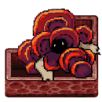](Bracket_Fungus.md) | - | 4x | 普通 | [真菌森林（The FUNGALxFOREST）](The_FUNGALxFOREST.md)  |
| [金针菇丛（Enoki Cluster）](Enoki_Cluster.md) | [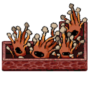](Enoki_Cluster.md) | - | 6x | 普通 | [真菌森林（The FUNGALxFOREST）](The_FUNGALxFOREST.md)  |
| [爆炸菇（Boomshroom）](Boomshroom.md) | [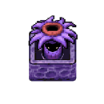](Boomshroom.md) | 发射一个弹丸到空中，经过延迟后落在你附近。 | 1x | 普通 | [真菌森林（The FUNGALxFOREST）](The_FUNGALxFOREST.md)  |
| [虫草喷吐者（Cordyceps Spitter）](Cordyceps_Spitter.md) | [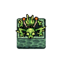](Cordyceps_Spitter.md) | 焦油飞溅向玩家，在命中时会使他们减速。 | 1x | 普通 | [真菌森林（The FUNGALxFOREST）](The_FUNGALxFOREST.md)  |
| [冲锋菇（Rushroom）](Rushroom.md) | [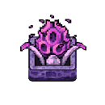](Rushroom.md) | 提高附近敌人的移动速度 | 1x | 普通 | [真菌森林（The FUNGALxFOREST）](The_FUNGALxFOREST.md)  |
| [爆鸣菇（Shroomboomer）](Shroomboomer.md) | [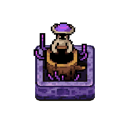](Shroomboomer.md) | 命中时发射一个小弹丸到空中，该弹丸会在延迟后落在玩家附近。 | 1x | 普通 | [真菌森林（The FUNGALxFOREST）](The_FUNGALxFOREST.md)  |
| [虫草女王（Cordyceps Queen）](Cordyceps_Queen.md) | [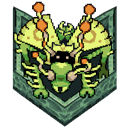](Cordyceps_Queen.md) | 向玩家发射多个焦油团，这些焦油团在命中时会使敌人减速。 | 20x | 小首领 | [真菌森林（The FUNGALxFOREST）](The_FUNGALxFOREST.md)  |
| [长老爆炸菇（Elder Boomshroom）](Elder_Boomshroom.md) | [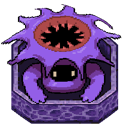](Elder_Boomshroom.md) | 发射出一个大型弹丸到空中，在延迟后落在你附近。 | 20x | 小首领 | [真菌森林（The FUNGALxFOREST）](The_FUNGALxFOREST.md)  |
| [菇群（Shroom Swarm）](Shroom_Swarm.md) |  | - | - | 关卡首领 | [真菌森林（The FUNGALxFOREST）](The_FUNGALxFOREST.md)  |
| [座狼（Warg）](Warg.md) | [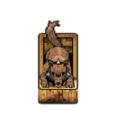](Warg.md) | - （可以与 [座狼骑手](Warg_Rider.md) 或 [座狼弓手](Warg_Archer.md) 叠放） | 1x | 普通 | [血腥草原（The GORYxGRASSLANDS）](The_GORYxGRASSLANDS.md)  |
| [座狼骑手（Warg Rider）](Warg_Rider.md) | [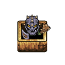](Warg_Rider.md) | - （可堆叠使用 [座狼](Warg.md)） | 1x | 普通 | [血腥草原（The GORYxGRASSLANDS）](The_GORYxGRASSLANDS.md)  |
| [座狼弓手（Warg Archer）](Warg_Archer.md) | [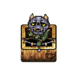](Warg_Archer.md) | - （可堆叠使用 [座狼](Warg.md)） | 1x | 普通 | [血腥草原（The GORYxGRASSLANDS）](The_GORYxGRASSLANDS.md)  |
| [老鼠（Mouse）](Mouse.md) | [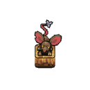](Mouse.md) | - | 1x | 普通 | [血腥草原（The GORYxGRASSLANDS）](The_GORYxGRASSLANDS.md)  |
| [远古座狼（Ancient Warg）](Ancient_Warg.md) | [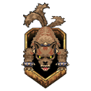](Ancient_Warg.md) | - （与 [哥布林军阀](Goblin_Warlord.md) 或 [哥布林狙击手](Goblin_Sniper.md) 同时出现） | 20x | 小首领 | [血腥草原（The GORYxGRASSLANDS）](The_GORYxGRASSLANDS.md)  |
| [哥布林军阀（Goblin Warlord）](Goblin_Warlord.md) | [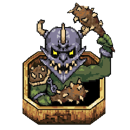](Goblin_Warlord.md) | - （与 [远古座狼](Ancient_Warg.md) 堆叠出现） | 20x | 小首领 | [血腥草原（The GORYxGRASSLANDS）](The_GORYxGRASSLANDS.md)  |
| [哥布林狙击手（Goblin Sniper）](Goblin_Sniper.md) | [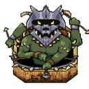](Goblin_Sniper.md) | - （与 [远古座狼](Ancient_Warg.md) 堆叠出现） | 20x | 小首领 | [血腥草原（The GORYxGRASSLANDS）](The_GORYxGRASSLANDS.md)  |
| [剑齿兽（Sabertooth）](Sabertooth.md) |  | - | - | 关卡首领 | [血腥草原（The GORYxGRASSLANDS）](The_GORYxGRASSLANDS.md)  |
| [幼龙（Dragonling）](Dragonling.md) |  | - | 1x | 普通 | [阴燃深渊（The SMOLDERINGxDEPTHS）](The_SMOLDERINGxDEPTHS.md)  |
| [蛮力幼龙（Dragonling Brute）](Dragonling_Brute.md) |  | - | 3x | 普通 | [阴燃深渊（The SMOLDERINGxDEPTHS）](The_SMOLDERINGxDEPTHS.md)  |
| [幼龙奴仆（Dragonling Thrall）](Dragonling_Thrall.md) |  | - | 3x | 普通 | [阴燃深渊（The SMOLDERINGxDEPTHS）](The_SMOLDERINGxDEPTHS.md)  |
| [幼龙屠夫（Dragonling Butcher）](Dragonling_Butcher.md) |  | - | 4x | 普通 | [阴燃深渊（The SMOLDERINGxDEPTHS）](The_SMOLDERINGxDEPTHS.md)  |
| [幼龙氏族（Dragonling Clan）](Dragonling_Clan.md) |  | - | 6x | 普通 | [阴燃深渊（The SMOLDERINGxDEPTHS）](The_SMOLDERINGxDEPTHS.md)  |
| [幼虫群（Grub Cluster）](Grub_Cluster.md) |  | 被摧毁时爆炸成一群 [幼虫（Grubs）](Grub.md) | 1x | 普通 | [阴燃深渊（The SMOLDERINGxDEPTHS）](The_SMOLDERINGxDEPTHS.md)  |
| [幼虫（Grub）](Grub.md) |  |  | 0.5x | 普通 | [阴燃深渊（The SMOLDERINGxDEPTHS）](The_SMOLDERINGxDEPTHS.md)  |
| [喷火者（Firespitter）](Firespitter.md) |  | 向玩家发射火球 | 1.5x | 普通 | [阴燃深渊（The SMOLDERINGxDEPTHS）](The_SMOLDERINGxDEPTHS.md)  |
| [幼虫母体（Grub Mother）](Grub_Mother.md) |  | 随着时间推移，会刷出 [幼虫（Grubs）](Grub.md)。 | 1x | 普通 | [阴燃深渊（The SMOLDERINGxDEPTHS）](The_SMOLDERINGxDEPTHS.md)  |
| [巨型幼虫群（Great Grub Cluster）](Great_Grub_Cluster.md) |  | 被摧毁时爆炸成一群 [Grub Clusters](Grub_Cluster.md) | 20x | 小首领 | [阴燃深渊（The SMOLDERINGxDEPTHS）](The_SMOLDERINGxDEPTHS.md)  |
| [喷焰者（Flamespitter）](Flamespitter.md) |  | 向玩家喷射出一连串火球 | 20x | 小首领 | [阴燃深渊（The SMOLDERINGxDEPTHS）](The_SMOLDERINGxDEPTHS.md)  |
| [龙王子（Dragon Prince）](Dragon_Prince.md) |  | - | - | 关卡首领 | [阴燃深渊（The SMOLDERINGxDEPTHS）](The_SMOLDERINGxDEPTHS.md)  |
| [天使眷属（Angelspawn）](Angelspawn.md) |  | - | 1x | 普通 | [天堂之门（The HEAVENLYxGATES）](The_HEAVENLYxGATES.md)  |
| [双头天使（Angelic Twinhead）](Angelic_Twinhead.md) |  | - | 3x | 普通 | [天堂之门（The HEAVENLYxGATES）](The_HEAVENLYxGATES.md)  |
| [天使巨鸮（Angelic Great Owl）](Angelic_Great_Owl.md) |  | - | 3x | 普通 | [天堂之门（The HEAVENLYxGATES）](The_HEAVENLYxGATES.md)  |
| [天使眷属狂战士（Angelspawn Berserker）](Angelspawn_Berserker.md) |  | - | 4x | 普通 | [天堂之门（The HEAVENLYxGATES）](The_HEAVENLYxGATES.md)  |
| [天使眷属唱诗班（Angelspawn Choir）](Angelspawn_Choir.md) |  | - | 6x | 普通 | [天堂之门（The HEAVENLYxGATES）](The_HEAVENLYxGATES.md)  |
| [有翼天使眷属（Winged Angelspawn）](Winged_Angelspawn.md) |  | 偶尔会飞到空中。在空中时无法被球击中。 | 1x | 普通 | [天堂之门（The HEAVENLYxGATES）](The_HEAVENLYxGATES.md)  |
| [有翼天使眷属斥候（Winged Angelspawn Scout）](Winged_Angelspawn_Scout.md) |  | 偶尔飞到空中发射箭矢。在空中时不会被球击中。 | 1x | 普通 | [天堂之门（The HEAVENLYxGATES）](The_HEAVENLYxGATES.md)  |
| [天使眷属女祭司（Angelspawn Priestess）](Angelspawn_Priestess.md) |  | 偶尔治疗附近的敌人 | 1x | 普通 | [天堂之门（The HEAVENLYxGATES）](The_HEAVENLYxGATES.md)  |
| [天使眷属掠夺者（Angelspawn Snatcher）](Angelspawn_Snatcher.md) |  | 捕获并握住你的其中一个球，直到将其销毁 | 2x | 普通 | [天堂之门（The HEAVENLYxGATES）](The_HEAVENLYxGATES.md)  |
| [丘比特（Cupid）](Cupid.md) |  | 向玩家发射归射箭矢 | 2x | 普通 | [天堂之门（The HEAVENLYxGATES）](The_HEAVENLYxGATES.md)  |
| [不安者（Restless One）](Restless_One.md) |  | 偶尔飞向空中 | 20x | 小首领 | [天堂之门（The HEAVENLYxGATES）](The_HEAVENLYxGATES.md)  |
| [枯瘦劫掠者（Wizened Snatcher）](Wizened_Snatcher.md) |  | 每次可接住并扣留你的 3 颗圆球。 | 20x | 小首领 | [天堂之门（The HEAVENLYxGATES）](The_HEAVENLYxGATES.md)  |
| [猫头鹰领主（Lord of Owls）](Lord_of_Owls.md) |  | - | - | 关卡首领 | [天堂之门（The HEAVENLYxGATES）](The_HEAVENLYxGATES.md)  |
| [月灵（Moonling）](Moonling.md) |  | - | 1x | 普通 | [浩瀚虚空（The VASTxVOID）](The_VASTxVOID.md)  |
| [月灵弓箭手（Moonling Archer）](Moonling_Archer.md) |  | 向玩家扔石头 | 1x | 普通 | [浩瀚虚空（The VASTxVOID）](The_VASTxVOID.md)  |
| [月灵晶洞（Moonling Geode）](Moonling_Geode.md) |  | 被摧毁时瞬间爆炸成几块 [月岩（Moonrocks）](Moonrock.md) | 1x | 普通 | [浩瀚虚空（The VASTxVOID）](The_VASTxVOID.md)  |
| [月岩（Moonrock）](Moonrock.md) |  | - | 0.5x | 普通 | [浩瀚虚空（The VASTxVOID）](The_VASTxVOID.md)  |
| [虚空幼体（Voidling）](Voidling.md) |  | 所有球都能穿透这个敌人 | 1x | 普通 | [浩瀚虚空（The VASTxVOID）](The_VASTxVOID.md)  |
| [新月月灵（Crescent Moonling）](Crescent_Moonling.md) |  | - | 4x | 普通 | [浩瀚虚空（The VASTxVOID）](The_VASTxVOID.md)  |
| [残月月灵（Waning Moonling）](Waning_Moonling.md) |  | - | 6x | 普通 | [浩瀚虚空（The VASTxVOID）](The_VASTxVOID.md)  |
| [月族（Moonkin）](Moonkin.md) |  | - | 20x | 小首领 | [浩瀚虚空（The VASTxVOID）](The_VASTxVOID.md)  |
| [月族晶洞（Moonkin Geode）](Moonkin_Geode.md) |  | 爆炸成几颗 [月精灵晶石](Moonling_Geode.md) | 16x | 小首领 | [浩瀚虚空（The VASTxVOID）](The_VASTxVOID.md)  |
| [月球（The Moon）](The_Moon.md) |  | - | - | 关卡首领 | [浩瀚虚空（The VASTxVOID）](The_VASTxVOID.md)  |

[返回总入口](../%E7%90%83%E6%AF%94%E4%BC%A6%E6%88%98%E8%AE%B0%20Wiki.md) · [返回本分目录](%E7%9B%AE%E5%BD%95.md)
