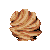

# 侵蚀（Erosion）

通过敌人。 将敌人目前身体的3%/ 4%/ 5%作为意外伤害。

[原文与贡献者记录](https://ballxpit.wiki.gg/wiki/Erosion) · [修订 4233](https://ballxpit.wiki.gg/index.php?oldid=4233) · [返回目录](../%E7%90%83%E6%AF%94%E4%BC%A6%E6%88%98%E8%AE%B0%20Wiki.md)

#### 一般信息

##### 由

[时间](Time.md)  + [风](Wind.md) 

##### 开始的性格

-

##### 命中效果（On-Hit Effects）

通过

##### 状态效果（Status Effects）

?

##### 由于状态影响

命中时

#### 进化配方

|  |  |  |  |  |  |  |
| --- | --- | --- | --- | --- | --- | --- |
|  |  |  |  |  |  |  |
| [时间（Time）](Time.md)  清除 SmolederingxDEPTHS 代码 |  |  |  | [风（Wind）](Wind.md)  |  |  |
|  |  |  |  |  |  |  |
|  |  | 侵蚀（Erosion） |  |  |  |  |

#### 关卡

| 等级 | 伤害 | 影响 |
| --- | --- | --- |
| 1 |  x(3.6至6.8) | 通过敌人，将敌人的3%，作为额外的伤害。 ／ |
| 2 |  x(3.6至6.8) | 通过敌人，将敌人的4%，作为额外的伤害。 ／ |
| 3 |  x(3.6至6.8) | 通过敌人，将敌人的5%，作为额外的伤害。 ／ |

#### 发展情况

*这个球不能进一步发展。*

#### 策略

大熔化: 石块x腐蚀( 熔化时首先选择石块): 将敌人400%的生命值作伤害处理。 (腐蚀 x Stone: 只处理5%的伤害。)

#### 更新记录

#### 冷知识

#### 图片库

[共享导航](../navigation/nav-63012059ef49.md)

**分类**　[分类 · 进化圆球](../categories/Evolved_Balls.md) · [分类 · 圆球](../categories/Balls.md) · [分类 · 页面有导航框](../categories/Pages_with_navboxes.md)

[返回总入口](../%E7%90%83%E6%AF%94%E4%BC%A6%E6%88%98%E8%AE%B0%20Wiki.md) · [返回本分目录](%E7%9B%AE%E5%BD%95.md)
