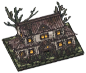

# 驱魔人（Exorcist）

在升级时添加驱逐升级的能力。

[原文与贡献者记录](https://ballxpit.wiki.gg/wiki/Exorcist) · [修订 3383](https://ballxpit.wiki.gg/index.php?oldid=3383) · [返回目录](../%E7%90%83%E6%AF%94%E4%BC%A6%E6%88%98%E8%AE%B0%20Wiki.md)

## 信息（Information）

### 分类（Category）

战争

### 子类（Subcategory）

将军

### 蓝图位置（Blueprint location）

[BONExYARD](The_BONExYARD.md)

### 基础资源消耗（Base resource cost）

 50  20

### 建造点消耗（Build point cost）

30

建成驱魔师后，可以在当前一局放逐特定升级，使它们在重抽选项或分配升级点时不再出现。升级建筑会提高每局可放逐的数量。可以放逐已取得的圆球和被动道具的升级，也可以放逐尚未获得的圆球或被动道具。放逐无法改动[宝石匠](Gemsmith.md)或[古董店](Antique_Shop.md)提供的奖励选项。使用[伪救世主](The_False_Messiah.md) 时无法使用放逐。开始下一局后，此前放逐的升级会重新出现。

被动效果与升级

| 等级 | 图片 | 说明 | 资源消耗 | 建造点消耗 | 拆除 |
| --- | --- | --- | --- | --- | --- |
| 1 |  | 在升级时增加驱逐升级的能力，最多可重复2次。 |  50  20 | 30 |  50  20 |
| 2 |  | 在升级时增加驱逐升级的能力，最多可重复 3 次 |  70  30 | 30 |  120  50 |
| 3 |  | 在升级时添加驱逐升级的能力，最多可触发4次。 |  105  45 | 90 |  225  95 |

[共享导航](../navigation/nav-d4956b01aa56.md)

**分类**　[分类 · 建筑](../categories/Buildings.md) · [分类 · 战争](../categories/Warfare.md) · [分类 · 通用](../categories/General.md) · [分类 · 带有导航框的页面](../categories/Pages_with_navboxes.md)

[返回总入口](../%E7%90%83%E6%AF%94%E4%BC%A6%E6%88%98%E8%AE%B0%20Wiki.md) · [返回本分目录](%E7%9B%AE%E5%BD%95.md)
