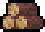
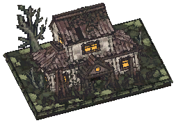
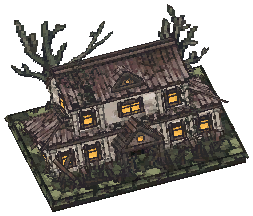

# 驱魔者（Exorcist）

在升级时，添加升级功能。

[原文与贡献者记录](https://ballxpit.wiki.gg/wiki/Exorcist) · [修订 3383](https://ballxpit.wiki.gg/index.php?oldid=3383) · [返回目录](../%E7%90%83%E6%AF%94%E4%BC%A6%E6%88%98%E8%AE%B0%20Wiki.md)

#### 信息（Information）

##### 分类（Category）

战争

##### 子类（Subcategory）

总

##### 蓝图位置（Blueprint location）

[BONExYARD](The_BONExYARD.md)

##### 基础资源消耗（Base resource cost）

 50  20

##### 建造点消耗（Build point cost）

30

构建驱魔器允许在同一级别运行期间，在重新滚动或花费升级点时再次出现特定升级的可能性， 通过建筑升级增加了可以在一次运行中被驱逐的总升级数量。注意，这包括已经获得的球和被动的排放水平升级以及全新的球和被动的排放水平升级，但这不能阻止球或被动的出现作为奖金的选择 [石家庄](Gemsmith.md) 或是 [古董店](Antique_Shop.md)在使用时，不能使用这种能力。 [伪救世主](The_False_Messiah.md)  在下一个级别开始时，被驱逐的升级再次出现。

被动效果与升级

| 等级 | 图片 | 描述 | 资源消耗 | 建造点消耗 | 拆除 |
| --- | --- | --- | --- | --- | --- |
| 1 |  | 在升级时，增加升级的功能，高达2倍 |  50  20 | 30 |  50  20 |
| 2 |  | 在升级时，增加升级的功能，高达3次 |  70  30 | 30 |  120  50 |
| 3 |  | 在升级时，增加升级的功能，高达4次 |  105  45 | 90 |  225  95 |

[共享导航](../navigation/nav-d4956b01aa56.md)

**分类**　[分类 · 建筑](../categories/Buildings.md) · [分类 · 战争](../categories/Warfare.md) · [分类 · 总](../categories/General.md) · [分类 · 页面有导航框](../categories/Pages_with_navboxes.md)

[返回总入口](../%E7%90%83%E6%AF%94%E4%BC%A6%E6%88%98%E8%AE%B0%20Wiki.md) · [返回本分目录](%E7%9B%AE%E5%BD%95.md)
