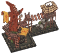

# 驯鹰小屋（Falconry Hut）

[原文与贡献者记录](https://ballxpit.wiki.gg/wiki/Falconry_Hut) · [修订 3405](https://ballxpit.wiki.gg/index.php?oldid=3405) · [返回目录](../%E7%90%83%E6%AF%94%E4%BC%A6%E6%88%98%E8%AE%B0%20Wiki.md)

[驯鹰人](The_Falconer.md)  的住宅。

## 信息（Information）

### 分类（Category）

住房

### 子类（Subcategory）

住房

### 蓝图位置（Blueprint location）

[天堂之门](The_HEAVENLYxGATES.md) 

### 基础资源消耗（Base resource cost）

 150  120

### 建造点消耗（Build point cost）

30

**驯鹰小屋** 是一个角色房屋 [建造](Buildings.md) 在 *[球比伦战记](Ball_x_Pit.md)*作为其中一部分被添加进来。 [Regal 更新](https://ballxpit.wiki.gg/wiki/Regal_Update?action=edit&redlink=1)建造猎鹰巢屋解锁 [驯鹰人](The_Falconer.md)  作为可游玩角色 [角色](Characters.md). 一旦 [角色获得足够的经验值](Character_Level_Mechanics.md) 达到等级4时，这座建筑会解锁一项被动能力，所有可使用的角色都会获得加成。  [速度](https://ballxpit.wiki.gg/wiki/Speed?action=edit&redlink=1) stat. 该建筑的能力可以通过以下方式进一步提升：而不是直接升级建筑本身，而是继续提升角色等级。注意，拆除角色的房屋将使该角色在收获模式或等级提升中无法使用，并使其从所有建筑任务中移除，直到其房屋重建为止（尽管该角色仍会保留之前的所有进度）。

被动效果与升级

| 等级 | 图片 | 说明 | 资源消耗 | 建造点消耗 | 拆除 | 角色等级要求 |
| --- | --- | --- | --- | --- | --- | --- |
| 1 |  | 给猎鹰者的一座房子 |  150  120 | 30 |  150  120 | - |
| 1 | - | 给猎鹰者的一座房子 所有角色均获得 +1 加成  [速度](https://ballxpit.wiki.gg/wiki/Speed?action=edit&redlink=1)。此加成会影响你的移动速度和球速。 | - | - |  150  120 | 4 |
| 2 | - | 给猎鹰者的一座房子 所有角色获得 +2 的加成  [速度](https://ballxpit.wiki.gg/wiki/Speed?action=edit&redlink=1)。这会影响你的移动速度和球速。 | - | - |  150  120 | 7 |
| 3 | - | 给猎鹰者的一座房子 所有角色均可获得 +3 的额外加成  [速度](https://ballxpit.wiki.gg/wiki/Speed?action=edit&redlink=1)。此效果会影响你的移动速度和球速。 | - | - |  150  120 | 9 |

[共享导航](../navigation/nav-d4956b01aa56.md)

**分类**　[分类 · 建筑](../categories/Buildings.md) · [分类 · 住房](../categories/Housing.md) · [分类 · 带有导航框的页面](../categories/Pages_with_navboxes.md)

[返回总入口](../%E7%90%83%E6%AF%94%E4%BC%A6%E6%88%98%E8%AE%B0%20Wiki.md) · [返回本分目录](%E7%9B%AE%E5%BD%95.md)
