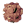
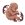
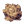

# 肉身（Flesh）

每次反弹，速度分别增加 25%/35%/40%

[原文与贡献者记录](https://ballxpit.wiki.gg/wiki/Flesh) · [修订 4189](https://ballxpit.wiki.gg/index.php?oldid=4189) · [返回目录](../%E7%90%83%E6%AF%94%E4%BC%A6%E6%88%98%E8%AE%B0%20Wiki.md)

## 基本信息

### 初始角色（Starting Character）

-

### 解锁

通关GORYxGRASSLANDS

### 状态效果（Status Effects）

-

## 进化（Evolutions）

### 进化成

[肉丘](Flesh_Mound.md) , [大出血](Hemorrhage.md) , [后代](Offspring.md) , [石化](Petrify.md) , [肿瘤](Tumor.md) , [僵尸](Zombie.md) 

**肉身** 是 [基础圆球](Balls.md#%E5%9F%BA%E7%A1%80%E5%9C%86%E7%90%83) 在游戏中引入 [自然学家更新](https://ballxpit.wiki.gg/wiki/The_Naturalist_Update?action=edit&redlink=1) 的 *[球比伦战记](Ball_x_Pit.md)*. 通过通关即可解锁。 [血腥草原](The_GORYxGRASSLANDS.md).

## 关卡

| 等级 | 伤害 | 效果 |
| --- | --- | --- |
| 1 |  x(3.5 至 6.5) | 每次反弹，速度增加25% |
| 2 |  x(3.5 至 6.5) | 每次反弹，速度增加35% |
| 3 |  x(3.5 至 6.5) | 每次反弹，速度增加40% |

## 进化

| 组合 | 进化 |
| --- | --- |
|  肉身（Flesh） + [育巢母体（Brood Mother）](Brood_Mother.md)  | [肉丘（Flesh Mound）](Flesh_Mound.md)  |
|  肉身（Flesh） + [流血（Bleed）](Bleed.md)  | [大出血（Hemorrhage）](Hemorrhage.md)  |
|  肉身（Flesh） + [细胞（Cell）](Cell.md)  | [后代（Offspring）](Offspring.md)  |
|  肉身（Flesh） + [石头（Stone）](Stone.md)  | [石化（Petrify）](Petrify.md)  |
|  肉身（Flesh） + [辐射束（Radiation Beam）](Radiation_Beam.md)  | [肿瘤（Tumor）](Tumor.md)  |
|  肉身（Flesh） + [吸血鬼（Vampire）](Vampire.md)  | [僵尸（Zombie）](Zombie.md)  |

## 策略

## 更新记录

## 冷知识

## 图片库

[共享导航](../navigation/nav-63012059ef49.md)

**分类**　[分类 · 基础圆球](../categories/Base_Balls.md) · [分类 · 圆球](../categories/Balls.md) · [分类 · 带有导航框的页面](../categories/Pages_with_navboxes.md)

[返回总入口](../%E7%90%83%E6%AF%94%E4%BC%A6%E6%88%98%E8%AE%B0%20Wiki.md) · [返回本分目录](%E7%9B%AE%E5%BD%95.md)
