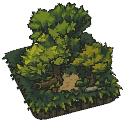

# 森林（Forest）

一个需要收获  木材的田地。

[原文与贡献者记录](https://ballxpit.wiki.gg/wiki/Forest) · [修订 3331](https://ballxpit.wiki.gg/index.php?oldid=3331) · [返回目录](../%E7%90%83%E6%AF%94%E4%BC%A6%E6%88%98%E8%AE%B0%20Wiki.md)

## 信息（Information）

### 分类（Category）

经济

### 子类（Subcategory）

资源

### 蓝图位置（Blueprint location）

- (默认解锁)

### 基础资源消耗（Base resource cost）

 50  2

### 建造点消耗（Build point cost）

0（即时）

**森林** 是一种资源 [建造](Buildings.md) 在 *[球比伦战记](Ball_x_Pit.md)* 并且是初始的 2x2 变体  游戏开始时，有可用的木材资源格。这个格会生长。  1以固定间隔进行，且仅持续到达到设定的最大容量为止。这两者都可以通过建造升级部件来提升，但始终会从...开始。  1 建造时。除了在收获模式期间的弹跳以及那些来自……的弹跳之外。 [采集者小屋](Gatherer_s_Hut.md)这个格也可以被被动地由它自己采集。 [伐木场](Lumberyard.md) 或者由…… [舒适的家](Cozy_Home.md) 一次 [同居者](The_Cohabitants.md)  已解锁该能力。与大多数建筑不同，此建筑以及“资源采集”子类别中的其他建筑，可以在玩家基地拥有必要的资源和空间的情况下，建造任意多次。

默认情况下，当角色从该格收获资源时，会反弹离开该格。不过，角色可以通过选择  [啄木鸟](https://ballxpit.wiki.gg/wiki/Woodpecker?action=edit&redlink=1) [升级](Harvest_Upgrades_Character_Bonus.md)来在穿过该格时继续收获资源。此外，角色还可以选择  [森林守护者](https://ballxpit.wiki.gg/wiki/Forester?action=edit&redlink=1) 或  [木材大师](https://ballxpit.wiki.gg/wiki/Wood_Master?action=edit&redlink=1) 进行升级，分别增加每次从该格收获的木材量或延长剩余收获时间。一旦 [激进者](The_Radical.md)  解锁了相关能力，附近的 [露营地](Campground.md) 也可以提高木材的再生率。

一旦解锁[大树](Grand_Tree.md)，森林功能即可被替代。

被动效果与升级

| 等级 | 图片 | 说明 | 资源消耗 | 建造点消耗 | 拆除 | 资源已创建 | 再生率 | 容量 |
| --- | --- | --- | --- | --- | --- | --- | --- | --- |
| 1 |  | 一个需要收获  木材的田地。 |  50  2 | 0（即时） |  50  2 |  木材 | 7.5 分钟 /  1 |  1 |
| 2 |  | 一个需要收获  木材的田地。 |  120  4 | 0（即时） |  170  6 |  木材 | 6分钟 /  1 |  3 |
| 3 |  | 一个需要收获  木材的田地。 |  180  6 | 0（即时） |  350  12 |  木材 | 4.5 分钟 /  1 |  5 |

[共享导航](../navigation/nav-d4956b01aa56.md)

**分类**　[分类 · 建筑](../categories/Buildings.md) · [分类 · 经济](../categories/Economy.md) · [分类 · 资源](../categories/Resources.md) · [分类 · 带有导航框的页面](../categories/Pages_with_navboxes.md)

[返回总入口](../%E7%90%83%E6%AF%94%E4%BC%A6%E6%88%98%E8%AE%B0%20Wiki.md) · [返回本分目录](%E7%9B%AE%E5%BD%95.md)
