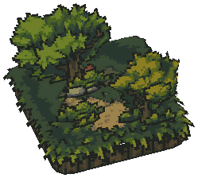
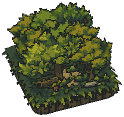

# 森林（Forest）

一个收获的田野  树木。

[原文与贡献者记录](https://ballxpit.wiki.gg/wiki/Forest) · [修订 3331](https://ballxpit.wiki.gg/index.php?oldid=3331) · [返回目录](../%E7%90%83%E6%AF%94%E4%BC%A6%E6%88%98%E8%AE%B0%20Wiki.md)

#### 信息（Information）

##### 分类（Category）

经济

##### 子类（Subcategory）

资源

##### 蓝图位置（Blueprint location）

- (默认解锁)

##### 基础资源消耗（Base resource cost）

 50  2

##### 建造点消耗（Build point cost）

0 (立即)

其他 **森林** 是一个资源 [建筑物](Buildings.md) 在 *[球比伦战记](Ball_x_Pit.md)* 并且是最初的2x2变体  游戏开始时可用的木材资源瓷砖。 此瓷砖生长  1在设定的间隔内，直到击中设定的最大容量为止，两者都可以通过建设升级来改进，但总是从  1在建时。除收割模式下的反弹或来自 [收藏家的小屋](Gatherer_s_Hut.md),这种瓷砖也可以被动地从 [木工场](Lumberyard.md) 或是 [舒适的家](Cozy_Home.md) 一次 [同居者](The_Cohabitants.md)  与大多数建筑物不同，资源和收集子类别中的这类和其他建筑物可以建造多次，只要玩家有必要的资源和空间。

默认情况下， 此瓷砖砖块会让字符在从中抓取时弹出字符， 但是字符可以选择  [啄木鸟](https://ballxpit.wiki.gg/wiki/Woodpecker?action=edit&redlink=1) [升级](Harvest_Upgrades_Character_Bonus.md) 来从这个瓷砖中获取资源，然后通过它。  [森林](https://ballxpit.wiki.gg/wiki/Forester?action=edit&redlink=1) 或是  [木材师](https://ballxpit.wiki.gg/wiki/Wood_Master?action=edit&redlink=1) 每次从这块瓷砖中收获时，分别提高木材收获量或增加剩余收获时钟。 [露营场](Campground.md) 一次 [激进者](The_Radical.md)  已经解锁了能力。

一旦解锁了[大树](Grand_Tree.md),森林就可以被功能取代。

被动效果与升级

| 等级 | 图片 | 描述 | 资源消耗 | 建造点消耗 | 拆除 | 创建资源 | 复兴率 | 产能 |
| --- | --- | --- | --- | --- | --- | --- | --- | --- |
| 1 |  | 一个收获的田野  树木。 |  50  2 | 0 (立即) |  50  2 |  木材 | 7.5分钟 /  1 |  1 |
| 2 |  | 一个收获的田野  树木。 |  120  4 | 0 (立即) |  170  6 |  木材 | 6分钟/  1 |  3 |
| 3 |  | 一个收获的田野  树木。 |  180  6 | 0 (立即) |  350  12 |  木材 | 时间为4.5分钟。  1 |  5 |

[共享导航](../navigation/nav-d4956b01aa56.md)

**分类**　[分类 · 建筑](../categories/Buildings.md) · [分类 · 经济](../categories/Economy.md) · [分类 · 资源](../categories/Resources.md) · [分类 · 页面有导航框](../categories/Pages_with_navboxes.md)

[返回总入口](../%E7%90%83%E6%AF%94%E4%BC%A6%E6%88%98%E8%AE%B0%20Wiki.md) · [返回本分目录](%E7%9B%AE%E5%BD%95.md)
