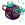
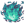
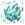
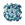
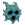
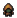
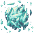

# 冻结（Freeze）

有 4% / 7% / 7% 的概率冻结敌人 5.0 / 5.0 / 8.0 秒。被冻结的敌人受到的伤害提高 25%。

[原文与贡献者记录](https://ballxpit.wiki.gg/wiki/Freeze) · [修订 4207](https://ballxpit.wiki.gg/index.php?oldid=4207) · [返回目录](../%E7%90%83%E6%AF%94%E4%BC%A6%E6%88%98%E8%AE%B0%20Wiki.md)

## 基本信息

### 初始角色（Starting Character）

[忏悔者](The_Repentant.md) 

### 解锁

默认解锁

### 状态效果（Status Effects）

[冻结](https://ballxpit.wiki.gg/wiki/Status_Effects?action=edit&redlink=1)

### 由状态效果触发

命中时

## 进化（Evolutions）

### 进化成

[暴风雪](Blizzard.md) , [元素](Elemental.md) , [冰冻射线](Freeze_Ray.md) , [冰冻火焰](Frozen_Flame.md) , [冰川](Glacier.md) , [时间停止](Timestop.md) , [毒液](Venom.md) , [怨灵](Wraith.md) 

**冻结** 是 [基础圆球](Balls.md#%E5%9F%BA%E7%A1%80%E5%9C%86%E7%90%83) 在基础游戏版本中引入 *[球比伦战记](Ball_x_Pit.md)*. 默认即可解锁。这是起始球。 [忏悔者](The_Repentant.md) .

## 关卡

| 等级 | 伤害 | 效果 |
| --- | --- | --- |
| 1 |  x(3.5 至 6.5) | 有4%的概率使敌人冻结5.0秒。被冻结的敌人受到的伤害增加25%。 |
| 2 |  x(3.5 至 6.5) | 有 7% 的概率将敌人冻结 5.0 秒。被冻结的敌人会受到额外 25% 的伤害。 |
| 3 |  x(3.5 至 6.5) | 有 7% 的概率使敌人冻结 8.0 秒。被冻结的敌人会受到额外 25% 的伤害。 |

## 进化

| 组合 | 进化 |
| --- | --- |
|  冻结（Freeze） + [闪电（Lightning）](Lightning.md)  ／  冻结（Freeze） + [风（Wind）](Wind.md)  | [暴风雪（Blizzard）](Blizzard.md)  |
|  冻结（Freeze） + [灼烧（Burn）](Burn.md)  + [风（Wind）](Wind.md)  + [地震（Earthquake）](Earthquake.md)  | [元素（Elemental）](Elemental.md)  |
|  冻结（Freeze） + [激光（水平）（Laser (Horizontal)）](Laser_Horizontal.md)  ／  冻结（Freeze） + [激光（垂直）（Laser (Vertical)）](Laser_Vertical.md)  | [冰冻射线（Freeze Ray）](Freeze_Ray.md)  |
|  冻结（Freeze） + [灼烧（Burn）](Burn.md)  | [冰冻火焰（Frozen Flame）](Frozen_Flame.md)  |
|  冻结（Freeze） + [地震（Earthquake）](Earthquake.md)  ／  冻结（Freeze） + [石头（Stone）](Stone.md)  | [冰川（Glacier）](Glacier.md)  |
|  冻结（Freeze） + [时间（Time）](Time.md)  | [时间停止（Timestop）](Timestop.md)  |
|  冻结（Freeze） + [中毒（Poison）](Poison.md)  | [毒液（Venom）](Venom.md)  |
|  冻结（Freeze） + [幽灵（Ghost）](Ghost.md)  | [怨灵（Wraith）](Wraith.md) （\*） |

* 可以进一步进化。

## 策略

## 更新记录

## 冷知识

## 图片库

[共享导航](../navigation/nav-63012059ef49.md)

**分类**　[分类 · 基础圆球](../categories/Base_Balls.md) · [分类 · 圆球](../categories/Balls.md) · [分类 · 带有导航框的页面](../categories/Pages_with_navboxes.md)

[返回总入口](../%E7%90%83%E6%AF%94%E4%BC%A6%E6%88%98%E8%AE%B0%20Wiki.md) · [返回本分目录](%E7%9B%AE%E5%BD%95.md)
