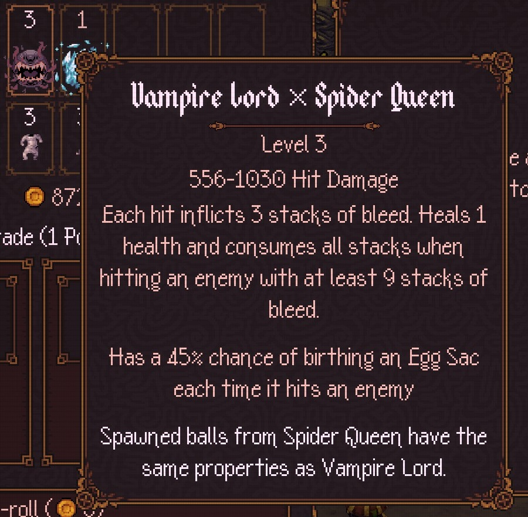

# 融合机制（Fusion Mechanics）

[原文与贡献者记录](https://ballxpit.wiki.gg/wiki/Fusion_Mechanics) · [修订 4217](https://ballxpit.wiki.gg/index.php?oldid=4217) · [返回目录](../%E7%90%83%E6%AF%94%E4%BC%A6%E6%88%98%E8%AE%B0%20Wiki.md)

##### 融合圆球

主题: 融合机制

引信弹泡和冻结球示例

合并球是通过合并其他2个球的球 *"未合并"* 3级特殊球，使用 [**聚合反应堆**](Fusion_Reactor.md)。可以将2个基球,2个进化球，甚至1个基球和1个进化球，但同一球不能与自身结合，如果2个球可以结合成一个进化球，那么你就可以 **我不能把它们合并。** 并且只能发展它们 (尽管这不适用于特殊球的对，其唯一的共同演变需要同时使用3个或更多的特殊球，如 [诺斯法拉图](Nosferatu.md)  或是 [基本](Elemental.md) ) 因此，有 `(90*89) {Special Ball Combos} - 87*2 {Evolution Combos} = 7836` 潜在的功能不同的融合球。

合并球将将合并它们的合并球的名称和效果，并且他们的图标也将被更新以匹配合并。例如，合并 **流血** 及 **冻结** 这将导致 **流血 × 冻结**, 具有两个能力, **流血** 及 **冻结**效果和统计的优先级取决于所涉及的组件球。 **合并球的顺序不会改变结果球的功能统计/能力**它的名称和外观将是不同的。 *五月* 视引信具体球(例如: **蛋袋X毒** 看起来就像 **毒 X蛋袋**然而, **蜘蛛女王X吸血鬼主** 完全不同于 **吸血鬼王 X 蜘蛛女王**注意，改变引信球顺序的唯一途径是改变它们获得的顺序， 此时不能手动选择核聚变的球顺序,

* 蛋袋X毒

  
* 毒 X蛋袋

  
* 蜘蛛女王X吸血鬼主

  
* 吸血鬼王 X 蜘蛛女王

  

##### 融合的能力

能力分为三类：

范围效果:对多个目标造成伤害。可以应用状态效应。

自来水:自来水的克隆人、婴儿球或苏门答腊。自来水的单位可以继承原球的能力。

状态效应:对目标进行调试，不能触发其他能力。

能力有4种不同的触发条件:当球击中目标时。当球损坏时。注意:核弹的辐射被视为损伤效应。当时:在固定的时间间隔上。当球击中时。

一般规则:

一般触发器规则

| 触发器类型 | 命中时 | 伤害 | 在时间表上 |
| --- | --- | --- | --- |
| 生成 | YES | YES | NO |
| 范围效果 | NO | YES | NO |
| 状态效果 | NO | NO | NO |

[返回总入口](../%E7%90%83%E6%AF%94%E4%BC%A6%E6%88%98%E8%AE%B0%20Wiki.md) · [返回本分目录](%E7%9B%AE%E5%BD%95.md)
