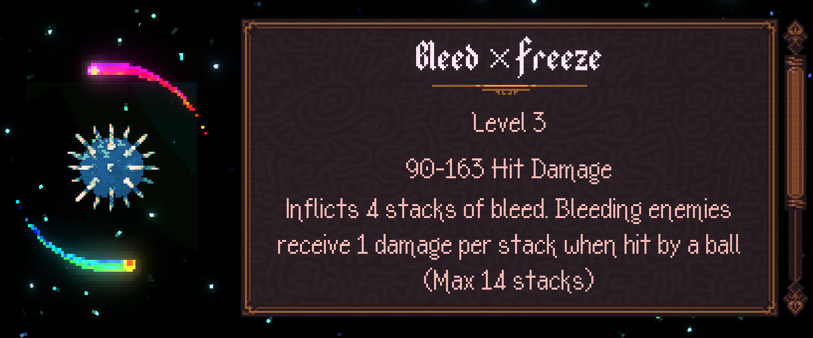
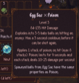
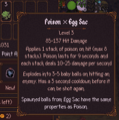
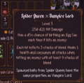

# 融合机制（Fusion Mechanics）

[原文与贡献者记录](https://ballxpit.wiki.gg/wiki/Fusion_Mechanics) · [修订 4217](https://ballxpit.wiki.gg/index.php?oldid=4217) · [返回目录](../%E7%90%83%E6%AF%94%E4%BC%A6%E6%88%98%E8%AE%B0%20Wiki.md)

### 融合圆球

主条目：融合机制

融合流血球和冻结球的示例

融合圆球（Fused Ball）由两颗尚未融合的 3 级特殊圆球通过[融合反应堆](Fusion_Reactor.md)合成。可以使用两颗基础圆球、两颗进化圆球，或者各用一颗。圆球不能与自身融合。如果两颗圆球可以直接进化成一种圆球，它们只能用于该进化。若共同进化还需要第 3 颗或更多圆球，这两颗仍可彼此融合，例如[诺斯费拉图（Nosferatu）](Nosferatu.md) 与[元素（Elemental）](Elemental.md) 的配方中的圆球。按原站公式，潜在融合组合数为 `90 × 89 − 87 × 2 = 7,836`。

融合圆球会组合两颗材料球的名称、效果与图标。例如，将**流血**和**冻结**融合为**流血 × 冻结（Bleed × Freeze）**，结果同时具有**流血**和**冻结**的能力。效果与数值如何合并，取决于参与融合的圆球。与进化不同，**融合材料的次序不影响最终数值和能力**，但会改变名称，也*可能*改变外观。比如**卵囊 × 中毒**和**中毒 × 卵囊**外观相同，**蜘蛛女王 × 吸血鬼领主**和**吸血鬼领主 × 蜘蛛女王**则使用不同的精灵图。融合次序由材料球的取得顺序决定，融合时无法手动调整。

* 卵囊 X 中毒

  
* 中毒 X 卵囊

  
* 蜘蛛女王 X 吸血鬼领主

  
* 吸血鬼领主 X 蜘蛛女王

  

### 融合技能

能力分为三类：

范围效果：对多个目标造成伤害。可施加状态效果。

生成：生成分身、小球或召唤物。生成的单位可以继承原始小球的能力。

状态效果：对目标施加负面状态。无法触发其他技能。

这些能力（Abilities）有 4 种不同的触发条件：On-Hit：当球击中目标时。On-Damage：当球造成伤害时（注意：核弹产生的辐射被视为伤害效果）。On-Timer：按固定的时间间隔触发。On-Shoot：当球发射时。

通用规则：

常见触发规则

| 触发类型 | 命中时 | 造成伤害时 | 定时 |
| --- | --- | --- | --- |
| 生成 | 是 | 是 | 否 |
| 范围效果 | 否 | 是 | 否 |
| 状态效果 | 否 | 否 | 否 |

[返回总入口](../%E7%90%83%E6%AF%94%E4%BC%A6%E6%88%98%E8%AE%B0%20Wiki.md) · [返回本分目录](%E7%9B%AE%E5%BD%95.md)
