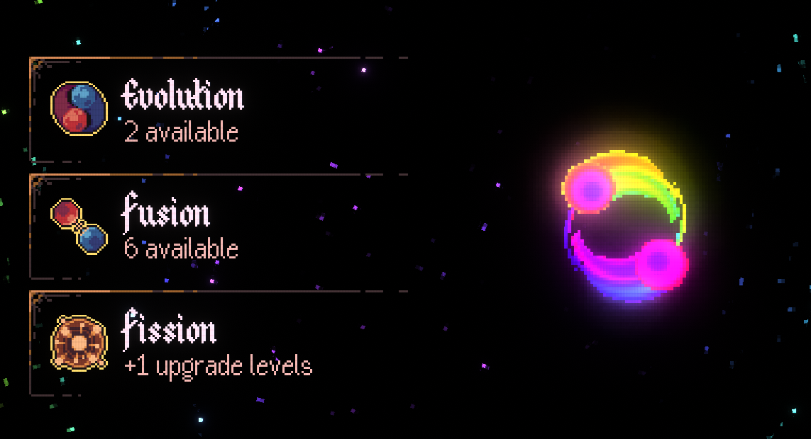
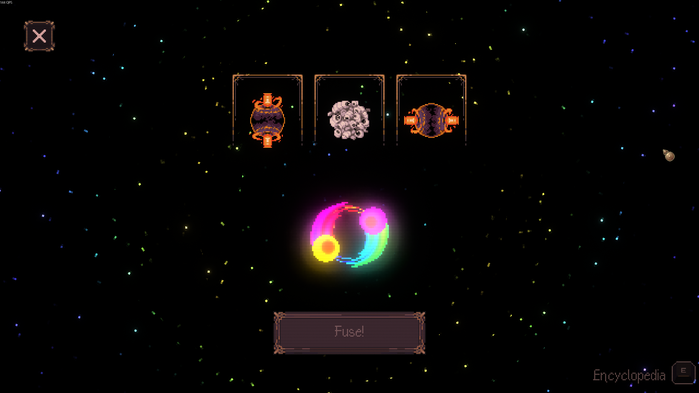

# 聚合反应堆（Fusion Reactor）

[原文与贡献者记录](https://ballxpit.wiki.gg/wiki/Fusion_Reactor) · [修订 2380](https://ballxpit.wiki.gg/index.php?oldid=2380) · [返回目录](../%E7%90%83%E6%AF%94%E4%BC%A6%E6%88%98%E8%AE%B0%20Wiki.md)

融合反应堆菜单

聚合反应堆是敌人有时放下的物品，你可以用几种不同的方式来提高你的功率水平。一些Fusion Reactor改进总是可选，但其他有某些要求，当玩家拿起它时必须满足。

#### 聚合反应堆

##### 裂变

这种选项总是可用的，它将奖励你随机数量的升级水平, [圆球](Balls.md) 及 [被动道具](Passives.md) 现在你已经在3级，然后Fission会给你一个随机金额。

##### 融合

主题: [融合机制](Fusion_Mechanics.md)

只有在您至少有 2 *unfused* 3级的球， 并且它允许您选择其中的2个球结合， 将它们的能力合并成一个球时， 才能使用融合。 这可以帮助为新球腾出一个空位。

聚变反应堆的聚变菜单

##### 进化

进化只能在你拥有所有必要的3级球或被动力 [进化圆球](Balls.md#%E8%BF%9B%E5%8C%96%E5%9C%86%E7%90%83) 或是 [进化被动](Passives.md#%E8%BF%9B%E5%8C%96%E8%A2%AB%E5%8A%A8)您可以从一个横向滚动的列表中选择一个演变。 这也会导致一个额外的球的插槽。

融合反应堆的进化菜单

**分类**　[分类 · 项目](../categories/Item.md)

[返回总入口](../%E7%90%83%E6%AF%94%E4%BC%A6%E6%88%98%E8%AE%B0%20Wiki.md) · [返回本分目录](%E7%9B%AE%E5%BD%95.md)
