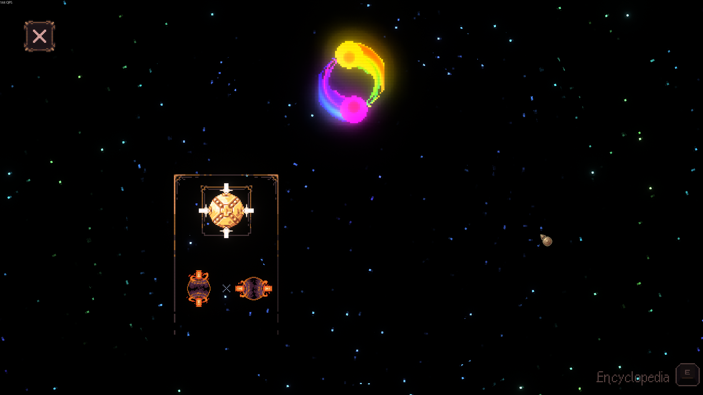

# 融合反应堆（Fusion Reactor）

[原文与贡献者记录](https://ballxpit.wiki.gg/wiki/Fusion_Reactor) · [修订 2380](https://ballxpit.wiki.gg/index.php?oldid=2380) · [返回目录](../%E7%90%83%E6%AF%94%E4%BC%A6%E6%88%98%E8%AE%B0%20Wiki.md)

融合反应堆菜单

融合反应堆是一种有时由敌人掉落的物品，你可以通过多种不同的方式利用它来提升单局游戏的战斗力。部分融合反应堆的增强效果始终作为选项提供，但其他效果则需要玩家在获得后满足特定条件才能使用。

## 融合反应堆

### 裂变

此选项始终可用，它将为您的球类和/或被动道具随机奖励一定数量的升级关卡。如果没有可用的升级选项（例如，如果您所有的…… [圆球](Balls.md) 及 [被动道具](Passives.md) 如果已达到 3 级，那么 Fission 将随机给予你一定数额的金币。

### 融合

主条目：[融合机制](Fusion_Mechanics.md)

融合功能仅在您拥有至少 2 个 *未融合*的 3 级球时可用，它允许您选择其中 2 个球进行融合，将它们的能力合并为一个球。这有助于腾出空间放置新球。

融合反应堆的融合菜单

### 进化

只有当你拥有制作一个或多个特定[进化圆球](Balls.md#%E8%BF%9B%E5%8C%96%E5%9C%86%E7%90%83)或[进化被动道具](Passives.md#%E8%BF%9B%E5%8C%96%E8%A2%AB%E5%8A%A8%E9%81%93%E5%85%B7)所需的全部3级圆球或被动道具时，才能进行进化。随后，你可以从横向滚动的列表中选择一个进行进化。这还将为你腾出一个额外的圆球位置。

融合反应堆的进化菜单

**分类**　[分类 · 物品](../categories/Item.md)

[返回总入口](../%E7%90%83%E6%AF%94%E4%BC%A6%E6%88%98%E8%AE%B0%20Wiki.md) · [返回本分目录](%E7%9B%AE%E5%BD%95.md)
