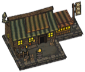
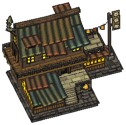

# 赌徒巢穴（Gambler's Den）

战斗中可免费重新进行升级尝试。

[原文与贡献者记录](https://ballxpit.wiki.gg/wiki/Gambler%27s_Den) · [修订 3379](https://ballxpit.wiki.gg/index.php?oldid=3379) · [返回目录](../%E7%90%83%E6%AF%94%E4%BC%A6%E6%88%98%E8%AE%B0%20Wiki.md)

## 信息（Information）

### 分类（Category）

战争

### 子类（Subcategory）

将军

### 蓝图位置（Blueprint location）

[GORYxGRASSLANDS](The_GORYxGRASSLANDS.md)

### 基础资源消耗（Base resource cost）

 50  5

### 建造点消耗（Build point cost）

5

建造赌徒巢穴会让玩家在每场战斗中获得一定次数的免费等级重置机会，通过建造升级装置可以增加这些次数。当所有免费重置机会用完后，将适用常规的重置费用。

使用[伪救世主](The_False_Messiah.md) 并开启升级投票时，这项能力基本失效。此时只有两种情况可重抽：只剩 1 个升级选项，或圆球与被动道具的栏位已满且全部升满（可选项只剩额外资源）。

被动效果与升级

| 等级 | 图片 | 说明 | 资源消耗 | 建造点消耗 | 拆除 |
| --- | --- | --- | --- | --- | --- |
| 1 |  | 每场战斗可获得2次免费的等级提升重投机会。 |  50  5 | 5 |  50  5 |
| 2 |  | 每场战斗可获得3次免费的等级提升重投机会。 |  120  8 | 5 |  170  13 |
| 3 |  | 每场战斗可免费获得4次等级提升重投机会。 |  180  12 | 15 |  350  25 |

[共享导航](../navigation/nav-d4956b01aa56.md)

**分类**　[分类 · 建筑](../categories/Buildings.md) · [分类 · 战争](../categories/Warfare.md) · [分类 · 通用](../categories/General.md) · [分类 · 带有导航框的页面](../categories/Pages_with_navboxes.md)

[返回总入口](../%E7%90%83%E6%AF%94%E4%BC%A6%E6%88%98%E8%AE%B0%20Wiki.md) · [返回本分目录](%E7%9B%AE%E5%BD%95.md)
