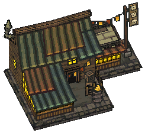
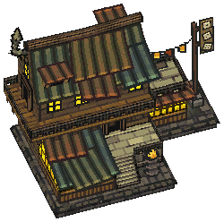

# 赌徒巢穴（Gambler's Den）

在战斗中获得自由升级。

[原文与贡献者记录](https://ballxpit.wiki.gg/wiki/Gambler%27s_Den) · [修订 3379](https://ballxpit.wiki.gg/index.php?oldid=3379) · [返回目录](../%E7%90%83%E6%AF%94%E4%BC%A6%E6%88%98%E8%AE%B0%20Wiki.md)

#### 信息（Information）

##### 分类（Category）

战争

##### 子类（Subcategory）

总

##### 蓝图位置（Blueprint location）

[GORYxGRASSLANDS](The_GORYxGRASSLANDS.md)

##### 基础资源消耗（Base resource cost）

 50  5

##### 建造点消耗（Build point cost）

5

正在构建赌博者角斗场时， 播放器每场比赛都有一定数量的自由水平再滚动， 其数量可以通过建筑物升级而增加。 一旦使用所有的免费再滚动， 再滚动的正常成本将适用。

在使用时 [伪救世主](The_False_Messiah.md)  如果有上级投票的选项，该功能将被有效取消，因为重复投票只有当剩下1个可能升级选项或当所有球和被动槽都满满和完全升级 (只有当选项是额外资源) 时才可使用。

被动效果与升级

| 等级 | 图片 | 描述 | 资源消耗 | 建造点消耗 | 拆除 |
| --- | --- | --- | --- | --- | --- |
| 1 |  | 获得2个免费级别升级每场战斗。 |  50  5 | 5 |  50  5 |
| 2 |  | 获得3个免费级别升级每场战斗。 |  120  8 | 5 |  170  13 |
| 3 |  | 获得4个免费级别升级每场战斗。 |  180  12 | 15 |  350  25 |

[共享导航](../navigation/nav-d4956b01aa56.md)

**分类**　[分类 · 建筑](../categories/Buildings.md) · [分类 · 战争](../categories/Warfare.md) · [分类 · 总](../categories/General.md) · [分类 · 页面有导航框](../categories/Pages_with_navboxes.md)

[返回总入口](../%E7%90%83%E6%AF%94%E4%BC%A6%E6%88%98%E8%AE%B0%20Wiki.md) · [返回本分目录](%E7%9B%AE%E5%BD%95.md)
