# 游戏更新（Game Updates）

[原文与贡献者记录](https://ballxpit.wiki.gg/wiki/Game_Updates) · [修订 4223](https://ballxpit.wiki.gg/index.php?oldid=4223) · [返回目录](../%E7%90%83%E6%AF%94%E4%BC%A6%E6%88%98%E8%AE%B0%20Wiki.md)

待完善

*此条目为 [待完善](../categories/Stubs.md). 你可以通过帮助 BALL x PIT 维基贡献一份力量。 [补充内容](https://ballxpit.wiki.gg/wiki/Game_Updates?action=edit).*

本页面包含关于 *[球比伦战记](Ball_x_Pit.md)* 过往补丁的信息，以及已知的未来更新内容。请注意，随着更多信息的公布，未来更新的信息可能会发生变化，某些功能可能最终不会纳入游戏。此外，目前无法游玩且尚未计划在未来更新中引入的内容，请前往 [测试版与删减内容](Beta_and_Cut_Content.md) 页面查询。

{TODO: 添加测试版发布/演示版的补丁说明}

## 过往更新

### 2025 年 11 月 5 日，11 月问题修复补丁

更新说明

* 更新百科词条，使用全彩图标
* 解决使用尚未通关该等级的最终角色通关时可能出现的软锁问题
* 重试操作将不再导致之前单局游戏中获得的资源丢失。
* 提升了 [市场](Market.md)的评分，恢复速度更快了
* 修复了 [赌场](Casino.md) 无法减少重新投掷成本的错误。
* 收获线不再从角色的最右侧开始。
* [采集者小屋（Gatherer's Hut）](Gatherer_s_Hut.md) 如果在工人外出时将其解绑，他们将无法无限收集。
* 加快收获速度后，收集的资源数量不再少于正常速度时的数量。
* [石兵](https://ballxpit.wiki.gg/wiki/Stone_Effigy?action=edit&redlink=1)在遭遇正在攻击你的小头目时，不再有时会陷入卡顿。
* 修复了在尝试将 [匹配](Matchmaker.md) [战士](The_Warrior.md)  与 [伪救世主](The_False_Messiah.md)  时显示的错误消息。
* [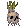](https://ballxpit.wiki.gg/wiki/Wretched_Onion) [可怜洋葱](https://ballxpit.wiki.gg/wiki/Wretched_Onion?action=edit&redlink=1) 的伤害现在随范围效果伤害倍数进行缩放。
* 修复了龙王子攻击在其他关卡中持续时间过长的错误。
* 使用 [采集者小屋](Gatherer_s_Hut.md) 建造的 [住房](Buildings.md#%E4%BD%8F%E6%88%BF) 现在能够正确解锁角色。
* 修复了以下漏洞：在 [边境沙漠](The_LIMINALxDESERT.md)  中，直到完成 [血腥草原](The_GORYxGRASSLANDS.md)  才能解锁最终蓝图。
* [激进者](The_Radical.md)  现在会自动选择复活，前提是您拥有 [死灵法师](Necromancer.md)
* 盟友或被施魔法的敌人不再导致最终首领无法正常进入
* 现在，带有冷却时间的[圆球](Balls.md)（[黑暗](Dark.md) , [黑洞](Black_Hole.md) ）的冷却时间变为[同居者](The_Cohabitants.md) 。
* [辐射束](Radiation_Beam.md) [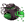](Radiation_Beam.md) 的范围效果伤害现在会在游戏统计界面中显示。
* 当工人在外面时，尝试更改 [采集者小屋](Gatherer_s_Hut.md) 的瞄准点时，不再出现软锁定现象。
* 修复了光标在屏幕上卡住的错误，该错误出现在 [物理学家](The_Physicist.md)  的情况下。
* 范围效果现在在连招中会触发 [避雷针](Lightning_Rod.md) 
* [啄木鸟](https://ballxpit.wiki.gg/wiki/Woodpecker?action=edit&redlink=1)[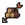](https://ballxpit.wiki.gg/wiki/Woodpecker)与[穿石者（Stonepiercer）](https://ballxpit.wiki.gg/wiki/Stonepiercer?action=edit&redlink=1)的加成现已可以穿透密集资源格。
* [激进者](The_Radical.md)  和 [沉思者](The_Cogitator.md)  无法再将球体与其融合。
* 当雪人女王处于地下时，你不能再伤害她了。
* [建筑](Buildings.md)无法放置在基地范围之外。
* 如果角色拥有的 [收获升级](Harvest_Upgrades_Character_Bonus.md)数量未达到应有的水平，那么下一次 [等级提升](Character_Level_Mechanics.md)将为你提供这些升级。
* 修复了以下漏洞：当角色作为第二角色引入时，无法获得 [收获升级](Harvest_Upgrades_Character_Bonus.md)。
* 如果长期忽略，Multiselect教程最终会停止显示。
* [作战室](War_Room.md)的角色不再从[角色](Characters.md)选择列表中消失
* 使用 [战术家](The_Tactician.md)  通关战场后，在升级界面时不再推进单位。
* [同居者](The_Cohabitants.md)  彼此之间的距离有限制吗
* 在基地内打开上下文菜单并同时尝试展开建筑区域，不再会导致导航问题。
* 在多次拆除过程中尝试多选时，不再会导致软锁现象。
* [战室](War_Room.md) 当角色更换时，单局游戏的奖励不会丢失。
* 在新游戏＋中，角色不能再仅进行位于 [作战室](War_Room.md) 的 [层](Levels.md) 任务，这些任务是在常规游戏中完成的。
* 结构 - [天堂之门奖杯](Heavenly_Trophy.md)在建造过程中不再显示为完全建成状态
* 从多个[金矿](Gold_Mine.md)收集到的金币数量现在与摘要屏幕显示的数量一致。
* 单局开始时，被动选择界面不再有时仅显示2个选项。
* 来自 [病毒](Virus.md)  的疾病状态不再传播到友方格子上。
* 单局中的击杀数在总结统计中与百科全书的统计数据一致。
* [同居者](The_Cohabitants.md)  - 现在可以发射那些能生成其他球的球，即使所有生成的球尚未返回。
* 记得上次进入等级选择时所在的NG+页面。
* 在动画过程中退出重新排列模式时，多升级功能将不再突出显示建筑。
* 当被击杀的敌人位于层底部时，[僵尸](Cursed_Elixir.md)将不再生成。
* 沙行者攻击时不再颤抖。
* 当被冻结时，Sandwalker 将不再移动。
* [物理学家](The_Physicist.md)  x [同居者](The_Cohabitants.md)  的速度不再过快
* 进入时，角色选择不再滚动到之前的选项。
* [真菌森林](The_FUNGALxFOREST.md)  等级不再提供比[血腥草原](The_GORYxGRASSLANDS.md)  更多的经验值。
* 各种拼写错误修正。
* 使用控制器从正常基础状态重新排列时，建筑不会错误地开始放置。
* 增加了在后台静音音频的选项。
* 现在按下上下方向键即可移动可操控角色。

### 2026-01-26: [皇家更新](https://ballxpit.wiki.gg/wiki/The_Regal_Update?action=edit&redlink=1)

更新说明

* 新游戏内容/功能
  + 2个新可玩角色 [角色（characters）](Characters.md)
    - [畅饮者](The_Carouser.md) 
    - [驯鹰人](The_Falconer.md) [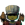](The_Falconer.md)
  + 新的游戏模式， [无尽模式](https://ballxpit.wiki.gg/wiki/Endless_Mode?action=edit&redlink=1)
    - 通过建造 [冒险者公会](Adventurer_s_Guild.md)解锁
  + 8个新内容 [圆球（balls）](Balls.md)
    - 1个新内容 [基础圆球](Balls.md#%E5%9F%BA%E7%A1%80%E5%9C%86%E7%90%83)
      * [石头（Stone）](Stone.md) 
    - 7个新内容 [进化圆球](Balls.md#%E8%BF%9B%E5%8C%96%E5%9C%86%E7%90%83)
      * [山崩](Landslide.md)  = [石头](Stone.md)  + [地震](Earthquake.md) [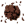](Earthquake.md)
      * [钢铁](Steel.md)  = [石头](Stone.md)  + [铁](Iron.md) 
      * [投石机](Catapult.md) [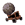](Catapult.md) = [石头](Stone.md)  + [卵囊](Egg_Sac.md) 
      * [硫磺](Brimstone.md) [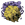](Brimstone.md) = ([石头](Stone.md)  或 [中毒](Poison.md) ) + [灼烧](Burn.md) 
      * [放逐之焰](Banished_Flame.md)  = [黑暗](Dark.md)  + [灼烧](Burn.md) 
      * [烟花](Fireworks.md)  = [卵囊](Egg_Sac.md)  + [灼烧](Burn.md) 
      * [激光切割机](Laser_Cutter.md) [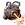](Laser_Cutter.md) = ([激光（垂直）](Laser_Vertical.md)  或 [激光（水平）](Laser_Horizontal.md) ) + [钢铁](Steel.md) 
    - 2种新的球比伦进化组合
      * [石头](Stone.md)  + [冻结](Freeze.md)  = [冰川](Glacier.md) 
      * [石头](Stone.md)  + [风](Wind.md)  = [沙暴](Sandstorm.md) 
  + 3个新 [被动道具（passives）](Passives.md)
    - 1个新内容 [基础被动](Passives.md#%E5%9F%BA%E7%A1%80%E8%A2%AB%E5%8A%A8%E9%81%93%E5%85%B7)
      * [铁制连体衣（Iron Onesie）](Iron_Onesie.md) 
    - 2个新内容 [进化被动道具](Passives.md#%E8%BF%9B%E5%8C%96%E8%A2%AB%E5%8A%A8%E9%81%93%E5%85%B7)
      * [怪异火炮](Grotesque_Artillery.md) [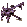](Grotesque_Artillery.md) = [炮塔](Turret.md)  +  [手扇](https://ballxpit.wiki.gg/wiki/Hand_Fan?action=edit&redlink=1)
      * [神射手穿刺矛](Deadeye_s_Impaler.md)  = [仁慈穿刺者](Gracious_Impaler.md)  + [神射手十字架](Deadeye_s_Cross.md) 
  + 3个新 [建筑（buildings）](Buildings.md)
    - [派对之家](Party_House.md) - 卡鲁瑟的家园
    - [驯鹰小屋](Falconry_Hut.md) - 猎鹰骑士的家园
    - [冒险者公会](Adventurer_s_Guild.md) - 解锁无尽模式
* 对现有游戏内容的修改
  + 待补充
* 漏洞修复
  + 待补充

### 2026-01-28：Regal更新热修复版（仅PC版）

更新说明

* 修复了在选项菜单中选择“随玩家移动光标”时出现软锁定问题。
  + 如 [此处](https://steamcommunity.com/app/2062430/discussions/1/694251506632779884/)所述

### 2026-04-27: [《球比伦战记》暗影更新](https://ballxpit.wiki.gg/wiki/The_Shadow_Update?action=edit&redlink=1)

更新说明

* 新游戏内容/功能
  + 2个新可玩角色 [角色（characters）](Characters.md)
    - [掘地者](The_Tunneller.md) 
    - [蹑足者（The Tiptoer）](The_Tiptoer.md) 
  + 11个新内容 [圆球（balls）](Balls.md)
    - 1个新内容 [基础圆球](Balls.md#%E5%9F%BA%E7%A1%80%E5%9C%86%E7%90%83)
      * [时间（Time）](Time.md) [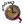](Time.md)
    - 10个新内容 [进化圆球](Balls.md#%E8%BF%9B%E5%8C%96%E5%9C%86%E7%90%83)
      * [时间停止](Timestop.md)  = [冻结](Freeze.md)  + [时间](Time.md) 
      * [侵蚀](Erosion.md)  = [风](Wind.md)  + [时间](Time.md) 
      * [扭曲](Warp.md)  = [光](Light.md)  + [时间](Time.md) 
      * [时间炸弹](Time_Bomb.md)  = [炸弹](Bomb.md)  + [时间](Time.md) 
      * [毒液](Venom.md)  = [冻结](Freeze.md)  + [中毒](Poison.md) 
      * [吞心者](Heart_Swallower.md)  = [幽灵](Ghost.md)  + [流血](Bleed.md) 
      * [死神](Reaper.md)  = [吞心者](Heart_Swallower.md)  + [吸魂者](Soul_Sucker.md) 
      * [X 射线](X_Ray.md)  = [激光束](Laser_Beam.md)  + [圣光激光](Holy_Laser.md) 
      * [女妖](Banshee.md)  = [怨灵](Wraith.md)  + [幻影](Phantom.md) 
      * [狙击手](Sniper.md)  = [刺客](Assassin.md)  + [霰弹枪](Shotgun.md) [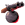](Shotgun.md)
    - 3种新的球比伦进化组合
      * [魅惑](Charm.md)  + [时间](Time.md)  = [迷恋](Lovestruck.md) 
      * [灼烧](Burn.md)  + [时间](Time.md)  = [炼狱](Inferno.md) 
      * [太阳](Sun.md)  + [时间](Time.md)  = [黑洞](Black_Hole.md) 
  + 4个新内容 [被动道具（passives）](Passives.md)
    - 1个新内容 [基础被动](Passives.md#%E5%9F%BA%E7%A1%80%E8%A2%AB%E5%8A%A8%E9%81%93%E5%85%B7)
      * [破剑者](Sword_Breaker.md) [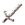](Sword_Breaker.md)
    - 3个新 [进化被动道具](Passives.md#%E8%BF%9B%E5%8C%96%E8%A2%AB%E5%8A%A8%E9%81%93%E5%85%B7)
      * [命运之箭](Arrow_of_Fate.md)  =  [手镜](https://ballxpit.wiki.gg/wiki/Hand_Mirror?action=edit&redlink=1) +  [恋人的箭袋](https://ballxpit.wiki.gg/wiki/Lover%27s_Quiver?action=edit&redlink=1)
      * [银质秒表](Argent_Stopwatch.md) [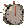](Argent_Stopwatch.md) = [银弹](Silver_Bullet.md)  + [沙漏](Hourglass.md) 
      * [全金属细剑](Full_Metal_Rapier.md)  = [破剑者](Sword_Breaker.md)  + [铁制连体衣](Iron_Onesie.md) 
  + 3个新 [建筑（buildings）](Buildings.md)
    - [石之领域](Stone_Domain.md) - 隧道者们的家园
    - [隐秘神殿](Hidden_Temple.md) - 蹑足者的家园
    - [公会大厅](Guild_Hall.md) - 允许重新滚动 [角色的收获升级](Harvest_Upgrades_Character_Bonus.md)
* 对现有游戏内容的修改
  + 待补充
* 漏洞修复
  + 待补充

### 2026-08-06: [自然学家更新](https://ballxpit.wiki.gg/wiki/The_Naturalist_Update?action=edit&redlink=1)

更新说明

* 新游戏内容/功能
  + 2个新可玩角色 [角色（characters）](Characters.md)
    - [持球者](The_Ballbearer.md) 
    - [白发囤积者](The_Hoary_Hoarder.md) 
  + 11个新内容 [圆球（balls）](Balls.md)
    - 1个新内容 [基础圆球](Balls.md#%E5%9F%BA%E7%A1%80%E5%9C%86%E7%90%83)
      * [肉身（Flesh）](Flesh.md) [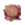](Flesh.md)
    - 10个新内容 [进化圆球](Balls.md#%E8%BF%9B%E5%8C%96%E5%9C%86%E7%90%83)
      * [石化（Petrify）](Petrify.md)  = [石头（Stone）](Stone.md)  + [肉身（Flesh）](Flesh.md) 
      * [肿瘤](Tumor.md)  = [辐射束](Radiation_Beam.md)  + [肉身](Flesh.md) 
      * [僵尸](Zombie.md)  = [吸血鬼](Vampire.md) [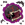](Vampire.md) + [肉身](Flesh.md) 
      * [后代](Offspring.md)  = [细胞](Cell.md)  + [肉身](Flesh.md) 
      * [肉丘](Flesh_Mound.md)  = [育巢母体](Brood_Mother.md)  + [肉身](Flesh.md) 
      * [闪电虫](Lightning_Bug.md)  = [育巢母体](Brood_Mother.md)  + [闪电](Lightning.md) 
      * [蚊子王国](Mosquito_Kingdom.md)  = [蚊王](Mosquito_King.md)  + [蚊群](Mosquito_Swarm.md) [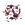](Mosquito_Swarm.md)
      * [钻头](Drill.md)  = [地震](Earthquake.md)  + [铁](Iron.md) 
      * [元素](Elemental.md)  = [地震](Earthquake.md)  + [灼烧](Burn.md)  + [冻结](Freeze.md)  + [风](Wind.md) 
      * [末日审判](Armageddon.md)  = [炼狱](Inferno.md)  + [风暴](Storm.md) 
    - 1个新球进化组合技
      * [流血](Bleed.md)  + [肉身](Flesh.md)  = [大出血](Hemorrhage.md) 
  + 5个新物品 [被动道具（passives）](Passives.md)
    - 1个新内容 [基础被动](Passives.md#%E5%9F%BA%E7%A1%80%E8%A2%AB%E5%8A%A8%E9%81%93%E5%85%B7)
      * [铂金哑铃](Platinum_Dumbbell.md) [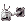](Platinum_Dumbbell.md)
    - 4个新内容 [进化被动道具](Passives.md#%E8%BF%9B%E5%8C%96%E8%A2%AB%E5%8A%A8%E9%81%93%E5%85%B7)
      * [无名战锤](Inglorious_Hammer.md) [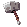](Inglorious_Hammer.md) = [铂金哑铃](Platinum_Dumbbell.md)  +  [翻转斧头](https://ballxpit.wiki.gg/wiki/Upturned_Hatchet?action=edit&redlink=1)
      * [炽热轮胎](Ardent_Tire.md)  =  [橡胶头带](https://ballxpit.wiki.gg/wiki/Rubber_Headband?action=edit&redlink=1) +  [马车轮](https://ballxpit.wiki.gg/wiki/Wagon_Wheel?action=edit&redlink=1)
      * [风织者](Windweaver.md)  = [瓶装龙卷风](Bottled_Tornado.md) [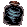](Bottled_Tornado.md) + [弹弓](Slingshot.md) 
      * [遥控起爆器](Remote_Detonator.md)  = [磁石](Magnet.md)  + [压力阀](Pressure_Valve.md) [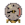](Pressure_Valve.md)
  + 2个新内容 [建筑（buildings）](Buildings.md)
    - [圆球屋](Ball_House.md) - 持球者的家园
    - [不稳定塔](Unstable_Tower.md) - 灰白宝藏的所在地
* 对现有游戏内容的修改
  + 待补充
* 漏洞修复
  + 待补充

## 计划中的更新

### 2026

2025 年 12 月 2 日，发行商 Devolver Digital 发布了 [预告片](https://www.youtube.com/watch?v=gCmmoL2Mtq0) 2026年期间计划发布3次免费内容更新： [Regal 更新](https://ballxpit.wiki.gg/wiki/Regal_Update?action=edit&redlink=1), the [暗影更新](https://ballxpit.wiki.gg/wiki/Shadow_Update?action=edit&redlink=1)，以及 [自然主义者更新](https://ballxpit.wiki.gg/wiki/Naturalist_Update?action=edit&redlink=1). 据说每次更新都会包含新内容。 [圆球](Balls.md), 进化, [建筑](Buildings.md)、 [角色](Characters.md)“以及更多。”每次更新都会通过褪色的横幅来预告两个新角色，并附带相应的标语。目前关于这些更新的其他信息尚不清楚，不过预告片的部分片段中也能看到一些新的建筑角色模型。

* 护盾持有者以及一名新角色，似乎就是皇家更新中备受期待的角色。

  [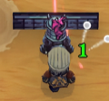](../files/Future_Content_-_2026_Updates_Vid_-_new_character_s_3_shieldbearer.png.md)
* 2个新角色，似乎是那些为“Shadow”更新所预热的角色。

  
* 一座周围环绕着飞行生物的新建筑，可能是新的角色住宅。

  [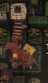](../files/Future_Content_-_2026_Updates_Vid_-_New_Building_1.png.md)
* 一座新的I形建筑

  [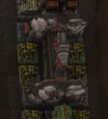](../files/Future_Content_-_2026_Updates_Vid_-_New_building_2.png.md)
* 一座新的蓝顶建筑

  [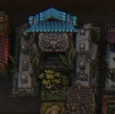](../files/Future_Content_-_2026_Updates_Vid_-_New_Building_3.png.md)
* 一个新的飞艇建筑，此前曾在 [数据挖掘的建筑精灵图](Beta_and_Cut_Content.md)中出现过。

  [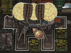](../files/Future_Content_-_2026_Updates_Vid_-_in-game_airship_full.png.md)

#### 王权更新（Regal Update），2026 年 1 月

[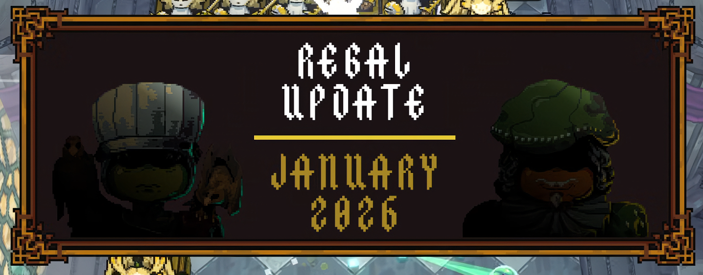](../files/Future_Content_-_2026_Updates_Vid_-_Regal_Update_banner.png.md)

“……由上流社会塑造的猎手们……”

#### 暗影更新（Shadow Update），2026 年 4 月

[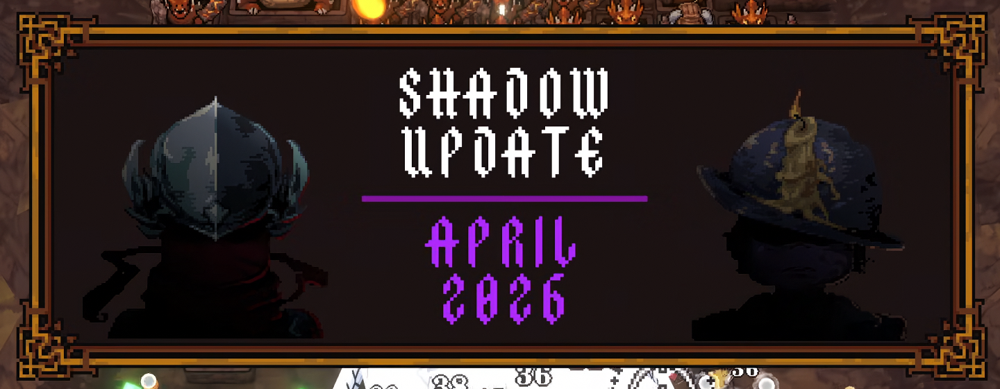](../files/Future_Content_-_2026_Updates_Vid_-_Shadow_Update_banner.png.md)

“……与精通欺骗之术的猎手们……”

#### 自然学家更新（Naturalist Update），2026 年 7 月

“……与那些在极端紧急情况下出战的猎手们……”

#### 重生球比伦（Risen Ballbylon），2026 年 11 月 12 日

9 月 20 日，Devolver Digital 上传了一段新的 [预告片](https://www.youtube.com/watch?v=HQ5YxcfgZ9w) 与此同时 [公告](https://store.steampowered.com/app/4008250/BALL_x_PIT_Risen_Ballbylon/) 作为付费DLC扩展包的内容 *[球比伦战记](Ball_x_Pit.md)* 标题 [重生球比伦](https://ballxpit.wiki.gg/wiki/Risen_Ballbylon?action=edit&redlink=1) 于 2026 年 11 月 12 日在所有已支持的平台推出。扩展包售价 6.99 美元，其中的新内容须完成本体游戏后才可解锁，包括：

* 4个新关卡，包含超过40种新敌人
* 8个新角色
* 45个新被动道具
* 24个新球
* 20座新建筑

**分类**　[分类 · 待完善](../categories/Stubs.md)

[返回总入口](../%E7%90%83%E6%AF%94%E4%BC%A6%E6%88%98%E8%AE%B0%20Wiki.md) · [返回本分目录](%E7%9B%AE%E5%BD%95.md)
