# 游戏更新（Game Updates）

[原文与贡献者记录](https://ballxpit.wiki.gg/wiki/Game_Updates) · [修订 4223](https://ballxpit.wiki.gg/index.php?oldid=4223) · [返回目录](../%E7%90%83%E6%AF%94%E4%BC%A6%E6%88%98%E8%AE%B0%20Wiki.md)

待补充条目

*这是一个 [待补充条目](../categories/Stubs.md)你可以帮助BALL xPIT Wiki通过 [补充此条目](https://ballxpit.wiki.gg/wiki/Game_Updates?action=edit).*

本页面包含关于过去的补丁的信息 *[球比伦战记](Ball_x_Pit.md)* 以及已知未来的更新。请注意，随着更多的更新，未来更新的信息可能会发生变化,此外，任何目前无法播放的内容或已知计划进行未来更新的内容都可以在 [测试版与删减内容](Beta_and_Cut_Content.md) 在页面上。

加入beta版本/demo的补丁说明

#### 过去的更新

##### 2025 年 11 月 5 日，11 月问题修复补丁

补丁说明

* 更新百科全书以使用全彩图标
* 修复可能的软锁当击败水平与你最后一个角色，尚未击败它
* 复试不再导致以前获得的资源丢失
* 改进的 [市场](Market.md) 率，率恢复到正常速度
* [赌场](Casino.md)没有降低再滚动成本的固定错误
* 收获目标线不再从角色的极右侧开始
* [收藏家的小屋](Gatherer_s_Hut.md) 工人再也不能无限聚集了，如果你在他们出局时将他们解职
* 提高收获速度不再导致收获的资源低于正常速度
* [Stone soldier](https://ballxpit.wiki.gg/wiki/Stone_Effigy?action=edit&redlink=1) 如果遇到攻击你的微型企业，他们就不能再被困住了
* 修复错误的消息，显示当你试图 [匹配机](Matchmaker.md) [战士（The Warrior）](The_Warrior.md)  在 [伪救世主（The False Messiah）](The_False_Messiah.md) 
*  [可怜洋葱（Wretched Onion）](https://ballxpit.wiki.gg/wiki/Wretched_Onion?action=edit&redlink=1) 现在的伤害量以范围效果伤害乘法
* 在其他层面中，龙王子的攻击可能会持续。
* [住房](Buildings.md#%E4%BD%8F%E6%88%BF) 采用 [收藏家的小屋（Gatherer's Hut）](Gatherer_s_Hut.md) 现在正确地解锁字符
* 修复了最终蓝图的错误 [边境沙漠（The LIMINALxDESERT）](The_LIMINALxDESERT.md)  在你完成之前，无法解锁。 [血腥草原（The GORYxGRASSLANDS）](The_GORYxGRASSLANDS.md) 
* [激进者（The Radical）](The_Radical.md)  现在，如果您有 [死灵法师（Necromancer）](Necromancer.md)
* 盟友或迷人的敌人不再导致最后的老板不进入正确
* [圆球（Balls）](Balls.md) 通过冷却 ([黑暗（Dark）](Dark.md) 、 [黑洞（Black Hole）](Black_Hole.md) ) 现在要冷却 [同居者（The Cohabitants）](The_Cohabitants.md) 
* [辐射束（Radiation Beam）](Radiation_Beam.md)  现在在游戏中可以追踪数据显示屏。
* 当工人已经退出时， 尝试更改 [收藏家的小屋](Gatherer_s_Hut.md) 目标时， 不再软锁
* 修复标记器在屏幕上的错误 [物理学家（The Physicist）](The_Physicist.md) 
* 目前适用于范围效果效应 [闪电棒（Lightning Rod）](Lightning_Rod.md)  在组合时
*  [啄木鸟（Woodpecker）](https://ballxpit.wiki.gg/wiki/Woodpecker?action=edit&redlink=1) /  [石头破碎者](https://ballxpit.wiki.gg/wiki/Stonepiercer?action=edit&redlink=1) 现在的奖金穿透密集的资源瓦
* [激进者（The Radical）](The_Radical.md)  及 [沉思者（The Cogitator）](The_Cogitator.md)  不能再把球与自己结合在一起
* 你不能再伤害耶蒂女王，只要它在地下。
* [建筑](Buildings.md) 不能再放置在基准界限之外
* 如果性格没有那么多 [收获升级](Harvest_Upgrades_Character_Bonus.md) 接下来, [升级](Character_Level_Mechanics.md) 我会给你一个
* 修复了错误，如果将字符作为第二个字符，字符不会获得 [收获升级](Harvest_Upgrades_Character_Bonus.md)
* 如果被忽视了足够长的时间,
* [战争室](War_Room.md) 字符不再从 [特征](Characters.md) 选择列表中消失
* 清除场 [战术家（The Tactician）](The_Tactician.md)  在升级屏幕上，不再向前推进单位
* 有限于距离 [同居者（The Cohabitants）](The_Cohabitants.md)  可以是彼此的
* 开放基础内文本菜单，同时尝试扩大建筑面积，不再导致导航问题
* 试图在多个解剖过程中进行多选择不再导致软锁
* [战争室的](War_Room.md) 运行奖励在指定字符更改时不再丢失
* 在新游戏+字符中，它们不再只能运行[战争室](War_Room.md)运行于[layers](Levels.md)它们经常完成
* 结构 - [天上的奖杯](Heavenly_Trophy.md) 不再显示在施工期间已完全建成
* 从多个[金矿](Gold_Mine.md) 收集的黄金数量现在与摘要屏幕显示的数字相似
* 在运行开始时的被动选择屏幕不再有时只显示2个
* 疾病状况 [病毒（Virus）](Virus.md)  友好瓷砖不再通行
* 运行总结中的杀人数现在符合百科全书的统计数据
* [同居者（The Cohabitants）](The_Cohabitants.md)  现在可以在所有产生的球返回之前发射其他球的球
* 在重新输入级别选择时记住以前的NG+页面
* 在动画中退出重组模式时，多次升级不再突出建筑物
* [僵尸](Cursed_Elixir.md) 当杀死的敌人是堆栈的底部时， 无法再产卵
* 沙步行者不再在攻击时感到紧张
* 冷冻后，沙行者不再移动
* [物理学家（The Physicist）](The_Physicist.md)  x [同居者（The Cohabitants）](The_Cohabitants.md)  球不再太快
* 查选择不再滚动到最初输入时的前选择
* [真菌森林（The FUNGALxFOREST）](The_FUNGALxFOREST.md)  水平不再提供更多的经验值 [血腥草原（The GORYxGRASSLANDS）](The_GORYxGRASSLANDS.md) 
* 修复各种字体错误。
* 控制器从正常的基层状态重新安装，不再导致建筑物不正确地启动
* 添加了默音在背景中的选项
* 按向向上或向下按上或向下方向按钮现在移动播放字符

##### 2026-01-26: [礼物更新](https://ballxpit.wiki.gg/wiki/The_Regal_Update?action=edit&redlink=1)

补丁说明

* 新的游戏内容/功能
  + 2个新的可播放 [角色（characters）](Characters.md)
    - [畅饮者（The Carouser）](The_Carouser.md) 
    - [驯鹰人（The Falconer）](The_Falconer.md) 
  + 新的游戏模式, [无限模式](https://ballxpit.wiki.gg/wiki/Endless_Mode?action=edit&redlink=1)
    - 通过构建 [冒险家协会（Adventurer's Guild）](Adventurer_s_Guild.md)
  + 8新的 [圆球（balls）](Balls.md)
    - 1个新设 [基球](Balls.md#%E5%9F%BA%E7%A1%80%E5%9C%86%E7%90%83)
      * [石头（Stone）](Stone.md) 
    - 7个新品 [发育的球](Balls.md#%E8%BF%9B%E5%8C%96%E5%9C%86%E7%90%83)
      * [地滑坡（Landslide）](Landslide.md)  = [石头（Stone）](Stone.md)  + [地震（Earthquake）](Earthquake.md) 
      * [钢铁（Steel）](Steel.md)  = [石头（Stone）](Stone.md)  + [铁（Iron）](Iron.md) 
      * [投石机（Catapult）](Catapult.md)  = [石头（Stone）](Stone.md)  + [蛋袋（Egg Sac）](Egg_Sac.md) 
      * [硫磺（Brimstone）](Brimstone.md)  = ([石头（Stone）](Stone.md)  或是 [中毒（Poison）](Poison.md) ) + [灼烧（Burn）](Burn.md) 
      * [驱逐的火焰（Banished Flame）](Banished_Flame.md)  = [黑暗（Dark）](Dark.md)  + [灼烧（Burn）](Burn.md) 
      * [烟花（Fireworks）](Fireworks.md) [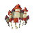](Fireworks.md) = [蛋袋（Egg Sac）](Egg_Sac.md)  + [灼烧（Burn）](Burn.md) 
      * [激光切割机（Laser Cutter）](Laser_Cutter.md)  = ([激光 (垂直)（Laser (Vertical)）](Laser_Vertical.md)  或是 [激光 (水平)（Laser (Horizontal)）](Laser_Horizontal.md) ) + [钢铁（Steel）](Steel.md) 
    - 2个新的球进化组合
      * [石头（Stone）](Stone.md)  + [冻结（Freeze）](Freeze.md)  = [冰川（Glacier）](Glacier.md) 
      * [石头（Stone）](Stone.md)  + [风（Wind）](Wind.md)  = [沙风（Sandstorm）](Sandstorm.md) [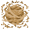](Sandstorm.md)
  + 3新的 [被动道具（passives）](Passives.md)
    - 1个新设 [基本被动](Passives.md#%E5%9F%BA%E6%9C%AC%E8%A2%AB%E5%8A%A8)
      * [铁制连体衣（Iron Onesie）](Iron_Onesie.md) [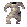](Iron_Onesie.md)
    - 2新的 [发展的被动性](Passives.md#%E8%BF%9B%E5%8C%96%E8%A2%AB%E5%8A%A8)
      * [怪异的炮兵（Grotesque Artillery）](Grotesque_Artillery.md)  = [塔楼（Turret）](Turret.md) [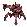](Turret.md) +  [手机风扇](https://ballxpit.wiki.gg/wiki/Hand_Fan?action=edit&redlink=1)
      * [死眼的硬化剂（Deadeye's Impaler）](Deadeye_s_Impaler.md)  = [慈悲不仁者（Gracious Impaler）](Gracious_Impaler.md) [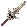](Gracious_Impaler.md) + ["死眼之十字架"（Deadeye's Cross）](Deadeye_s_Cross.md) 
  + 3新的 [建筑（buildings）](Buildings.md)
    - [聚会之家（Party House）](Party_House.md) - - - 归于卡鲁塞尔
    - [驯鹰小屋（Falconry Hut）](Falconry_Hut.md) - 飞鹰家的家
    - [冒险家协会（Adventurer's Guild）](Adventurer_s_Guild.md) - 解锁无限模式
* 已有的游戏内容的变化
  + 现在，我们要去做什么呢?
* 修复错误
  + 现在，我们要去做什么呢?

##### 2026-01-28: 礼品更新热修 (仅PC)

补丁说明

* 在选项菜单中选择"移动导向器与播放器移动"时解决了软锁问题
  + 如下所述 [在这里](https://steamcommunity.com/app/2062430/discussions/1/694251506632779884/)

##### 2026-04-27: [影子更新](https://ballxpit.wiki.gg/wiki/The_Shadow_Update?action=edit&redlink=1)

补丁说明

* 新的游戏内容/功能
  + 2个新的可播放 [角色（characters）](Characters.md)
    - [掘地者（The Tunneller）](The_Tunneller.md) 
    - [蹑足者（The Tiptoer）](The_Tiptoer.md) 
  + 11个新品 [圆球（balls）](Balls.md)
    - 1个新设 [基球](Balls.md#%E5%9F%BA%E7%A1%80%E5%9C%86%E7%90%83)
      * [时间（Time）](Time.md) 
    - 10个新品 [发育的球](Balls.md#%E8%BF%9B%E5%8C%96%E5%9C%86%E7%90%83)
      * [时间限制（Timestop）](Timestop.md)  = [冻结（Freeze）](Freeze.md)  + [时间（Time）](Time.md) 
      * [侵蚀（Erosion）](Erosion.md)  = [风（Wind）](Wind.md)  + [时间（Time）](Time.md) 
      * [变形（Warp）](Warp.md)  = [光（Light）](Light.md)  + [时间（Time）](Time.md) 
      * [时间炸弹（Time Bomb）](Time_Bomb.md)  = [炸弹（Bomb）](Bomb.md)  + [时间（Time）](Time.md) 
      * [毒药（Venom）](Venom.md)  = [冻结（Freeze）](Freeze.md)  + [中毒（Poison）](Poison.md) 
      * [吞心者（Heart Swallower）](Heart_Swallower.md)  = [鬼魂（Ghost）](Ghost.md)  + [流血（Bleed）](Bleed.md) 
      * [收获者（Reaper）](Reaper.md)  = [吞心者（Heart Swallower）](Heart_Swallower.md)  + [吸血鬼（Soul Sucker）](Soul_Sucker.md) 
      * [X 射线（X Ray）](X_Ray.md)  = [激光束（Laser Beam）](Laser_Beam.md)  + [圣激光（Holy Laser）](Holy_Laser.md) 
      * [班西（Banshee）](Banshee.md)  = [灵魂（Wraith）](Wraith.md)  + [幽灵（Phantom）](Phantom.md) 
      * [狙击手（Sniper）](Sniper.md)  = [凶手（Assassin）](Assassin.md)  + [枪枪（Shotgun）](Shotgun.md) 
    - 3个新的球进化组合
      * [迷人（Charm）](Charm.md)  + [时间（Time）](Time.md)  = [爱情者（Lovestruck）](Lovestruck.md) 
      * [灼烧（Burn）](Burn.md)  + [时间（Time）](Time.md)  = [在地狱里（Inferno）](Inferno.md) 
      * [太阳（Sun）](Sun.md)  + [时间（Time）](Time.md)  = [黑洞（Black Hole）](Black_Hole.md) 
  + 4新的 [被动道具（passives）](Passives.md)
    - 1个新设 [基本被动](Passives.md#%E5%9F%BA%E6%9C%AC%E8%A2%AB%E5%8A%A8)
      * [剑打破者（Sword Breaker）](Sword_Breaker.md) [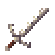](Sword_Breaker.md)
    - 3新的 [发展的被动性](Passives.md#%E8%BF%9B%E5%8C%96%E8%A2%AB%E5%8A%A8)
      * [命运的箭（Arrow of Fate）](Arrow_of_Fate.md) [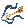](Arrow_of_Fate.md) =  [手镜](https://ballxpit.wiki.gg/wiki/Hand_Mirror?action=edit&redlink=1) +  [恋人的箭袋（Lover's Quiver）](https://ballxpit.wiki.gg/wiki/Lover%27s_Quiver?action=edit&redlink=1)
      * [阿根廷止时钟（Argent Stopwatch）](Argent_Stopwatch.md)  = [银子子弹（Silver Bullet）](Silver_Bullet.md)  + [砂钟（Hourglass）](Hourglass.md) 
      * [全金属光谱机（Full Metal Rapier）](Full_Metal_Rapier.md) [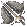](Full_Metal_Rapier.md) = [剑打破者（Sword Breaker）](Sword_Breaker.md)  + [铁制连体衣（Iron Onesie）](Iron_Onesie.md) 
  + 3新的 [建筑（buildings）](Buildings.md)
    - [石域（Stone Domain）](Stone_Domain.md) -《隧道者》的家
    - [隐秘神殿（Hidden Temple）](Hidden_Temple.md) - 迪普托尔的家
    - [协会厅（Guild Hall）](Guild_Hall.md) - 允许重新滚动 [字符的收获升级](Harvest_Upgrades_Character_Bonus.md)
* 已有的游戏内容的变化
  + 现在，我们要去做什么呢?
* 修复错误
  + 现在，我们要去做什么呢?

##### 2026-08-06: [自然主义者更新](https://ballxpit.wiki.gg/wiki/The_Naturalist_Update?action=edit&redlink=1)

补丁说明

* 新的游戏内容/功能
  + 2个新的可播放 [角色（characters）](Characters.md)
    - [持球者（The Ballbearer）](The_Ballbearer.md) [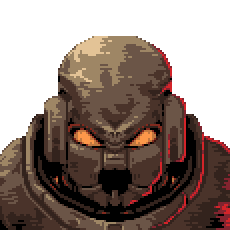](The_Ballbearer.md)
    - [白发囤积者（The Hoary Hoarder）](The_Hoary_Hoarder.md) [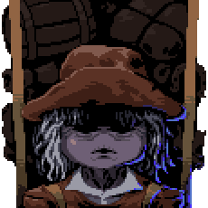](The_Hoary_Hoarder.md)
  + 11个新品 [圆球（balls）](Balls.md)
    - 1个新设 [基球](Balls.md#%E5%9F%BA%E7%A1%80%E5%9C%86%E7%90%83)
      * [肉类（Flesh）](Flesh.md) 
    - 10个新品 [发育的球](Balls.md#%E8%BF%9B%E5%8C%96%E5%9C%86%E7%90%83)
      * [石化（Petrify）](Petrify.md)  = [石头（Stone）](Stone.md)  + [肉类（Flesh）](Flesh.md) 
      * [肿瘤（Tumor）](Tumor.md)  = [辐射束（Radiation Beam）](Radiation_Beam.md)  + [肉类（Flesh）](Flesh.md) 
      * [僵尸（Zombie）](Zombie.md)  = [吸血鬼（Vampire）](Vampire.md)  + [肉类（Flesh）](Flesh.md) 
      * [后代（Offspring）](Offspring.md)  = [细胞（Cell）](Cell.md)  + [肉类（Flesh）](Flesh.md) 
      * [肉山（Flesh Mound）](Flesh_Mound.md)  = [育巢母体（Brood Mother）](Brood_Mother.md)  + [肉类（Flesh）](Flesh.md) 
      * [闪电虫（Lightning Bug）](Lightning_Bug.md)  = [育巢母体（Brood Mother）](Brood_Mother.md)  + [闪电（Lightning）](Lightning.md) 
      * [蚊子王国（Mosquito Kingdom）](Mosquito_Kingdom.md)  = [蚊子王（Mosquito King）](Mosquito_King.md)  + [蚊子群（Mosquito Swarm）](Mosquito_Swarm.md) 
      * [钻头（Drill）](Drill.md) [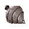](Drill.md) = [地震（Earthquake）](Earthquake.md)  + [铁（Iron）](Iron.md) 
      * [基本（Elemental）](Elemental.md)  = [地震（Earthquake）](Earthquake.md)  + [灼烧（Burn）](Burn.md)  + [冻结（Freeze）](Freeze.md)  + [风（Wind）](Wind.md) 
      * [亚马格登（Armageddon）](Armageddon.md)  = [在地狱里（Inferno）](Inferno.md)  + [风暴（Storm）](Storm.md) 
    - 1个新球进化组合
      * [流血（Bleed）](Bleed.md)  + [肉类（Flesh）](Flesh.md)  = [输血（Hemorrhage）](Hemorrhage.md) 
  + 5个新品 [被动道具（passives）](Passives.md)
    - 1个新设 [基本被动](Passives.md#%E5%9F%BA%E6%9C%AC%E8%A2%AB%E5%8A%A8)
      * [哑铃（Platinum Dumbbell）](Platinum_Dumbbell.md) 
    - 4新的 [发展的被动性](Passives.md#%E8%BF%9B%E5%8C%96%E8%A2%AB%E5%8A%A8)
      * [光荣锤（Inglorious Hammer）](Inglorious_Hammer.md)  = [哑铃（Platinum Dumbbell）](Platinum_Dumbbell.md)  + [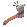](https://ballxpit.wiki.gg/wiki/Upturned_Hatchet) [翻转的斧头](https://ballxpit.wiki.gg/wiki/Upturned_Hatchet?action=edit&redlink=1)
      * [燃烧的轮胎（Ardent Tire）](Ardent_Tire.md)  =  [橡胶头带（Rubber Headband）](https://ballxpit.wiki.gg/wiki/Rubber_Headband?action=edit&redlink=1) +  [车轮](https://ballxpit.wiki.gg/wiki/Wagon_Wheel?action=edit&redlink=1)
      * [风织机（Windweaver）](Windweaver.md)  = [瓶装龙卷风（Bottled Tornado）](Bottled_Tornado.md)  + [弹弓（Slingshot）](Slingshot.md) [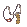](Slingshot.md)
      * [远程发射器（Remote Detonator）](Remote_Detonator.md) [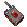](Remote_Detonator.md) = [磁铁（Magnet）](Magnet.md)  + [压力阀（Pressure Valve）](Pressure_Valve.md) [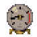](Pressure_Valve.md)
  + 2新的 [建筑（buildings）](Buildings.md)
    - [球场（Ball House）](Ball_House.md) - - - 归于"球手"
    - [不稳定的塔楼（Unstable Tower）](Unstable_Tower.md) - 霍利汽车旅馆的家
* 已有的游戏内容的变化
  + 现在，我们要去做什么呢?
* 修复错误
  + 现在，我们要去做什么呢?

#### 计划更新

##### 2026

2025 年 12 月 2 日，发行商 Devolver Digital 发布了 [拖车](https://www.youtube.com/watch?v=gCmmoL2Mtq0) 在2026年期间，计划进行3次免费内容更新: [礼物更新](https://ballxpit.wiki.gg/wiki/Regal_Update?action=edit&redlink=1)在 [影子更新](https://ballxpit.wiki.gg/wiki/Shadow_Update?action=edit&redlink=1)在 [自然主义者更新](https://ballxpit.wiki.gg/wiki/Naturalist_Update?action=edit&redlink=1)每次更新都会有新的功能。 [圆球](Balls.md)发展, [建筑](Buildings.md)、 [角色](Characters.md)每个更新都有一个淡化的横幅取笑两个新人物以及一个挂着标签的标签目前还没有其他关于这些更新的信息，但新建筑和角色模型的片段也可以在拖车的某些部分看到。

* 护盾手和一个新角色似乎在雷加尔最新消息中被戏弄

  
* 2个新角色，显然是为了更新影子的人

  
* 一个新的建筑物，周围有飞行生物，可能是一个新的角色之家

  [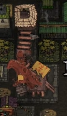](../files/Future_Content_-_2026_Updates_Vid_-_New_Building_1.png.md)
* 一个新的I形建筑物

  
* 一座新的蓝天屋顶建筑

  
* 一个新的飞船建筑，以前在 [数据化建筑物喷气板](Beta_and_Cut_Content.md)

  [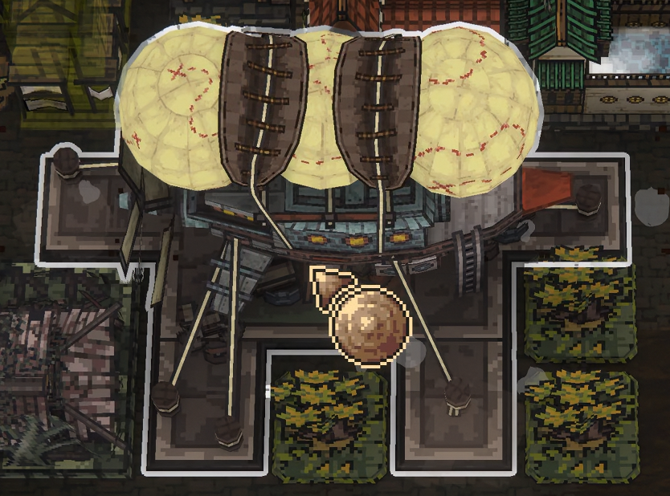](../files/Future_Content_-_2026_Updates_Vid_-_in-game_airship_full.png.md)

###### 王权更新（Regal Update），2026 年 1 月

"与高层社会塑造的猎人。.. "

###### 暗影更新（Shadow Update），2026 年 4 月

"与猎人沉浸在欺骗的艺术"...

###### 自然学家更新（Naturalist Update），2026 年 7 月

[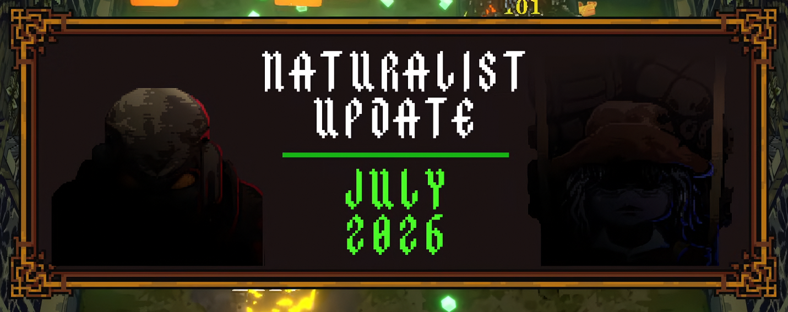](../files/Future_Content_-_2026_Updates_Vid_-_Naturalist_Update_banner.png.md)

"与极端需要处理的猎人。..

###### 重生球比伦（Risen Ballbylon），2026 年 11 月 12 日

9 月 20 日，Devolver Digital 上传了一段新的 [拖车](https://www.youtube.com/watch?v=HQ5YxcfgZ9w) 在 [公告](https://store.steampowered.com/app/4008250/BALL_x_PIT_Risen_Ballbylon/) 付费的DLC扩展 *[球比伦战记](Ball_x_Pit.md)* 标题 [重生球比伦](https://ballxpit.wiki.gg/wiki/Risen_Ballbylon?action=edit&redlink=1) 于 2026 年 11 月 12 日在所有已支持的平台推出。扩展包售价 6.99 美元，其中的新内容须完成本体游戏后才可解锁，包括：

* 4个新级别，有超过40个新敌人
* 8个新字符
* 45个新的负债
* 24个新的球
* 20个新建筑物

**分类**　[分类 · 坚力](../categories/Stubs.md)

[返回总入口](../%E7%90%83%E6%AF%94%E4%BC%A6%E6%88%98%E8%AE%B0%20Wiki.md) · [返回本分目录](%E7%9B%AE%E5%BD%95.md)
