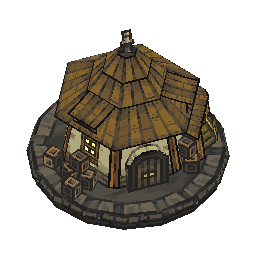
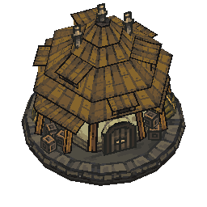

# 采集者小屋（Gatherer's Hut）

在此分配一个角色，使其按预设方向自动移动，每隔几分钟独立进行收获。

[原文与贡献者记录](https://ballxpit.wiki.gg/wiki/Gatherer%27s_Hut) · [修订 3339](https://ballxpit.wiki.gg/index.php?oldid=3339) · [返回目录](../%E7%90%83%E6%AF%94%E4%BC%A6%E6%88%98%E8%AE%B0%20Wiki.md)

## 信息（Information）

### 分类（Category）

经济

### 子类（Subcategory）

收集

### 蓝图位置（Blueprint location）

[血腥草原](The_GORYxGRASSLANDS.md) 

### 基础资源消耗（Base resource cost）

 50  5  2

### 建造点消耗（Build point cost）

5

**采集者小屋** 是 *[球比伦战记](Ball_x_Pit.md)* 中的一种独特的收集类 [建筑](Buildings.md)，它本身并不生产或收集资源，而是被动地为分配的角色启动收获单局。 [角色](Characters.md) 会以玩家自定义的方向进行资源收获，就像在收获模式中一样（但这不会消耗收获模式的单局时间）。这些单局会以固定的时长和间隔自动启动，并可通过建筑升级提升这些参数。 **{?未完成的机制问题：在这些收获过程中，角色和建筑是否会保留其所有效果？} [收获升级](Harvest_Upgrades_Character_Bonus.md) 以及正常收获时的能力如何？}** 必须为这座建筑分配一个角色才能使其运行，而被分配的角色在收获模式期间将 **无法** 使用。默认情况下，收获单局会持续运行直到游戏关闭，除非已建造 [工人工会](Worker_s_Guild_Building.md)。与大多数建筑不同，只要玩家基地拥有足够的资源和空间，这个建筑以及“资源收集”子类别中的其他建筑都可以多次建造。不过，从功能上讲，采集者小屋在这方面受到可分配角色数量的限制。

被动效果与升级

| 等级 | 图片 | 说明 | 资源消耗 | 建造点消耗 | 拆除 | 收集的资源 | 收获单局率 | 收获单局时长 |
| --- | --- | --- | --- | --- | --- | --- | --- | --- |
| 1 |  | 在此分配一个角色，使其每10分钟自动朝预设方向出发进行收获。工人可收获10秒后返回。 |  50  5  2 | 5 |  50  5  2 |  金币  小麦  木材  石头 | 1/10分钟 | 10秒 |
| 2 |  | 在此分配一个角色，使其每 9 分钟自动朝预设方向外出进行收获。工人可收获 15 秒后返回。 |  100  10  5 | 5 |  150  15  7 |  金币  小麦  木材  石头 | 1 / 9 分钟 | 15秒 |
| 3 |  | 在此分配一个角色，使其每8分钟自动朝预设方向出发进行收获。工人可收获20秒后返回。 |  150  15  8 | 15 |  300  30  15 |  金币  小麦  木材  石头 | 1 / 8分钟 | 20秒 |

[共享导航](../navigation/nav-d4956b01aa56.md)

**分类**　[分类 · 建筑](../categories/Buildings.md) · [分类 · 经济](../categories/Economy.md) · [分类 · 收集](../categories/Gathering.md) · [分类 · 带有导航框的页面](../categories/Pages_with_navboxes.md)

[返回总入口](../%E7%90%83%E6%AF%94%E4%BC%A6%E6%88%98%E8%AE%B0%20Wiki.md) · [返回本分目录](%E7%9B%AE%E5%BD%95.md)
