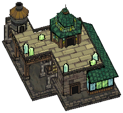
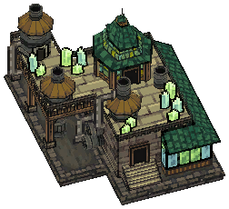

# 石家庄（Gemsmith）

开始每场战斗，选择一个额外的球。

[原文与贡献者记录](https://ballxpit.wiki.gg/wiki/Gemsmith) · [修订 3384](https://ballxpit.wiki.gg/index.php?oldid=3384) · [返回目录](../%E7%90%83%E6%AF%94%E4%BC%A6%E6%88%98%E8%AE%B0%20Wiki.md)

不应与 [枪手](Gunsmith.md).

#### 信息（Information）

##### 分类（Category）

战争

##### 子类（Subcategory）

总

##### 蓝图位置（Blueprint location）

[GORYxGRASSLANDS](The_GORYxGRASSLANDS.md)

##### 基础资源消耗（Base resource cost）

 1,000  20

##### 建造点消耗（Build point cost）

90

构建Gemsmith让玩家在每个级别运行的开始时选择一个额外的球。这个奖金球从1级开始，但通过构建升级可以增加起始水平。注意，这个奖金球的起始水平是 **NOT** 受到从 [进化室](Evolution_Chamber_Building.md) 其他建筑物，但仍然可以增加选用球的数量 [冥想帐篷](Meditation_Tent.md).

被动效果与升级

| 等级 | 图片 | 描述 | 资源消耗 | 建造点消耗 | 拆除 |
| --- | --- | --- | --- | --- | --- |
| 1 |  | 开始每场战斗，选择一个额外的球。 |  1,000  20 | 90 |  1,000  20 |
| 2 |  | 开始每场战斗，选择一个额外的球。 奖金球从2级开始 |  2,000  40 | 90 |  3,000  60 |
| 3 |  | 开始每场战斗，选择一个额外的球。 奖金球从3级开始 |  3,000  60 | 270 |  6,000  120 |

[共享导航](../navigation/nav-d4956b01aa56.md)

**分类**　[分类 · 建筑](../categories/Buildings.md) · [分类 · 战争](../categories/Warfare.md) · [分类 · 总](../categories/General.md) · [分类 · 页面有导航框](../categories/Pages_with_navboxes.md)

[返回总入口](../%E7%90%83%E6%AF%94%E4%BC%A6%E6%88%98%E8%AE%B0%20Wiki.md) · [返回本分目录](%E7%9B%AE%E5%BD%95.md)
