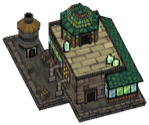
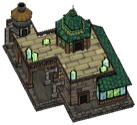
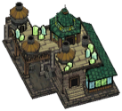

# 宝石匠（Gemsmith）

每场战斗开始时，可以选择额外一个球。

[原文与贡献者记录](https://ballxpit.wiki.gg/wiki/Gemsmith) · [修订 3384](https://ballxpit.wiki.gg/index.php?oldid=3384) · [返回目录](../%E7%90%83%E6%AF%94%E4%BC%A6%E6%88%98%E8%AE%B0%20Wiki.md)

请勿与 [枪匠](Gunsmith.md) 混淆。

## 信息（Information）

### 分类（Category）

战争

### 子类（Subcategory）

将军

### 蓝图位置（Blueprint location）

[GORYxGRASSLANDS](The_GORYxGRASSLANDS.md)

### 基础资源消耗（Base resource cost）

 1,000  20

### 建造点消耗（Build point cost）

90

在每级开始时，建造宝石匠会给予玩家一个额外球的选择权。这个额外球从1级开始提供，但可以通过建造升级来提高起始等级。请注意，额外球的起始等级 **不会** 受到起始等级加成的影响，例如来自 [进化舱](Evolution_Chamber_Building.md) 等建筑，不过可供选择的球的数量仍然可以增加。

被动效果与升级

| 等级 | 图片 | 说明 | 资源消耗 | 建造点消耗 | 拆除 |
| --- | --- | --- | --- | --- | --- |
| 1 |  | 每场战斗开始时，可以选择额外一个球。 |  1,000  20 | 90 |  1,000  20 |
| 2 |  | 每场战斗开始时，可以选择额外一个球。 奖励球从 2 级开始。 |  2,000  40 | 90 |  3,000  60 |
| 3 |  | 每场战斗开始时，可以选择额外一个球。 额外球从 3 级开始。 |  3,000  60 | 270 |  6,000  120 |

[共享导航](../navigation/nav-d4956b01aa56.md)

**分类**　[分类 · 建筑](../categories/Buildings.md) · [分类 · 战争](../categories/Warfare.md) · [分类 · 通用](../categories/General.md) · [分类 · 带有导航框的页面](../categories/Pages_with_navboxes.md)

[返回总入口](../%E7%90%83%E6%AF%94%E4%BC%A6%E6%88%98%E8%AE%B0%20Wiki.md) · [返回本分目录](%E7%9B%AE%E5%BD%95.md)
