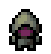

# 鬼魂（Ghost）

通过敌人。

[原文与贡献者记录](https://ballxpit.wiki.gg/wiki/Ghost) · [修订 4208](https://ballxpit.wiki.gg/index.php?oldid=4208) · [返回目录](../%E7%90%83%E6%AF%94%E4%BC%A6%E6%88%98%E8%AE%B0%20Wiki.md)

#### 一般信息

##### 开始的性格

[空巢者](The_Empty_Nester.md) 

##### 解锁

默认解锁

##### 命中效果（On-Hit Effects）

通过

##### 状态效果（Status Effects）

-

#### 发展情况（Evolutions）

##### 演变为

[凶手](Assassin.md) 、 [吞心者](Heart_Swallower.md) 、 [幽灵](Phantom.md) 、 [吸血鬼](Soul_Sucker.md) 、 [病毒](Virus.md) 、 [灵魂](Wraith.md) 

**鬼魂** 是一个 [基球](Balls.md#%E5%9F%BA%E7%A1%80%E5%9C%86%E7%90%83) 在基本游戏版本中推出了 *[球比伦战记](Ball_x_Pit.md)*它是首发的球。 [空巢者](The_Empty_Nester.md) .

#### 关卡

| 等级 | 伤害 | 影响 |
| --- | --- | --- |
| 1 |  x(3.5至6.5) | 通过敌人。 ／ |
| 2 |  x(3.5至6.5) | 通过敌人。 ／ |
| 3 |  x(3.5至6.5) | 通过敌人。 ／ |

#### 发展情况

| 组合 | 进化 |
| --- | --- |
|  鬼魂（Ghost） + [铁（Iron）](Iron.md)  | [凶手（Assassin）](Assassin.md) （\*） |
|  鬼魂（Ghost） + [流血（Bleed）](Bleed.md)  | [吞心者（Heart Swallower）](Heart_Swallower.md) （\*） |
|  鬼魂（Ghost） + [黑暗（Dark）](Dark.md)  | [幽灵（Phantom）](Phantom.md) （\*） |
|  鬼魂（Ghost） + [吸血鬼（Vampire）](Vampire.md)  | [吸血鬼（Soul Sucker）](Soul_Sucker.md) （\*） |
|  鬼魂（Ghost） + [中毒（Poison）](Poison.md)  | [病毒（Virus）](Virus.md)  |
|  鬼魂（Ghost） + [冻结（Freeze）](Freeze.md)  | [灵魂（Wraith）](Wraith.md) （\*） |

* 可以进一步发展。

#### 策略

#### 更新记录

#### 冷知识

#### 图片库

[共享导航](../navigation/nav-63012059ef49.md)

**分类**　[分类 · 基础圆球](../categories/Base_Balls.md) · [分类 · 圆球](../categories/Balls.md) · [分类 · 页面有导航框](../categories/Pages_with_navboxes.md)

[返回总入口](../%E7%90%83%E6%AF%94%E4%BC%A6%E6%88%98%E8%AE%B0%20Wiki.md) · [返回本分目录](%E7%9B%AE%E5%BD%95.md)
