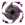
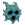

# 幽灵（Ghost）

穿过敌人。

[原文与贡献者记录](https://ballxpit.wiki.gg/wiki/Ghost) · [修订 4208](https://ballxpit.wiki.gg/index.php?oldid=4208) · [返回目录](../%E7%90%83%E6%AF%94%E4%BC%A6%E6%88%98%E8%AE%B0%20Wiki.md)

## 基本信息

### 初始角色（Starting Character）

[空巢者](The_Empty_Nester.md) 

### 解锁

默认解锁

### 命中效果（On-Hit Effects）

穿透

### 状态效果（Status Effects）

-

## 进化（Evolutions）

### 进化成

[刺客](Assassin.md) , [吞心者](Heart_Swallower.md) , [幻影](Phantom.md) , [吸魂者](Soul_Sucker.md) , [病毒](Virus.md) , [怨灵](Wraith.md) 

**幽灵** 是 [基础圆球](Balls.md#%E5%9F%BA%E7%A1%80%E5%9C%86%E7%90%83) 在基础游戏版本中引入 *[球比伦战记](Ball_x_Pit.md)*. 默认即可解锁。这是起始球。 [空巢者](The_Empty_Nester.md) .

## 关卡

| 等级 | 伤害 | 效果 |
| --- | --- | --- |
| 1 |  x(3.5 至 6.5) | 穿过敌人。 |
| 2 |  x(3.5 至 6.5) | 穿过敌人。 |
| 3 |  x(3.5 至 6.5) | 穿过敌人。 |

## 进化

| 组合 | 进化 |
| --- | --- |
|  幽灵（Ghost） + [铁（Iron）](Iron.md)  | [刺客（Assassin）](Assassin.md) （\*） |
|  幽灵（Ghost） + [流血（Bleed）](Bleed.md)  | [吞心者（Heart Swallower）](Heart_Swallower.md) （\*） |
|  幽灵（Ghost） + [黑暗（Dark）](Dark.md)  | [幻影（Phantom）](Phantom.md) （\*） |
|  幽灵（Ghost） + [吸血鬼（Vampire）](Vampire.md)  | [吸魂者（Soul Sucker）](Soul_Sucker.md) （\*） |
|  幽灵（Ghost） + [中毒（Poison）](Poison.md)  | [病毒（Virus）](Virus.md)  |
|  幽灵（Ghost） + [冻结（Freeze）](Freeze.md)  | [怨灵（Wraith）](Wraith.md) （\*） |

* 可以进一步进化。

## 策略

## 更新记录

## 冷知识

## 图片库

[共享导航](../navigation/nav-63012059ef49.md)

**分类**　[分类 · 基础圆球](../categories/Base_Balls.md) · [分类 · 圆球](../categories/Balls.md) · [分类 · 带有导航框的页面](../categories/Pages_with_navboxes.md)

[返回总入口](../%E7%90%83%E6%AF%94%E4%BC%A6%E6%88%98%E8%AE%B0%20Wiki.md) · [返回本分目录](%E7%9B%AE%E5%BD%95.md)
