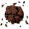

# 冰川（Glacier）

该球会随时间释放冰刺，对触碰到冰刺的敌人造成15-30/25-40/25-40的伤害，并将其冻结2.0/2.0/3.0秒。该球及其冰刺还会对附近的单位造成6-12的伤害。

[原文与贡献者记录](https://ballxpit.wiki.gg/wiki/Glacier) · [修订 4235](https://ballxpit.wiki.gg/index.php?oldid=4235) · [返回目录](../%E7%90%83%E6%AF%94%E4%BC%A6%E6%88%98%E8%AE%B0%20Wiki.md)

## 基本信息

### 由……创建

[冻结](Freeze.md)  + ([地震](Earthquake.md)  或 [石头](Stone.md) )

### 初始角色（Starting Character）

-

### 状态效果（Status Effects）

[冻结](https://ballxpit.wiki.gg/wiki/Status_Effects?action=edit&redlink=1)

### 由状态效果触发

命中时，范围效果，定时

## 进化配方

|  |  |  |  |  |  |  |
| --- | --- | --- | --- | --- | --- | --- |
|  |  |  |  |  |  |  |
| [冻结（Freeze）](Freeze.md)  |  |  |  | [地震（Earthquake）](Earthquake.md)  或 [石头（Stone）](Stone.md) （通关白雪海岸后解锁） |  |  |
|  |  |  |  |  |  |  |
|  |  | 冰川（Glacier） |  |  |  |  |

## 关卡

| 等级 | 伤害 | 效果 |
| --- | --- | --- |
| 1 |  x(4.2 至 8.0) | 该球会随时间释放冰刺，对触碰到它的敌人造成15-30点伤害，并使其冻结2.0秒。该球及其冰刺还会对附近的单位造成6-12点伤害。 |
| 2 |  x(4.2 至 8.0) | 该球会随时间释放冰刺，对触碰到它的敌人造成25-40点伤害，并使其冻结2.0秒。该球及其冰刺还会对附近的单位造成6-12点伤害。 |
| 3 |  x(4.2 至 8.0) | 该球会随时间释放冰刺，对触碰到它的敌人造成25-40点伤害，并将其冻结3.0秒。该球及其冰刺还会对附近的单位造成6-12点伤害。 |

## 进化

*这个球无法进一步进化。*

## 策略

若将其与 [丰满的卵囊](Voluptuous_Egg_Sac.md) 或 [细胞](Cell.md) 结合使用，甚至可能与 [虚灵斗篷](Ethereal_Cloak.md) 协同作用，其副本和小球会释放冰刺，并在接触时对附近的单位造成伤害，从而产生更多的冰刺。

## 更新记录

## 冷知识

## 图片库

[共享导航](../navigation/nav-63012059ef49.md)

**分类**　[分类 · 进化圆球](../categories/Evolved_Balls.md) · [分类 · 圆球](../categories/Balls.md) · [分类 · 带有导航框的页面](../categories/Pages_with_navboxes.md)

[返回总入口](../%E7%90%83%E6%AF%94%E4%BC%A6%E6%88%98%E8%AE%B0%20Wiki.md) · [返回本分目录](%E7%9B%AE%E5%BD%95.md)
