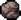
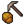
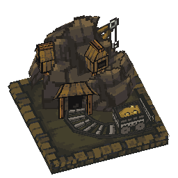

# 金矿（Gold Mine）

[原文与贡献者记录](https://ballxpit.wiki.gg/wiki/Gold_Mine) · [修订 3338](https://ballxpit.wiki.gg/index.php?oldid=3338) · [返回目录](../%E7%90%83%E6%AF%94%E4%BC%A6%E6%88%98%E8%AE%B0%20Wiki.md)

在此分配一名工人来开采 。当这座建筑被触发时，他们将开采 。

## 信息（Information）

### 分类（Category）

经济

### 子类（Subcategory）

收集

### 蓝图位置（Blueprint location）

[边境沙漠](The_LIMINALxDESERT.md) 

### 基础资源消耗（Base resource cost）

 10  12

### 建造点消耗（Build point cost）

5

**金矿**是位于*[球比伦战记](Ball_x_Pit.md)*中的一处聚集[建筑](Buildings.md)。与其他聚集建筑不同，金矿仅通过让[角色](Characters.md)在收获模式期间或从[采集者小屋](Gatherer_s_Hut.md)发射的炮弹撞击它来产出其资源金币。每次撞击都会产出一定范围内的随机金币数量（该范围会因建筑的升级而扩大），但在收到100次撞击后，金矿在下次收获运行之前将不再产出额外金币。必须指定一个角色来操作此建筑以进行资源收获，但指定的角色在收获模式期间将**无法**使用。与大多数建筑不同，金矿及资源与采集子类别中的其他建筑可以在玩家基地拥有足够资源和空间的情况下多次建造，但金矿在功能上受可分配给它的角色数量限制。

拥有  [金币猎手](https://ballxpit.wiki.gg/wiki/Gold_Digger?action=edit&redlink=1) [收获升级](Harvest_Upgrades_Character_Bonus.md)的角色可以分配到金矿中，从而增加每次反弹所获得的金币数量。

被动效果与升级

| 等级 | 图片 | 说明 | 资源消耗 | 建造点消耗 | 拆除 | 收集的资源 | 收集率 |
| --- | --- | --- | --- | --- | --- | --- | --- |
| 1 |  | 在此分配一名工人来开采 。当该建筑被触发时，他们将进行1-2次  的开采（每次收获最多100次）。 |  10  12 | 5 |  10  12 |  金币 |  1-2 / 反弹 |
| 2 |  | 在此分配一名工人来开采 。当该建筑被触发时，它们将开采 1-3 （每次收获最多可开采 100 次）。 |  10  15 | 5 |  20  27 |  金币 |  1-3 / 反弹次数 |
| 3 |  | 在此分配一名工人来开采 。当该建筑被触发时，它们将开采 1-4 （每次收获最多 100 次）。 |  15  22 | 15 |  35  49 |  金币 |  1-4 / 反弹次数 |

[共享导航](../navigation/nav-d4956b01aa56.md)

**分类**　[分类 · 建筑](../categories/Buildings.md) · [分类 · 经济](../categories/Economy.md) · [分类 · 收集](../categories/Gathering.md) · [分类 · 带有导航框的页面](../categories/Pages_with_navboxes.md)

[返回总入口](../%E7%90%83%E6%AF%94%E4%BC%A6%E6%88%98%E8%AE%B0%20Wiki.md) · [返回本分目录](%E7%9B%AE%E5%BD%95.md)
