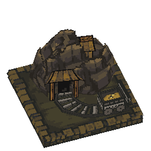
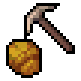
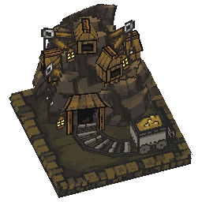

# 金矿（Gold Mine）

派一个工人到我的 当这座建筑被击落时，他们会被挖掘。 .

[原文与贡献者记录](https://ballxpit.wiki.gg/wiki/Gold_Mine) · [修订 3338](https://ballxpit.wiki.gg/index.php?oldid=3338) · [返回目录](../%E7%90%83%E6%AF%94%E4%BC%A6%E6%88%98%E8%AE%B0%20Wiki.md)

#### 信息（Information）

##### 分类（Category）

经济

##### 子类（Subcategory）

聚会

##### 蓝图位置（Blueprint location）

[边境沙漠](The_LIMINALxDESERT.md) 

##### 基础资源消耗（Base resource cost）

 10  12

##### 建造点消耗（Build point cost）

5

其他 **金矿** 是一个聚会。 [建筑物](Buildings.md) 在 *[球比伦战记](Ball_x_Pit.md)*与其他采集建筑不同，金矿只提供了资源,  黄金，通过跳转 [角色](Characters.md) 以收割方式，或从山岳上，射出, [收藏家的小屋](Gatherer_s_Hut.md).每次反弹都会在收集率范围内的随机量黄金 (建筑的升级增加了这一范围)，但在收到100次反弹后，一个黄金矿直到下一次收获之前不会产生任何额外的黄金。必须赋予这个建筑一个字符，以便它获得资源, **没有** 在收获模式下可使用。与大多数建筑物不同，资源和收集子类别中的这类和其他建筑物可以建造多次，只要玩家有必要的资源和空间,

字符与  [金矿](https://ballxpit.wiki.gg/wiki/Gold_Digger?action=edit&redlink=1) [收获升级](Harvest_Upgrades_Character_Bonus.md) 可以分配到金矿上，以便增加从金矿上挣得的黄金数额。

被动效果与升级

| 等级 | 图片 | 描述 | 资源消耗 | 建造点消耗 | 拆除 | 资源收集 | 收藏率 |
| --- | --- | --- | --- | --- | --- | --- | --- |
| 1 |  | 派一个工人到我的 当这座建筑被击落时，他们会挖掘1-2  (每种收获可达到100次)。 |  10  12 | 5 |  10  12 |  金币 |  1 - 2 / 跳转 |
| 2 |  | 派一个工人到我的 当这座建筑被击落时，他们会挖到1到3。  (每种收获可达到100次)。 |  10  15 | 5 |  20  27 |  金币 |  1-3 / 跳转 |
| 3 |  | 派一个工人到我的 当这座建筑被击落时，他们会开采1-4  (每种收获可达到100次)。 |  15  22 | 15 |  35  49 |  金币 |  1-4 / 跳转 |

[共享导航](../navigation/nav-d4956b01aa56.md)

**分类**　[分类 · 建筑](../categories/Buildings.md) · [分类 · 经济](../categories/Economy.md) · [分类 · 聚会](../categories/Gathering.md) · [分类 · 页面有导航框](../categories/Pages_with_navboxes.md)

[返回总入口](../%E7%90%83%E6%AF%94%E4%BC%A6%E6%88%98%E8%AE%B0%20Wiki.md) · [返回本分目录](%E7%9B%AE%E5%BD%95.md)
