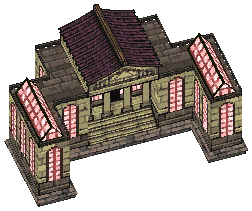
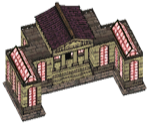

# 大博物馆（Grand Museum）

获得  点智力加成。可无限升级。

[原文与贡献者记录](https://ballxpit.wiki.gg/wiki/Grand_Museum) · [修订 3357](https://ballxpit.wiki.gg/index.php?oldid=3357) · [返回目录](../%E7%90%83%E6%AF%94%E4%BC%A6%E6%88%98%E8%AE%B0%20Wiki.md)

## 信息（Information）

### 分类（Category）

战争

### 子类（Subcategory）

属性加成

### 蓝图位置（Blueprint location）

[VASTxVOID](The_VASTxVOID.md)

### 基础资源消耗（Base resource cost）

 500  40

### 建造点消耗（Build point cost）

50

作为六座可无限升级属性加成建筑之一，大博物馆为所有角色在建造时提供  智力的额外加成。与基础六属性加成建筑不同，该建筑在5级后没有上限，可无限次升级，每级增加1点属性点数。不过，每级资源消耗呈指数级增长，建造点消耗则呈线性增长，但最终会达到1050的上限。与其他建筑一样，拆除后仍可全额退还至该建筑建造及升级所花费的所有资源。当 [战术家](The_Tactician.md)  解锁该能力后，将该建筑放置在 [队长宿舍](Captain_s_Quarters.md)的效应区域时，可额外获得+1的加成。建造该建筑可获得“纪念碑”成就，升级至5级则可获得“结构力量”成就。

被动效果与升级

| 图片 | 说明 | 资源消耗 | 建造点消耗 | 拆除 |
| --- | --- | --- | --- | --- |
|  | 获得 +1 的  智力加成。可无限升级。 ／ 每级额外获得 +1 的  智力加成。 |  500  40 | 50 |  500  40 |

|  |  |  |  |
| --- | --- | --- | --- |
|  | [升级到下一等级的成本](Buildings.md#%E5%8F%AF%E6%97%A0%E9%99%90%E5%8D%87%E7%BA%A7%E7%9A%84%E5%BB%BA%E7%AD%91) |  |  |
| 等级 |  |  | 建造点 |
| 1 | 1,000 | 70 | 50 |
| 2 | 1,500 | 105 | 150 |
| 3 | 2,000 | 140 | 250 |
| 4 | 2,500 | 175 | 350 |
| 5 | 3,000 | 210 | 450 |
| 6 | 11,000 | 770 | 550 |
| 7 | 13,000 | 910 | 650 |
| 8 | 15,000 | 1,050 | 750 |
| 9 | 17,000 | 1,190 | 850 |
| 10 | 19,000 | 1,330 | 950 |
| 11 | 41,000 | 2,870 | 1050 |
| 12 | 45,000 | 3,150 | 1050 |
| 13 | 49,000 | 3,430 | 1050 |
| 14 | 53,000 | 3,710 | 1050 |
| 15 | 57,000 | 3,990 | 1050 |
| 16 | 121,000 | 8,470 | 1050 |
| 17 | 129,000 | 9,030 | 1050 |
| 18 | 137,000 | 9,590 | 1050 |
| 19 | 145,000 | 10,150 | 1050 |
| 20 | 153,000 | 10,710 | 1050 |
| 21 | 321,000 | 22,470 | 1050 |
| 22 | 337,000 | 23,590 | 1050 |
| 23 | 353,000 | 24,710 | 1050 |
| 24 | 369,000 | 25,830 | 1050 |
| 25 | 385,000 | 26,950 | 1050 |
| 26 | 801,000 | 56,070 | 1050 |
| 27 | 833,000 | 58,310 | 1050 |
| 28 | 865,000 | 60,550 | 1050 |
| 29 | 897,000 | 62,790 | 1050 |
| 30 | 929,000 | 65,030 | 1050 |
| 31 | 1,921,000 | 134,470 | 1050 |
| 32 | 1,985,000 | 138,950 | 1050 |
| 33 | 2,049,000 | 143,430 | 1050 |
| 34 | 2,113,000 | 147,910 | 1050 |
| 35 | 2,177,000 | 152,390 | 1050 |
| 36 | 2,241,000 | 156,870 | 1050 |
| 37 | 2,305,000 | 161,350 | 1050 |
| 38 | 2,369,000 | 165,830 | 1050 |
| 39 | 2,433,000 | 170,310 | 1050 |
| 40 | 2,497,000 | 174,790 | 1050 |
| 41 | 2,561,000 | 179,270 | 1050 |
| 42 | 2,625,000 | 183,750 | 1050 |
| 43 | 2,689,000 | 188,230 | 1050 |
| 44 | 2,753,000 | 192,710 | 1050 |
| 45 | 2,817,000 | 197,190 | 1050 |
| 46 | 2,881,000 | 201,670 | 1050 |
| 47 | 2,945,000 | 206,150 | 1050 |
| 48 | 3,009,000 | 210,630 | 1050 |
| 49 | 3,073,000 | 215,110 | 1050 |
| 50 | 3,137,000 | 219,590 | 1050 |

[共享导航](../navigation/nav-d4956b01aa56.md)

**分类**　[分类 · 建筑](../categories/Buildings.md) · [分类 · 战争](../categories/Warfare.md) · [分类 · 属性加成](../categories/Stat_Bonuses.md) · [分类 · 带有导航框的页面](../categories/Pages_with_navboxes.md)

[返回总入口](../%E7%90%83%E6%AF%94%E4%BC%A6%E6%88%98%E8%AE%B0%20Wiki.md) · [返回本分目录](%E7%9B%AE%E5%BD%95.md)
