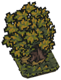

# 大树（Grand Tree）

一棵巨大的树木，你可以从中收集出生长率高且产量大的  木材。

[原文与贡献者记录](https://ballxpit.wiki.gg/wiki/Grand_Tree) · [修订 3332](https://ballxpit.wiki.gg/index.php?oldid=3332) · [返回目录](../%E7%90%83%E6%AF%94%E4%BC%A6%E6%88%98%E8%AE%B0%20Wiki.md)

## 信息（Information）

### 分类（Category）

经济

### 子类（Subcategory）

资源

### 蓝图位置（Blueprint location）

[血腥草原](The_GORYxGRASSLANDS.md) 

### 基础资源消耗（Base resource cost）

 150  1

### 建造点消耗（Build point cost）

0（即时）

**大树** 是 *[球比伦战记](Ball_x_Pit.md)* 中的一种资源类 [建筑](Buildings.md)，是  木材资源格的高级 1x1 变体，只有找到位于 [血腥草原](The_GORYxGRASSLANDS.md)  的蓝图后才会出现。只要拥有资源，它的功能就优于 [森林](Forest.md)：空间利用率更高，再生速率和储量上限也更高，且两者都能通过建筑升级进一步提高。此外，除了收获模式中的弹跳，或来自 [采集者小屋](Gatherer_s_Hut.md) 的收获之外，这个格还可以被 [伐木场](Lumberyard.md) 或 [舒适的家](Cozy_Home.md)（需先解锁 [同居者](The_Cohabitants.md)  的能力）被动采集。与大多数建筑不同，只要玩家基地拥有足够的资源和空间，这个建筑以及“资源采集”子类别中的其他建筑都可以多次建造。

默认情况下，当工人从这块格子上收获资源时，他们会反弹离开。不过，角色可以通过选择  [啄木鸟](https://ballxpit.wiki.gg/wiki/Woodpecker?action=edit&redlink=1) [收获升级](Harvest_Upgrades_Character_Bonus.md)来在穿过这块格子时继续收获资源。此外，角色还可以选择  [森林守护者](https://ballxpit.wiki.gg/wiki/Forester?action=edit&redlink=1) 或  [木材大师](https://ballxpit.wiki.gg/wiki/Wood_Master?action=edit&redlink=1) 进行升级，以便在每次从这块格子收获资源时分别增加木材的收获量或延长剩余的收获时间。一旦 [激进者](The_Radical.md)  解锁了相关能力，附近的 [露营地](Campground.md) 也可以提高木材的再生率。

被动效果与升级

| 等级 | 图片 | 说明 | 资源消耗 | 建造点消耗 | 拆除 | 资源已创建 | 再生率 | 容量 |
| --- | --- | --- | --- | --- | --- | --- | --- | --- |
| 1 |  | 一棵巨大的树木，你可以从中收集出生长率高且产量大的  木材。 |  150  1 | 0（即时） |  150  1 |  木材 | 3.75 分钟 /  1 |  3 |
| 2 |  | 一棵巨大的树木，你可以从中收集出生长率高且产量大的  木材。 |  300  2 | 0（即时） |  450  3 |  木材 | 3分钟 /  1 |  7 |
| 3 |  | 一棵巨大的树木，你可以从中收集出生长率高且产量大的  木材。 |  450  3 | 0（即时） |  900  6 |  木材 | 2.25 分钟 /  1 |  11 |

[共享导航](../navigation/nav-d4956b01aa56.md)

**分类**　[分类 · 建筑](../categories/Buildings.md) · [分类 · 经济](../categories/Economy.md) · [分类 · 资源](../categories/Resources.md) · [分类 · 带有导航框的页面](../categories/Pages_with_navboxes.md)

[返回总入口](../%E7%90%83%E6%AF%94%E4%BC%A6%E6%88%98%E8%AE%B0%20Wiki.md) · [返回本分目录](%E7%9B%AE%E5%BD%95.md)
