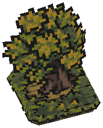
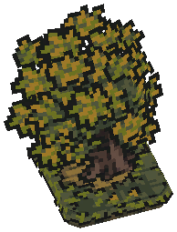

# 大树（Grand Tree）

一棵巨大的树，你可以从中收集  有高增长率和容量的木材。

[原文与贡献者记录](https://ballxpit.wiki.gg/wiki/Grand_Tree) · [修订 3332](https://ballxpit.wiki.gg/index.php?oldid=3332) · [返回目录](../%E7%90%83%E6%AF%94%E4%BC%A6%E6%88%98%E8%AE%B0%20Wiki.md)

#### 信息（Information）

##### 分类（Category）

经济

##### 子类（Subcategory）

资源

##### 蓝图位置（Blueprint location）

[血腥草原](The_GORYxGRASSLANDS.md) 

##### 基础资源消耗（Base resource cost）

 150  1

##### 建造点消耗（Build point cost）

0 (立即)

其他 **大树** 是一个资源 [建筑物](Buildings.md) 在 *[球比伦战记](Ball_x_Pit.md)* 并且是先进的1x1变体  木材资源瓷砖，只有在找到其蓝图之后才能使用 [血腥草原](The_GORYxGRASSLANDS.md) 。只要你拥有资源，它的职能就比 [森林](Forest.md) 提高空间效率，提高再增长率和能力，两者都可以通过建筑升级提高。 [收藏家的小屋](Gatherer_s_Hut.md),这种瓷砖也可以被动地从 [木工场](Lumberyard.md) 或是 [舒适的家](Cozy_Home.md) 一次 [同居者](The_Cohabitants.md)  与大多数建筑物不同，资源和收集子类别中的这类和其他建筑物可以建造多次，只要玩家有必要的资源和空间。

默认情况下，这个瓷砖会让工人在收获时从瓷砖上跳出来，但字符可以随  [啄木鸟](https://ballxpit.wiki.gg/wiki/Woodpecker?action=edit&redlink=1) [升级](Harvest_Upgrades_Character_Bonus.md) 来从这个瓷砖中获取资源，然后通过它。  [森林](https://ballxpit.wiki.gg/wiki/Forester?action=edit&redlink=1) 或是  [木材师](https://ballxpit.wiki.gg/wiki/Wood_Master?action=edit&redlink=1) 每次从瓷砖中收获时分别增加伐木量或增加剩余的收获时钟，再升级，以增加伐木量。 [露营场](Campground.md) 一次 [激进者](The_Radical.md)  已经解锁了能力。

被动效果与升级

| 等级 | 图片 | 描述 | 资源消耗 | 建造点消耗 | 拆除 | 创建资源 | 复兴率 | 产能 |
| --- | --- | --- | --- | --- | --- | --- | --- | --- |
| 1 |  | 一棵巨大的树，你可以从中收集  有高增长率和容量的木材。 |  150  1 | 0 (立即) |  150  1 |  木材 | 3.75分钟/  1 |  3 |
| 2 |  | 一棵巨大的树，你可以从中收集  有高增长率和容量的木材。 |  300  2 | 0 (立即) |  450  3 |  木材 | 3分钟  1 |  7 |
| 3 |  | 一棵巨大的树，你可以从中收集  有高增长率和容量的木材。 |  450  3 | 0 (立即) |  900  6 |  木材 | 2.25分钟/  1 |  11 |

[共享导航](../navigation/nav-d4956b01aa56.md)

**分类**　[分类 · 建筑](../categories/Buildings.md) · [分类 · 经济](../categories/Economy.md) · [分类 · 资源](../categories/Resources.md) · [分类 · 页面有导航框](../categories/Pages_with_navboxes.md)

[返回总入口](../%E7%90%83%E6%AF%94%E4%BC%A6%E6%88%98%E8%AE%B0%20Wiki.md) · [返回本分目录](%E7%9B%AE%E5%BD%95.md)
