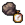
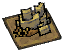
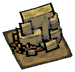

# 花岗岩板（Granite Slab）

一块巨大的花岗岩，你可以从其中收集出高再生率且再生能力强的  石头。

[原文与贡献者记录](https://ballxpit.wiki.gg/wiki/Granite_Slab) · [修订 3334](https://ballxpit.wiki.gg/index.php?oldid=3334) · [返回目录](../%E7%90%83%E6%AF%94%E4%BC%A6%E6%88%98%E8%AE%B0%20Wiki.md)

## 信息（Information）

### 分类（Category）

经济

### 子类（Subcategory）

资源

### 蓝图位置（Blueprint location）

[阴燃深渊](The_SMOLDERINGxDEPTHS.md) 

### 基础资源消耗（Base resource cost）

 250

 1

### 建造点消耗（Build point cost）

0（即时）

**花岗岩板** 是 *[球比伦战记](Ball_x_Pit.md)* 中的一种资源类 [建筑](Buildings.md)，是  石头资源格的高级 1x1 变体，只有找到位于 [阴燃深渊](The_SMOLDERINGxDEPTHS.md)  的蓝图后才会出现。只要拥有资源，它的功能就优于 [巨石](Boulder.md)：空间利用率更高，再生速率和储量上限也更高，且两者都能通过建筑升级进一步提高。此外，除了收获模式中的弹跳，或来自 [采集者小屋](Gatherer_s_Hut.md) 的收获之外，这个格还可以被 [石矿场](Stone_Mine.md) 或 [剧场](Theater.md)（需先解锁 [杂耍者](The_Juggler.md)  的能力）被动采集。与大多数建筑不同，只要玩家基地拥有足够的资源和空间，这个建筑以及“资源采集”子类别中的其他建筑都可以多次建造。

默认情况下，这个格会使工人在收获时反弹离开；不过角色可以选择  [穿石者](https://ballxpit.wiki.gg/wiki/Stonepiercer?action=edit&redlink=1) [收获升级](Harvest_Upgrades_Character_Bonus.md)，在穿过这个格时继续收获资源。此外，角色还可以选择  [破坏者](https://ballxpit.wiki.gg/wiki/Demolitionist?action=edit&redlink=1) 或  [石之大师](https://ballxpit.wiki.gg/wiki/Stone_Master?action=edit&redlink=1) 升级，在每次从这个格收获时，分别增加石头的收获量或延长剩余的收获时间。附近的 [岩石山丘](Rocky_Hill.md) 则可以在 [临时西西弗斯](The_Makeshift_Sisyphus.md)  解锁相应能力后，提高这个格的再生速率。

被动效果与升级

| 等级 | 图片 | 说明 | 资源消耗 | 建造点消耗 | 拆除 | 资源已创建 | 再生率 | 容量 |
| --- | --- | --- | --- | --- | --- | --- | --- | --- |
| 1 |  | 一块巨大的花岗岩，你可以从其中收集出高再生率且再生能力强的  石头。 |  250  1 | 0（即时） |  250  1 |  石头 | 5分钟 /  1 |  3 |
| 2 |  | 一块巨大的花岗岩，你可以从其中收集出高再生率且再生能力强的  石头。 |  400  2 | 0（即时） |  650  3 |  石头 | 4分钟 /  1 |  7 |
| 3 |  | 一块巨大的花岗岩，你可以从其中收集出高再生率且再生能力强的  石头。 |  600  3 | 0（即时） |  1,250  6 |  石头 | 3分钟 /  1 |  11 |

[共享导航](../navigation/nav-d4956b01aa56.md)

**分类**　[分类 · 建筑](../categories/Buildings.md) · [分类 · 经济](../categories/Economy.md) · [分类 · 资源](../categories/Resources.md) · [分类 · 带有导航框的页面](../categories/Pages_with_navboxes.md)

[返回总入口](../%E7%90%83%E6%AF%94%E4%BC%A6%E6%88%98%E8%AE%B0%20Wiki.md) · [返回本分目录](%E7%9B%AE%E5%BD%95.md)
