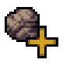

# 花岗岩板（Granite Slab）

一块大石材，你可以从中收集  具有高增长率和容量的石头。

[原文与贡献者记录](https://ballxpit.wiki.gg/wiki/Granite_Slab) · [修订 3334](https://ballxpit.wiki.gg/index.php?oldid=3334) · [返回目录](../%E7%90%83%E6%AF%94%E4%BC%A6%E6%88%98%E8%AE%B0%20Wiki.md)

#### 信息（Information）

##### 分类（Category）

经济

##### 子类（Subcategory）

资源

##### 蓝图位置（Blueprint location）

[阴燃深渊](The_SMOLDERINGxDEPTHS.md) 

##### 基础资源消耗（Base resource cost）

 250

 1

##### 建造点消耗（Build point cost）

0 (立即)

其他 **花岗岩板** 是一个资源 [建筑物](Buildings.md) 在 *[球比伦战记](Ball_x_Pit.md)* 并且是先进的1x1变体  地石资源瓷砖，只有在找到其蓝图之后才能使用。 [阴燃深渊](The_SMOLDERINGxDEPTHS.md) 。只要你拥有资源，它的职能就比 [石头](Boulder.md) 提高空间效率，提高再增长率和能力，随着建筑物的升级，两者都可以提高。 [收藏家的小屋](Gatherer_s_Hut.md),这种瓷砖也可以被动地从 [石矿](Stone_Mine.md) 或是 [剧院](Theater.md) 一次 [杂耍者](The_Juggler.md)  与大多数建筑物不同，资源和收集子类别中的这类和其他建筑物可以建造多次，只要玩家有必要的资源和空间。

默认情况下，这个瓷砖会让工人在收获时从瓷砖上跳出来，但字符可以随  [石头破碎者](https://ballxpit.wiki.gg/wiki/Stonepiercer?action=edit&redlink=1) [升级](Harvest_Upgrades_Character_Bonus.md) 来从这个瓷砖中获取资源，然后通过它。  [拆除主义者](https://ballxpit.wiki.gg/wiki/Demolitionist?action=edit&redlink=1) 或是  [石头师](https://ballxpit.wiki.gg/wiki/Stone_Master?action=edit&redlink=1) 提高升级，以便每次从瓷砖中收获时分别增加收获的石块数量或增加剩余的收获时钟。 还可以在附近提高再增长率。 [洛基山](Rocky_Hill.md) 一次 [临时西西弗斯](The_Makeshift_Sisyphus.md)  已经解锁了能力。

被动效果与升级

| 等级 | 图片 | 描述 | 资源消耗 | 建造点消耗 | 拆除 | 创建资源 | 复兴率 | 产能 |
| --- | --- | --- | --- | --- | --- | --- | --- | --- |
| 1 |  | 一块大石材，你可以从中收集  具有高增长率和容量的石头。 |  250  1 | 0 (立即) |  250  1 |  石头 | 5分钟/  1 |  3 |
| 2 |  | 一块大石材，你可以从中收集  具有高增长率和容量的石头。 |  400  2 | 0 (立即) |  650  3 |  石头 | 4分钟 /  1 |  7 |
| 3 |  | 一块大石材，你可以从中收集  具有高增长率和容量的石头。 |  600  3 | 0 (立即) |  1,250  6 |  石头 | 3分钟  1 |  11 |

[共享导航](../navigation/nav-d4956b01aa56.md)

**分类**　[分类 · 建筑](../categories/Buildings.md) · [分类 · 经济](../categories/Economy.md) · [分类 · 资源](../categories/Resources.md) · [分类 · 页面有导航框](../categories/Pages_with_navboxes.md)

[返回总入口](../%E7%90%83%E6%AF%94%E4%BC%A6%E6%88%98%E8%AE%B0%20Wiki.md) · [返回本分目录](%E7%9B%AE%E5%BD%95.md)
