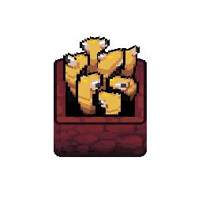

# 幼虫（Grub）

[原文与贡献者记录](https://ballxpit.wiki.gg/wiki/Grub) · [修订 3568](https://ballxpit.wiki.gg/index.php?oldid=3568) · [返回目录](../%E7%90%83%E6%AF%94%E4%BC%A6%E6%88%98%E8%AE%B0%20Wiki.md)

#### 信息（Information）

##### 类型

[常见的敌人](../categories/Normal_enemies.md)

##### 卫生规模

0.5x

##### 等级（Level）

[阴燃深渊](The_SMOLDERINGxDEPTHS.md) 

其他 **幼虫** 是一个 [通常的敌人](../categories/Normal_enemies.md) 在 [阴燃深渊](The_SMOLDERINGxDEPTHS.md)  它的健康规模是0.5倍。

格鲁布斯在杀死 [集群群](Grub_Cluster.md)  或是由 [幼虫母体](Grub_Mother.md) .

#### 冷知识

* 缩缩和 [月岩（Moonrocks）](Moonrock.md)  被捆绑在一起，是健康水平最低的敌人，是0.5x。

[共享导航](../navigation/nav-115867ac1be8.md)

**分类**　[分类 · 敌人](../categories/Enemies.md) · [分类 · 普通敌人](../categories/Normal_enemies.md) · [分类 · 页面有导航框](../categories/Pages_with_navboxes.md)

[返回总入口](../%E7%90%83%E6%AF%94%E4%BC%A6%E6%88%98%E8%AE%B0%20Wiki.md) · [返回本分目录](%E7%9B%AE%E5%BD%95.md)
