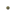

# 幼虫（Grub）

[原文与贡献者记录](https://ballxpit.wiki.gg/wiki/Grub) · [修订 3568](https://ballxpit.wiki.gg/index.php?oldid=3568) · [返回目录](../%E7%90%83%E6%AF%94%E4%BC%A6%E6%88%98%E8%AE%B0%20Wiki.md)

## 信息（Information）

### 类型

[普通敌人](../categories/Normal_enemies.md)

### 生命值倍率（Health scale）

0.5x

### 等级（Level）

[阴燃深渊](The_SMOLDERINGxDEPTHS.md) 

**幼虫** 是一种出现在 [阴燃深渊](The_SMOLDERINGxDEPTHS.md)  中的 [普通敌人](../categories/Normal_enemies.md)。其生命值倍数为 0.5x。

杀死[幼虫群](Grub_Cluster.md)  时，或者由[幼虫母体](Grub_Mother.md)  生成时，都会出现幼虫。

## 冷知识

* 虫子和 [月岩](Moonrock.md)  属于生命值最低的敌人，其生命值倍率为 0.5x。

[共享导航](../navigation/nav-115867ac1be8.md)

**分类**　[分类 · 敌人](../categories/Enemies.md) · [分类 · 普通敌人](../categories/Normal_enemies.md) · [分类 · 带有导航框的页面](../categories/Pages_with_navboxes.md)

[返回总入口](../%E7%90%83%E6%AF%94%E4%BC%A6%E6%88%98%E8%AE%B0%20Wiki.md) · [返回本分目录](%E7%9B%AE%E5%BD%95.md)
