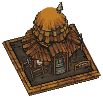
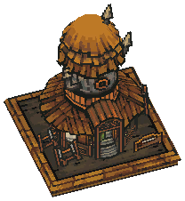
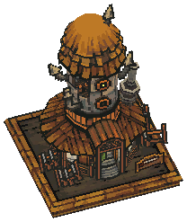
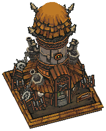

# 枪手（Gunsmith）

所有字符都获得奖励 <stat\_dexterity.png> Dexterity.

[原文与贡献者记录](https://ballxpit.wiki.gg/wiki/Gunsmith) · [修订 3349](https://ballxpit.wiki.gg/index.php?oldid=3349) · [返回目录](../%E7%90%83%E6%AF%94%E4%BC%A6%E6%88%98%E8%AE%B0%20Wiki.md)

不应与 [石家庄](Gemsmith.md).

#### 信息（Information）

##### 分类（Category）

战争

##### 子类（Subcategory）

属性加成

##### 蓝图位置（Blueprint location）

[BONExYARD](The_BONExYARD.md)

##### 基础资源消耗（Base resource cost）

 2  2

##### 建造点消耗（Build point cost）

4

枪匠是六个基本的奖金建筑之一， 给所有角色一个奖金,奖金从基础建筑开始为+1，可通过建筑升级增加至最大的+5。在建筑物的效果区内，该建筑物可以提供额外的 +1奖励 [队长的四处](Captain_s_Quarters.md) 一次 [战术家](The_Tactician.md)  已经解锁了这个能力。将这栋大楼全面升级到5级，从而实现了结构动力的实现。

被动效果与升级

| 等级 | 图片 | 描述 | 资源消耗 | 建造点消耗 | 拆除 |
| --- | --- | --- | --- | --- | --- |
| 1 |  | 所有字符都获得 +1奖励。 影响火速，重载时间和关键击中机会。 |  2  2 | 4 |  2  2 |
| 2 |  | 所有字符都获得+2的奖励。 影响火速，重载时间和关键击中机会。 |  10  2 | 4 |  12  4 |
| 3 |  | 所有角色都获得+3的奖励。 影响火速，重载时间和关键击中机会。 |  15  3 | 12 |  27  7 |
| 4 |  | 所有角色都获得+4的奖励。 影响火速，重载时间和关键击中机会。 |  20  4 | 20 |  47  11 |
| 5 |  | 所有字符都获得+5的奖励。 影响火速，重载时间和关键的击中机会。 |  25  5 | 28 |  72  16 |

[共享导航](../navigation/nav-d4956b01aa56.md)

**分类**　[分类 · 建筑](../categories/Buildings.md) · [分类 · 战争](../categories/Warfare.md) · [分类 · 属性加成](../categories/Stat_Bonuses.md) · [分类 · 页面有导航框](../categories/Pages_with_navboxes.md)

[返回总入口](../%E7%90%83%E6%AF%94%E4%BC%A6%E6%88%98%E8%AE%B0%20Wiki.md) · [返回本分目录](%E7%9B%AE%E5%BD%95.md)
