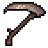
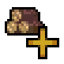
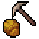
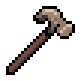

# 收获升级 (角色奖金)（Harvest Upgrades (Character Bonus)）

[原文与贡献者记录](https://ballxpit.wiki.gg/wiki/Harvest_Upgrades_%28Character_Bonus%29) · [修订 3718](https://ballxpit.wiki.gg/index.php?oldid=3718) · [返回目录](../%E7%90%83%E6%AF%94%E4%BC%A6%E6%88%98%E8%AE%B0%20Wiki.md)

不应与 [建筑物#收获升级](Buildings.md#%E6%94%B6%E8%8E%B7%E5%8D%87%E7%BA%A7).

收获升级是给予特定字符的奖励，这些字符在收获模式中永久增加其有效性，并且通过在级别运行后升级字符来获得奖励。一旦一个角色达到一个特定的水平，玩家可以根据角色和达到的水平选择两个收获升级之一 (见 [单个字符页面](Characters.md) 详细信息)。这些升级从每次抽取某一个资源瓷砖时提高收获时钟到允许从中取出某一资源，直至增加从每次抽取的某一资源的数量。

大多数升级都可一次以上进行 (除了  [石头破碎者](https://ballxpit.wiki.gg/wiki/Stonepiercer?action=edit&redlink=1) 及  [啄木鸟](https://ballxpit.wiki.gg/wiki/Woodpecker?action=edit&redlink=1))，每次次升级都会增加额外的奖励，等于第一个奖励 (例如为  [时间守护者](https://ballxpit.wiki.gg/wiki/Time_Keeper?action=edit&redlink=1),第一次给予2秒总奖金，第二次4总奖金，第三次6总奖金等。 [协会厅](Guild_Hall.md).

| 名称 | 标志 | 描述 |
| --- | --- | --- |
| [石头破碎者](https://ballxpit.wiki.gg/wiki/Stonepiercer?action=edit&redlink=1) |  | 在收获时穿过岩石  石头。 |
| [啄木鸟（Woodpecker）](https://ballxpit.wiki.gg/wiki/Woodpecker?action=edit&redlink=1) |  | 在收获时穿过森林  树木。 |
| [长柄镰刀（Long Sickle）](https://ballxpit.wiki.gg/wiki/Long_Sickle?action=edit&redlink=1) |  | 增加在  收获了小麦。 |
| [麦机](https://ballxpit.wiki.gg/wiki/Wheat_Harvester?action=edit&redlink=1) |  | 收藏 2  每一小麦都弹出。 |
| [森林](https://ballxpit.wiki.gg/wiki/Forester?action=edit&redlink=1) |  | 收藏 2  每次跳动都会带木头。 |
| [拆除主义者](https://ballxpit.wiki.gg/wiki/Demolitionist?action=edit&redlink=1) |  | 收藏 2  每一弹都弹出石块。 |
| [金矿](https://ballxpit.wiki.gg/wiki/Gold_Digger?action=edit&redlink=1) |  | 在矿山工作时，挖矿额外的+1  每次金矿被弹射时都会有金子 |
| [麦子主](https://ballxpit.wiki.gg/wiki/Wheat_Master?action=edit&redlink=1) |  | 每次收获时增加0.2秒的收获时间  小麦 (每种收获可达20次)。 |
| [木材师](https://ballxpit.wiki.gg/wiki/Wood_Master?action=edit&redlink=1) |  | 每次收获时增加0.2秒的收获时间  树木 (每种收获最多20次)。 |
| [石头师](https://ballxpit.wiki.gg/wiki/Stone_Master?action=edit&redlink=1) |  | 每次收获时增加0.2秒的收获时间  石头 (每种收获最多20次)。 |
| [时间守护者](https://ballxpit.wiki.gg/wiki/Time_Keeper?action=edit&redlink=1) |  | 在收获的一部分时，增加收获时钟2秒。 |
| [建筑师](https://ballxpit.wiki.gg/wiki/Builder?action=edit&redlink=1) |  | 在收获模式下跳到架架上增加1个构建点。 |
| [冲刺运动员](https://ballxpit.wiki.gg/wiki/Sprinter?action=edit&redlink=1) |  | 在收获过程中，提高20%的运动速度。 |

[返回总入口](../%E7%90%83%E6%AF%94%E4%BC%A6%E6%88%98%E8%AE%B0%20Wiki.md) · [返回本分目录](%E7%9B%AE%E5%BD%95.md)
