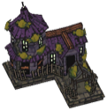

# 鬼屋（Haunted House）

[原文与贡献者记录](https://ballxpit.wiki.gg/wiki/Haunted_House) · [修订 3391](https://ballxpit.wiki.gg/index.php?oldid=3391) · [返回目录](../%E7%90%83%E6%AF%94%E4%BC%A6%E6%88%98%E8%AE%B0%20Wiki.md)

[忏悔者](The_Repentant.md)  的住宅。

## 信息（Information）

### 分类（Category）

住房

### 子类（Subcategory）

住房

### 蓝图位置（Blueprint location）

[骸骨墓园](The_BONExYARD.md) 

### 基础资源消耗（Base resource cost）

 5

### 建造点消耗（Build point cost）

6

**鬼屋**是位于*[球比伦战记](Ball_x_Pit.md)*中的角色住房[建筑](Buildings.md)。建造鬼屋可解锁作为可玩[角色](Characters.md)的[忏悔者](The_Repentant.md) 。当该[角色获得足够的经验值](Character_Level_Mechanics.md)达到4级时，这座建筑会解锁一项被动能力：每次收获时，首先撞击此建筑的工人将获得一定百分比的移动速度加成。通过以下方式可进一步提升此建筑的能力：不直接升级建筑本身，而是继续提升角色等级。注意，拆除角色的住房将使该角色在收获模式或等级提升中无法使用，并将其从所有建筑任务中移除，直到其住房重建为止（尽管该角色仍保留之前的所有进度）。

被动效果与升级

| 等级 | 图片 | 说明 | 资源消耗 | 建造点消耗 | 拆除 | 角色等级要求 |
| --- | --- | --- | --- | --- | --- | --- |
| 1 |  | 一个给忏悔者准备的房子。 |  5 | 6 |  5 | - |
| 1 | - | 一个给忏悔者准备的房子。 每次收获时，最先在这座建筑上弹开的 2 名工人获得 25% 移动速度加成。 | - | - |  5 | 4 |
| 2 | - | 一个给忏悔者准备的房子。 每次收获时，首次反弹到该建筑上的前3名工人将获得30%的移动速度加成。 | - | - |  5 | 7 |
| 3 | - | 一个给忏悔者准备的房子。 每次收获时，反弹在该建筑上的前4名工人将获得35%的移动速度加成。 | - | - |  5 | 9 |

[共享导航](../navigation/nav-d4956b01aa56.md)

**分类**　[分类 · 建筑](../categories/Buildings.md) · [分类 · 住房](../categories/Housing.md) · [分类 · 带有导航框的页面](../categories/Pages_with_navboxes.md)

[返回总入口](../%E7%90%83%E6%AF%94%E4%BC%A6%E6%88%98%E8%AE%B0%20Wiki.md) · [返回本分目录](%E7%9B%AE%E5%BD%95.md)
