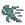
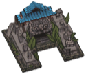

# 隐秘神殿（Hidden Temple）

[原文与贡献者记录](https://ballxpit.wiki.gg/wiki/Hidden_Temple) · [修订 3409](https://ballxpit.wiki.gg/index.php?oldid=3409) · [返回目录](../%E7%90%83%E6%AF%94%E4%BC%A6%E6%88%98%E8%AE%B0%20Wiki.md)

[蹑足者](The_Tiptoer.md)  的房子。

## 信息（Information）

### 分类（Category）

住房

### 子类（Subcategory）

住房

### 蓝图位置（Blueprint location）

[阴燃深渊](The_SMOLDERINGxDEPTHS.md) 

### 基础资源消耗（Base resource cost）

 70  20

### 建造点消耗（Build point cost）

30

**隐秘神殿** 是 *[球比伦战记](Ball_x_Pit.md)* [暗影更新](https://ballxpit.wiki.gg/wiki/Shadow_Update?action=edit&redlink=1) 中加入的角色住房 [建筑](Buildings.md)。建造隐秘神殿可解锁作为可玩 [角色](Characters.md) 的 [蹑足者](The_Tiptoer.md) 。当该 [角色获得足够的经验值](Character_Level_Mechanics.md) 达到 4 级时，这座建筑会解锁一项被动能力：所有角色获得  [敏捷](https://ballxpit.wiki.gg/wiki/Dexterity?action=edit&redlink=1) 加成。该建筑的能力可以通过不直接升级建筑本身，而是继续提升角色等级来进一步提升。注意，拆除角色的住房将使该角色在收获模式或等级提升中无法使用，并将其从所有建筑任务中移除，直到其住房重建为止（尽管该角色仍保留之前的所有进度）。

被动效果与升级

| 等级 | 图片 | 说明 | 资源消耗 | 建造点消耗 | 拆除 | 角色等级要求 |
| --- | --- | --- | --- | --- | --- | --- |
| 1 |  | 一个给蹑足者准备的房子。 |  70  20 | 30 |  70  20 | - |
| 1 | - | 一个给蹑足者准备的房子。 所有角色获得 +1 的敏捷加成  [敏捷](https://ballxpit.wiki.gg/wiki/Dexterity?action=edit&redlink=1)。该加成会影响发射频率、重新装填时间以及暴击率。 | - | - |  70  20 | 4 |
| 2 | - | 一个给蹑足者准备的房子。 所有角色获得 +2 的敏捷属性  [敏捷](https://ballxpit.wiki.gg/wiki/Dexterity?action=edit&redlink=1) 加成。该加成会影响发射频率、重新装填时间以及暴击率。 | - | - |  70  20 | 7 |
| 3 | - | 一个给蹑足者准备的房子。 所有角色获得 +3 的 [敏捷](https://ballxpit.wiki.gg/wiki/Dexterity?action=edit&redlink=1)加成。该加成会影响发射频率、重新装填时间以及暴击率。 | - | - |  70  20 | 9 |

[共享导航](../navigation/nav-d4956b01aa56.md)

**分类**　[分类 · 建筑](../categories/Buildings.md) · [分类 · 住房](../categories/Housing.md) · [分类 · 带有导航框的页面](../categories/Pages_with_navboxes.md)

[返回总入口](../%E7%90%83%E6%AF%94%E4%BC%A6%E6%88%98%E8%AE%B0%20Wiki.md) · [返回本分目录](%E7%9B%AE%E5%BD%95.md)
