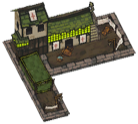

# 医院（Hospital）

获得  耐力加成。可无限升级。

[原文与贡献者记录](https://ballxpit.wiki.gg/wiki/Hospital) · [修订 3352](https://ballxpit.wiki.gg/index.php?oldid=3352) · [返回目录](../%E7%90%83%E6%AF%94%E4%BC%A6%E6%88%98%E8%AE%B0%20Wiki.md)

## 信息（Information）

### 分类（Category）

战争

### 子类（Subcategory）

属性加成

### 蓝图位置（Blueprint location）

[VASTxVOID](The_VASTxVOID.md)

### 基础资源消耗（Base resource cost）

 100  40

### 建造点消耗（Build point cost）

50

作为六座可无限升级属性加成建筑之一，医院为所有角色在建造时提供  耐力的加成。与基础六属性加成建筑不同，该建筑在5级后没有上限，可无限次升级，每级增加1点属性点数。不过，每级资源消耗呈指数级增长，建造点消耗则呈线性增长，但最终会达到1050的上限。与其他建筑一样，拆除后仍可全额退还至该建筑建造及升级所花费的所有资源。当 [战术家](The_Tactician.md)  解锁该能力后，将该建筑放置在 [队长宿舍](Captain_s_Quarters.md)的效应区域时，可额外获得+1的加成。建造该建筑可获得“纪念碑”成就，升级至5级则可获得“结构力量”成就。

被动效果与升级

| 图片 | 说明 | 资源消耗 | 建造点消耗 | 拆除 |
| --- | --- | --- | --- | --- |
|  | 获得 +1 额外  耐力。可无限升级。 ／ 每级额外获得 +1  耐力。 |  100  40 | 50 |  100  40 |

|  |  |  |  |
| --- | --- | --- | --- |
|  | [升级到下一等级的成本](Buildings.md#%E5%8F%AF%E6%97%A0%E9%99%90%E5%8D%87%E7%BA%A7%E7%9A%84%E5%BB%BA%E7%AD%91) |  |  |
| 等级 |  |  | 建造点 |
| 1 | 240 | 80 | 50 |
| 2 | 360 | 120 | 150 |
| 3 | 480 | 160 | 250 |
| 4 | 600 | 200 | 350 |
| 5 | 720 | 240 | 450 |
| 6 | 2,640 | 880 | 550 |
| 7 | 3,120 | 1,040 | 650 |
| 8 | 3,600 | 1,200 | 750 |
| 9 | 4,080 | 1,360 | 850 |
| 10 | 4,560 | 1,520 | 950 |
| 11 | 9,840 | 3,280 | 1050 |
| 12 | 10,800 | 3,600 | 1050 |
| 13 | 11,760 | 3,920 | 1050 |
| 14 | 12,720 | 4,240 | 1050 |
| 15 | 13,680 | 4,560 | 1050 |
| 16 | 29,040 | 9,680 | 1050 |
| 17 | 30,960 | 10,320 | 1050 |
| 18 | 32,880 | 10,960 | 1050 |
| 19 | 34,800 | 11,600 | 1050 |
| 20 | 36,720 | 12,240 | 1050 |
| 21 | 77,040 | 25,680 | 1050 |
| 22 | 80,880 | 26,960 | 1050 |
| 23 | 84,720 | 28,240 | 1050 |
| 24 | 88,560 | 29,520 | 1050 |
| 25 | 92,400 | 30,800 | 1050 |
| 26 | 192,240 | 64,080 | 1050 |
| 27 | 199,920 | 66,640 | 1050 |
| 28 | 207,600 | 69,200 | 1050 |
| 29 | 215,280 | 71,760 | 1050 |
| 30 | 222,960 | 74,320 | 1050 |
| 31 | 461,040 | 153,680 | 1050 |
| 32 | 476,400 | 158,800 | 1050 |
| 33 | 491,760 | 163,920 | 1050 |
| 34 | 507,120 | 169,040 | 1050 |
| 35 | 522,480 | 174,160 | 1050 |
| 36 | 537,840 | 179,280 | 1050 |
| 37 | 553,200 | 184,400 | 1050 |
| 38 | 568,560 | 189,520 | 1050 |
| 39 | 583,920 | 194,640 | 1050 |
| 40 | 599,280 | 199,760 | 1050 |
| 41 | 614,640 | 204,880 | 1050 |
| 42 | 630,000 | 210,000 | 1050 |
| 43 | 645,360 | 215,120 | 1050 |
| 44 | 660,720 | 220,240 | 1050 |
| 45 | 676,080 | 225,360 | 1050 |
| 46 | 691,440 | 230,480 | 1050 |
| 47 | 706,800 | 235,600 | 1050 |
| 48 | 722,160 | 240,720 | 1050 |
| 49 | 737,520 | 245,840 | 1050 |
| 50 | 752,880 | 250,960 | 1050 |

[共享导航](../navigation/nav-d4956b01aa56.md)

**分类**　[分类 · 建筑](../categories/Buildings.md) · [分类 · 战争](../categories/Warfare.md) · [分类 · 属性加成](../categories/Stat_Bonuses.md) · [分类 · 带有导航框的页面](../categories/Pages_with_navboxes.md)

[返回总入口](../%E7%90%83%E6%AF%94%E4%BC%A6%E6%88%98%E8%AE%B0%20Wiki.md) · [返回本分目录](%E7%9B%AE%E5%BD%95.md)
