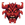

# 梦魔（Incubus）

每次命中都有4%/4%/5%的概率使敌人魅惑9秒。被魅惑的敌人会对附近的敌人施咒。被施咒的敌人在被击中5次后，会受到100-200/150-250/150-250的伤害。

[原文与贡献者记录](https://ballxpit.wiki.gg/wiki/Incubus) · [修订 4108](https://ballxpit.wiki.gg/index.php?oldid=4108) · [返回目录](../%E7%90%83%E6%AF%94%E4%BC%A6%E6%88%98%E8%AE%B0%20Wiki.md)

## 基本信息

### 由……创建

[魅惑](Charm.md)  + [黑暗](Dark.md) 

### 初始角色（Starting Character）

-

### 状态效果（Status Effects）

[魅惑](https://ballxpit.wiki.gg/wiki/Status_Effects?action=edit&redlink=1), [诅咒](https://ballxpit.wiki.gg/wiki/Status_Effects?action=edit&redlink=1)

### 由状态效果触发

命中时

## 进化（Evolutions）

### 进化成

[撒旦](Satan.md) 

## 进化配方

|  |  |  |  |  |  |  |
| --- | --- | --- | --- | --- | --- | --- |
|  |  |  |  |  |  |  |
| [魅惑（Charm）](Charm.md) （通关天堂之门后解锁） |  |  |  | [黑暗（Dark）](Dark.md) （通关骸骨墓园后解锁） |  |  |
|  |  |  |  |  |  |  |
|  |  | 梦魔（Incubus） |  |  |  |  |

## 关卡

| 等级 | 伤害 | 效果 |
| --- | --- | --- |
| 1 |  x(3.6 至 6.8) | 每次命中有4%的概率使敌人魅惑9秒。被魅惑的敌人会对附近的敌人施咒。被施咒的敌人受到5次攻击后将受到100-200点的伤害。 |
| 2 |  x(3.6 至 6.8) | 每次命中都有4%的概率使敌人魅惑9秒。被魅惑的敌人会对附近的敌人施咒。被施咒的敌人在被击中5次后会受到150-250点的伤害。 |
| 3 |  x(3.6 至 6.8) | 每次命中都有 5% 的概率使敌人魅惑 9 秒。被魅惑的敌人会对附近的敌人施咒。被施咒的敌人在被击中 5 次后会受到 150-250 点的伤害。 |

## 进化

| 组合 | 进化 |
| --- | --- |
|  梦魔（Incubus） + [魅魔（Succubus）](Succubus.md)  | [撒旦（Satan）](Satan.md)  |

## 策略

## 更新记录

## 冷知识

## 图片库

[共享导航](../navigation/nav-63012059ef49.md)

**分类**　[分类 · 进化圆球](../categories/Evolved_Balls.md) · [分类 · 圆球](../categories/Balls.md) · [分类 · 带有导航框的页面](../categories/Pages_with_navboxes.md)

[返回总入口](../%E7%90%83%E6%AF%94%E4%BC%A6%E6%88%98%E8%AE%B0%20Wiki.md) · [返回本分目录](%E7%9B%AE%E5%BD%95.md)
