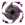
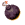
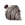
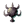
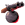
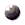

# 铁（Iron）

造成双倍伤害，但移动速度降低 40%/40%/30%。

[原文与贡献者记录](https://ballxpit.wiki.gg/wiki/Iron) · [修订 4221](https://ballxpit.wiki.gg/index.php?oldid=4221) · [返回目录](../%E7%90%83%E6%AF%94%E4%BC%A6%E6%88%98%E8%AE%B0%20Wiki.md)

## 基本信息

### 初始角色（Starting Characters）

[持盾者](The_Shieldbearer.md) 
[战术家](The_Tactician.md) 

### 解锁

默认解锁

### 状态效果（Status Effects）

-

## 进化（Evolutions）

### 进化成

[刺客](Assassin.md) , [炸弹](Bomb.md) , [钻头](Drill.md) , [大出血](Hemorrhage.md) , [避雷针](Lightning_Rod.md) , [霰弹枪](Shotgun.md) , [钢铁](Steel.md) 

**铁** 是 *[球比伦战记](Ball_x_Pit.md)* 基础游戏版本中引入的 [基础圆球](Balls.md#%E5%9F%BA%E7%A1%80%E5%9C%86%E7%90%83)，默认解锁，也是 [持盾者](The_Shieldbearer.md)  和 [战术家](The_Tactician.md)  的初始圆球。

## 关卡

| 等级 | 伤害 | 效果 |
| --- | --- | --- |
| 1 |  x(3.5 至 6.5) | 造成双倍伤害，但移动速度慢40% |
| 2 |  x(3.5 至 6.5) | 造成双倍伤害，但移动速度慢40% |
| 3 |  x(3.5 至 6.5) | 造成双倍伤害，但移动速度慢30% |

## 进化

| 组合 | 进化 |
| --- | --- |
|  铁（Iron） + [黑暗（Dark）](Dark.md)  ／  铁（Iron） + [幽灵（Ghost）](Ghost.md)  | [刺客（Assassin）](Assassin.md) （\*） |
|  铁（Iron） + [灼烧（Burn）](Burn.md)  | [炸弹（Bomb）](Bomb.md) （\*） |
|  铁（Iron） + [地震（Earthquake）](Earthquake.md)  | [钻头（Drill）](Drill.md)  |
|  铁（Iron） + [流血（Bleed）](Bleed.md)  | [大出血（Hemorrhage）](Hemorrhage.md)  |
|  铁（Iron） + [闪电（Lightning）](Lightning.md)  | [避雷针（Lightning Rod）](Lightning_Rod.md)  |
|  铁（Iron） + [卵囊（Egg Sac）](Egg_Sac.md)  | [霰弹枪（Shotgun）](Shotgun.md) （\*） |
|  铁（Iron） + [石头（Stone）](Stone.md)  | [钢铁（Steel）](Steel.md) （\*） |

* 可以进一步进化。

## 策略

## 更新记录

## 冷知识

* 这个图标被用作游戏的桌面图标以及官方 Discord 服务器的图标。

## 图片库

[共享导航](../navigation/nav-63012059ef49.md)

**分类**　[分类 · 基础圆球](../categories/Base_Balls.md) · [分类 · 圆球](../categories/Balls.md) · [分类 · 带有导航框的页面](../categories/Pages_with_navboxes.md)

[返回总入口](../%E7%90%83%E6%AF%94%E4%BC%A6%E6%88%98%E8%AE%B0%20Wiki.md) · [返回本分目录](%E7%9B%AE%E5%BD%95.md)
