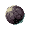
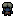

# 铁（Iron）

处理双重伤害，但速度 40%/40%/30%慢

[原文与贡献者记录](https://ballxpit.wiki.gg/wiki/Iron) · [修订 4221](https://ballxpit.wiki.gg/index.php?oldid=4221) · [返回目录](../%E7%90%83%E6%AF%94%E4%BC%A6%E6%88%98%E8%AE%B0%20Wiki.md)

#### 一般信息

##### 开始的角色

[持盾者](The_Shieldbearer.md) 
[战术家](The_Tactician.md) 

##### 解锁

默认解锁

##### 状态效果（Status Effects）

-

#### 发展情况（Evolutions）

##### 演变为

[凶手](Assassin.md) 、 [炸弹](Bomb.md) 、 [钻头](Drill.md) 、 [输血](Hemorrhage.md) 、 [闪电棒](Lightning_Rod.md) 、 [枪枪](Shotgun.md) 、 [钢铁](Steel.md) 

**铁** 是一个 [基球](Balls.md#%E5%9F%BA%E7%A1%80%E5%9C%86%E7%90%83) 在基本游戏版本中推出了 *[球比伦战记](Ball_x_Pit.md)*它是首发的球。 [持盾者](The_Shieldbearer.md)  及 [战术家](The_Tactician.md) .

#### 关卡

| 等级 | 伤害 | 影响 |
| --- | --- | --- |
| 1 |  x(3.5至6.5) | 造成两倍的伤害，但速度降低了40%。 ／ |
| 2 |  x(3.5至6.5) | 造成两倍的伤害，但速度降低了40%。 ／ |
| 3 |  x(3.5至6.5) | 造成双重伤害，但速度降低30%。 ／ |

#### 发展情况

| 组合 | 进化 |
| --- | --- |
|  铁（Iron） + [黑暗（Dark）](Dark.md)  ／  铁（Iron） + [鬼魂（Ghost）](Ghost.md)  | [凶手（Assassin）](Assassin.md) （\*） |
|  铁（Iron） + [灼烧（Burn）](Burn.md)  | [炸弹（Bomb）](Bomb.md) （\*） |
|  铁（Iron） + [地震（Earthquake）](Earthquake.md)  | [钻头（Drill）](Drill.md)  |
|  铁（Iron） + [流血（Bleed）](Bleed.md)  | [输血（Hemorrhage）](Hemorrhage.md)  |
|  铁（Iron） + [闪电（Lightning）](Lightning.md)  | [闪电棒（Lightning Rod）](Lightning_Rod.md)  |
|  铁（Iron） + [蛋袋（Egg Sac）](Egg_Sac.md)  | [枪枪（Shotgun）](Shotgun.md) （\*） |
|  铁（Iron） + [石头（Stone）](Stone.md)  | [钢铁（Steel）](Steel.md) （\*） |

* 可以进一步发展。

#### 策略

#### 更新记录

#### 冷知识

* 这个球是游戏的桌面标志和官方的Discord服务器的标志。

#### 图片库

[共享导航](../navigation/nav-63012059ef49.md)

**分类**　[分类 · 基础圆球](../categories/Base_Balls.md) · [分类 · 圆球](../categories/Balls.md) · [分类 · 页面有导航框](../categories/Pages_with_navboxes.md)

[返回总入口](../%E7%90%83%E6%AF%94%E4%BC%A6%E6%88%98%E8%AE%B0%20Wiki.md) · [返回本分目录](%E7%9B%AE%E5%BD%95.md)
