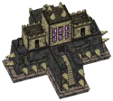

# 铁堡（Iron Fortress）

[原文与贡献者记录](https://ballxpit.wiki.gg/wiki/Iron_Fortress) · [修订 3396](https://ballxpit.wiki.gg/index.php?oldid=3396) · [返回目录](../%E7%90%83%E6%AF%94%E4%BC%A6%E6%88%98%E8%AE%B0%20Wiki.md)

[持盾者](The_Shieldbearer.md)  的住宅。

## 信息（Information）

### 分类（Category）

住房

### 子类（Subcategory）

住房

### 蓝图位置（Blueprint location）

[真菌森林](The_FUNGALxFOREST.md) 

### 基础资源消耗（Base resource cost）

 70

### 建造点消耗（Build point cost）

30

建造铁堡将解锁[持盾者](The_Shieldbearer.md)  作为可玩角色。一旦该角色获得足够的经验值达到等级{?TODO查找房屋奖励所需的角色等级要求}，此建筑将解锁一项被动能力，即每当角色在收获模式或来自[采集者小屋](Gatherer_s_Hut.md)时反弹撞击铁堡，其影响范围内的每个脚手架将获得额外的建造点数。通过进一步提升角色等级至{???}级，可以进一步提升此建筑的能力。请注意，拆除角色的房屋将使该角色在收获模式或等级提升过程中无法使用，并使其从任何建筑任务中移除，直到其房屋重建为止（尽管该角色仍将保留之前的所有进度）。

被动效果与升级

| 等级 | 图片 | 说明 | 资源消耗 | 建造点消耗 | 拆除 | 角色等级要求 |
| --- | --- | --- | --- | --- | --- | --- |
| 1 |  | 一个给持盾者准备的房子。 |  70 | 30 |  70 | - |
| 2 |  |  | - | - |  70 |  |
| 3 |  | 一个给持盾者准备的房子。 在这座建筑上弹跳会向所有附近的脚手架施加+4的建造点数。 | - | - |  70 |  |

[共享导航](../navigation/nav-d4956b01aa56.md)

**分类**　[分类 · 建筑](../categories/Buildings.md) · [分类 · 住房](../categories/Housing.md) · [分类 · 带有导航框的页面](../categories/Pages_with_navboxes.md)

[返回总入口](../%E7%90%83%E6%AF%94%E4%BC%A6%E6%88%98%E8%AE%B0%20Wiki.md) · [返回本分目录](%E7%9B%AE%E5%BD%95.md)
