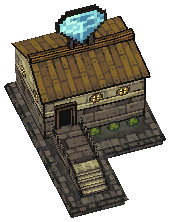
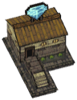
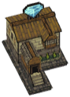

# 珠宝匠（Jeweler）

提升初始球等级。

[原文与贡献者记录](https://ballxpit.wiki.gg/wiki/Jeweler) · [修订 3373](https://ballxpit.wiki.gg/index.php?oldid=3373) · [返回目录](../%E7%90%83%E6%AF%94%E4%BC%A6%E6%88%98%E8%AE%B0%20Wiki.md)

## 信息（Information）

### 分类（Category）

战争

### 子类（Subcategory）

将军

### 蓝图位置（Blueprint location）

[FUNGALxFOREST](The_FUNGALxFOREST.md)

### 基础资源消耗（Base resource cost）

 200  10

### 建造点消耗（Build point cost）

60

建造珠宝匠后，主角色在战斗开始时携带 2 级初始圆球。升级该建筑可再提高到 3 级。此建筑**不会提高**副角色初始圆球的等级。要提升副角色的初始圆球，需进一步升级[媒人](Matchmaker.md)。

被动效果与升级

| 等级 | 图片 | 说明 | 资源消耗 | 建造点消耗 | 拆除 |
| --- | --- | --- | --- | --- | --- |
| 1 |  | 将初始球等级提高至2级 |  200  10 | 60 |  200  10 |
| 2 |  | 将初始球等级提高至3级 |  400  50 | 60 |  600  60 |

[共享导航](../navigation/nav-d4956b01aa56.md)

**分类**　[分类 · 建筑](../categories/Buildings.md) · [分类 · 战争](../categories/Warfare.md) · [分类 · 通用](../categories/General.md) · [分类 · 带有导航框的页面](../categories/Pages_with_navboxes.md)

[返回总入口](../%E7%90%83%E6%AF%94%E4%BC%A6%E6%88%98%E8%AE%B0%20Wiki.md) · [返回本分目录](%E7%9B%AE%E5%BD%95.md)
