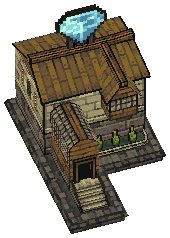

# 珠宝家（Jeweler）

提高起始球水平。

[原文与贡献者记录](https://ballxpit.wiki.gg/wiki/Jeweler) · [修订 3373](https://ballxpit.wiki.gg/index.php?oldid=3373) · [返回目录](../%E7%90%83%E6%AF%94%E4%BC%A6%E6%88%98%E8%AE%B0%20Wiki.md)

#### 信息（Information）

##### 分类（Category）

战争

##### 子类（Subcategory）

总

##### 蓝图位置（Blueprint location）

[FUNGALxFOREST](The_FUNGALxFOREST.md)

##### 基础资源消耗（Base resource cost）

 200  10

##### 建造点消耗（Build point cost）

60

建造珠宝器将增加起始球的起始水平，主要角色在战斗中。这种增加从2级开始，但通过升级建筑物可以提高到3级。 **NOT** 增加起始球的起始水平，对于二级字符，这本身需要进一步升级 [匹配机](Matchmaker.md) 而不是。

被动效果与升级

| 等级 | 图片 | 描述 | 资源消耗 | 建造点消耗 | 拆除 |
| --- | --- | --- | --- | --- | --- |
| 1 |  | 提高起始球水平到2 |  200  10 | 60 |  200  10 |
| 2 |  | 提高起始球水平到3 |  400  50 | 60 |  600  60 |

[共享导航](../navigation/nav-d4956b01aa56.md)

**分类**　[分类 · 建筑](../categories/Buildings.md) · [分类 · 战争](../categories/Warfare.md) · [分类 · 总](../categories/General.md) · [分类 · 页面有导航框](../categories/Pages_with_navboxes.md)

[返回总入口](../%E7%90%83%E6%AF%94%E4%BC%A6%E6%88%98%E8%AE%B0%20Wiki.md) · [返回本分目录](%E7%9B%AE%E5%BD%95.md)
