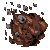

# 地滑坡（Landslide）

创建滑坡并自毁于撞击敌人。 滑坡持续5秒， 并处理20- 30/ 25- 35/ 30- 40损失 / 仅次于2瓦半径范围内的敌人。

[原文与贡献者记录](https://ballxpit.wiki.gg/wiki/Landslide) · [修订 4111](https://ballxpit.wiki.gg/index.php?oldid=4111) · [返回目录](../%E7%90%83%E6%AF%94%E4%BC%A6%E6%88%98%E8%AE%B0%20Wiki.md)

#### 一般信息

##### 由

[石头](Stone.md)  + [地震](Earthquake.md) 

##### 开始的性格

-

##### 命中效果（On-Hit Effects）

自杀

##### 状态效果（Status Effects）

[地滑坡](https://ballxpit.wiki.gg/wiki/Status_Effects?action=edit&redlink=1)

##### 由于状态影响

热点，范围效果

#### 进化配方

|  |  |  |  |  |  |  |
| --- | --- | --- | --- | --- | --- | --- |
|  |  |  |  |  |  |  |
| [石头（Stone）](Stone.md)  清除 SNOWYS 课 |  |  |  | [地震（Earthquake）](Earthquake.md)  |  |  |
|  |  |  |  |  |  |  |
|  |  | 地滑坡（Landslide） |  |  |  |  |

#### 关卡

| 等级 | 伤害 | 影响 |
| --- | --- | --- |
| 1 |  x(3.6至6.8) | 创建滑坡并自毁于撞击敌人。 滑坡持续5秒， 并处理在 2瓦半径范围内对敌人的 20- 30破坏 / 秒。 ／ |
| 2 |  x(3.6至6.8) | 创建滑坡并自毁于撞击敌人。 滑坡持续5秒， 并在2瓦半径范围内对敌人进行25- 35伤害 / 次。 ／ |
| 3 |  x(3.6至6.8) | 创建滑坡并在击中敌人时伤害自己。 滑坡持续5秒， 并在2瓦半径范围内对敌人进行30- 40伤害 / 次。 ／ |

#### 发展情况

*这个球不能进一步发展。*

#### 策略

#### 更新记录

#### 冷知识

#### 图片库

[共享导航](../navigation/nav-63012059ef49.md)

**分类**　[分类 · 进化圆球](../categories/Evolved_Balls.md) · [分类 · 圆球](../categories/Balls.md) · [分类 · 页面有导航框](../categories/Pages_with_navboxes.md)

[返回总入口](../%E7%90%83%E6%AF%94%E4%BC%A6%E6%88%98%E8%AE%B0%20Wiki.md) · [返回本分目录](%E7%9B%AE%E5%BD%95.md)
